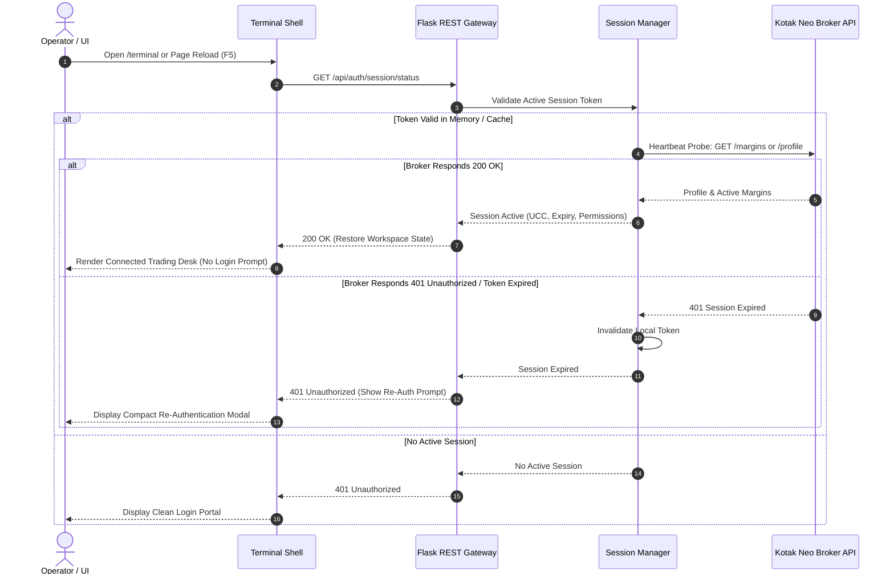
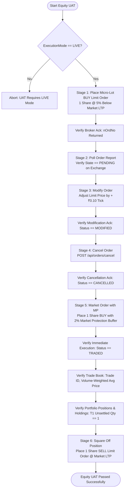

# Phase 12 Design Specification: Production Hardening & Real Kotak UAT

**Document Version:** 1.0.0  
**Phase:** Phase 12 (Production Hardening & Real Kotak UAT)  
**Target Milestone:** Milestone M7 (Production Hardening & V1 Live Operational Readiness)  
**Status:** Design Only (Approved for Architecture Review — No Implementation)  
**Author:** Antigravity / Senior Trading Systems Architect  
**Date:** 2026-11-09  

---

## 1. Executive Summary

Phase 12 constitutes the final engineering, validation, and operational hardening phase required to transition the **Kotak Neo Personal Trading Terminal** from a feature-complete development baseline (Milestones M1 through M6) into an enterprise-grade, production-hardened live trading system. 

Where preceding phases established architectural abstractions, mathematical domain models, asynchronous WebSocket pipelines, defensive order state machines, and professional Kite-inspired UI workstations, Phase 12 focuses strictly on **real-world broker validation (User Acceptance Testing / UAT)**, **stress and soak resilience**, **chaos failure injection**, **disaster recovery**, **secure cloud deployment under SEBI static IP compliance**, and **standardized operational runbooks**.

All Phase 12 specifications strictly enforce the core tenets of the **Project Constitution**:
1. **Human-Initiated Execution Only:** Zero autonomous bots, algorithmic signal loops, or unprompted square-offs.
2. **Defensive Order Hierarchy:** Invariable routing: $\text{UI} \to \text{REST} \to \text{Domain Service} \to \text{ExecutionMode Gating} \to \text{Kotak Adapter}$. Direct broker wire bypass is prohibited.
3. **ExecutionMode Safety Gating:** System defaults to `DISABLED`. Transitions to `LIVE` enforce explicit token verification (`CONFIRM_LIVE`). High-risk actions enforce typed safety challenges.
4. **The Golden Rule Compliance:** Absence of broker or tick data renders strictly as `—` or `NONE`. Unconfirmed orders render as `RECONCILING`—never optimistically assumed filled or cancelled.
5. **Regulatory Dual Timestamping:** Every order, trade, touchline, and position records both `source_timestamp` (upstream exchange/broker tick) and `retrieved_timestamp` (local ingestion time).
6. **Strict Scope Exclusions:** No Greeks derivations (Delta/Gamma/Theta/Vega), no IV surface modeling, no autonomous scalpers, and no copy trading.

---

## 2. Real Kotak Login Validation

### 2.1. Live Credential Handshake Architecture
The production login handshake integrates directly with Kotak Neo API SDK (`kotakneoapi>=3.0.13`) using five-factor credential authentication:
1. `NEO_CONSUMER_KEY`: Application identification token.
2. `NEO_MOBILE_NUMBER`: Operator registered 10-digit mobile number.
3. `NEO_UCC`: Unique Client Code (operator trading account identifier).
4. `NEO_MPIN`: 6-digit permanent personal identification number.
5. `NEO_TOTP_SECRET`: Base32 time-based one-time password secret evaluated via RFC 6238 (`pyotp.TOTP`).

```
+---------------------------------------------------------------------------------------------------------+
|                                    REAL KOTAK LOGIN HANDSHAKE PIPELINE                                  |
|                                                                                                         |
|  [ Operator Environment / .env ]                                                                        |
|    ├── NEO_CONSUMER_KEY, NEO_MOBILE_NUMBER, NEO_UCC, NEO_MPIN, NEO_TOTP_SECRET                        |
|            |                                                                                            |
|            v                                                                                            |
|  [ Backend Login Orchestrator: app/auth/services/auth_service.py ]                                      |
|    ├── Step 1: Validate local format (10-digit mobile, 6-digit MPIN, RFC 6238 TOTP seed)                 |
|    ├── Step 2: Generate current TOTP code using pyotp.TOTP(NEO_TOTP_SECRET).now()                       |
|    ├── Step 3: Invoke client.login_with_credentials(mobile_number, password=mpin)                       |
|    ├── Step 4: Validate OTP handshake via client.validate_totp(totp_code)                                |
|    └── Step 5: Extract Neo Session Envelope:                                                            |
|                  - Access Token (Bearer JWT for trading endpoints)                                      |
|                  - View Token (Read-only query token)                                                   |
|                  - Session ID (`sid`) & Upstream User ID                                                |
|            |                                                                                            |
|            v                                                                                            |
|  [ Profile & Account Verification ]                                                                     |
|    ├── Query client.profile() to verify:                                                                |
|    │     ├── Operator Name & UCC match NEO_UCC                                                          |
|    │     ├── Segment Permissions: NSE Cash (CM), NSE Derivatives (FO), BSE Cash (CM), BSE FO            |
|    │     └── Upstream Broker Status == "ACTIVE"                                                         |
|    └── Query client.margins() to initialize cash and collateral balances                                |
|            |                                                                                            |
|            v                                                                                            |
|  [ Mutually Exclusive UI State Activation ]                                                             |
|    ├── Transition UI from Disconnected State (Login Portal) to Connected State (Trading Terminal)      |
|    └── Log immutable regulatory audit event: AUDIT_AUTH_LOGIN (UCC, IP, Timestamp, Success)             |
+---------------------------------------------------------------------------------------------------------+
```

### 2.2. Validation Criteria & Acceptance Tests
* **TC-LOG-01 (Successful Handshake):** Valid credentials yield HTTP 200, valid JWT tokens, populated profile envelope, and non-empty trading account UCC.
* **TC-LOG-02 (Expired / Invalid TOTP Drift):** If system clock drifts $\pm 30\text{s}$, login detects clock skew, logs `CLOCK_SKEW_ERROR`, and prevents account lockout.
* **TC-LOG-03 (Account Lockout Defense):** After 2 consecutive failed attempts, client introduces exponential backoff delay (minimum 60s) to prevent broker-side account freezing.
* **TC-LOG-04 (Zero Credential Leakage):** Credentials must never appear in query parameters, terminal DOM attributes, or unmasked log lines. Sensitive tokens are masked in logs as `***`.

---

## 3. Real Session Restore Validation

### 3.1. Session Lifecycle & Persistence Strategy
Kotak Neo authentication tokens expire at end-of-day (approximately 23:59 IST) or upon explicit logout. To avoid disruptive re-logins on terminal page refreshes or browser restarts, Phase 12 specifies an automated **Session Re-hydration & Heartbeat Pipeline**:



### 3.2. Session Restore Invariants
1. **Workspace State Preservation:** When a session is restored, the terminal reloads the operator's active watchlist, open tabs, compact mode setting, and uncommitted basket drafts without data loss.
2. **Graceful Expiration Degradation:** When an upstream session expires during market hours:
   - Global ExecutionMode automatically drops to `DISABLED` to prevent unauthenticated wire attempts.
   - Streaming WebSocket displays an amber `SESSION_EXPIRED` warning banner.
   - An interactive Re-Authentication Modal opens without clearing active draft orders or market watch configurations.

---

## 4. Real SFeed Validation

### 4.1. Kotak Neo SFeed Streaming Architecture
The Kotak Neo SFeed WebSocket is an asynchronous binary/JSON streaming pipeline. Real-world production deployment requires strict adherence to Kotak Neo protocol specifics:

```
+---------------------------------------------------------------------------------------------------------+
|                                    REAL SFEED STREAMING SPECIFICATION                                    |
|                                                                                                         |
|  [ Upstream SFeed Protocol Specifications ]                                                             |
|    ├── Endpoint: wss://neo-feed.kotakneo.com/sfeed/v1 (or dynamic broker gateway URL)                   |
|    ├── Authentication: Authorization Header + Session Token + UCC                                        |
|    └── Protocol Mode: Binary Protobuf / Scaled Integer JSON Frames                                      |
|                                                                                                         |
|  [ Subscription Invariant Rules ]                                                                       |
|    ├── 1. Index Subscription Rule (CRITICAL):                                                           |
|    │      - Indices MUST be subscribed using exact string names: "Nifty 50", "Nifty Bank", "SENSEX"     |
|    │      - Numeric tokens (e.g. 26000, 1) MUST NOT be used for subscribe_index().                      |
|    │      - Price change field in incoming SFeedIndex packets is 'change' (NOT 'net_change').           |
|    ├── 2. Scrip Touchline Subscription:                                                                 |
|    │      - Subscribed via subscribe_scrips([WsToken(segment, token)])                                  |
|    │      - Delivers LTP, High, Low, Open, Close, Volume, and Last Traded Time.                         |
|    ├── 3. 5-Level Depth Subscription:                                                                   |
|    │      - Subscribed via subscribe_depth([WsToken(segment, token)])                                   |
|    │      - Delivers Best 5 Bids (Orders, Qty, Price) and Best 5 Asks (Price, Qty, Orders).             |
|    └── 4. Subscription Batching:                                                                        |
|           - Maximum 100 tokens per wire frame; reference-counted dynamic unsubscriptions.               |
|                                                                                                         |
|  [ Exchange Segment Price Scaling Dividers ]                                                            |
|    ├── NSE Cash (nse_cm): Divider = 100.0 (Prices broadcast in paise -> converted to Rupees)            |
|    ├── NSE Derivatives (nse_fo): Divider = 100.0                                                        |
|    ├── BSE Cash (bse_cm): Divider = 100.0                                                               |
|    └── Currency Derivatives (cde_fo): Divider = 10000.0 (4 decimal places)                              |
+---------------------------------------------------------------------------------------------------------+
```

### 4.2. Latency Profiling & Non-Destructive Cache
* **Dual Timestamp Ingestion:** For every incoming tick, the pipeline logs:
  $$\Delta t_{\text{latency}} = t_{\text{retrieved\_timestamp}} - t_{\text{source\_timestamp}}$$
  Maintains Cumulative Moving Average (CMA) latency; warns operator if $\Delta t_{\text{latency}} > 500\text{ms}$.
* **Non-Destructive Cache Invariant:** A 1-level touchline tick must **never** overwrite or wipe out an existing 5-level depth book in the local price cache.

---

## 5. Real Equity Order Validation

### 5.1. Live Micro-Lot Equity Order Life Cycle
To validate live exchange connectivity, Phase 12 mandates an automated micro-lot validation protocol executed on a high-liquidity NIFTY 50 equity stock (e.g., 1 share of `ITC` or `INFY` on `nse_cm`):



### 5.2. Equity Validation Checks
* **Tick Modulo Rule:** Verify that non-standard tick prices (e.g. ₹245.13) are strictly intercepted by the local pre-trade validator and rounded to 0.05 ticks (₹245.15) before reaching the broker wire.
* **Market Protection (MP) Collar:** Verify that pure market orders are converted to aggressive Limit orders buffered at $+2\%$ for BUY and $-2\%$ for SELL to prevent catastrophic slippage.

---

## 6. Real Option Order Validation

### 6.1. Live Micro-Lot Derivative Order Protocol
Derivative orders involve specific structural constraints: lot size multiples, strike freeze limits, and mandatory Stop Loss parameters:

```
+---------------------------------------------------------------------------------------------------------+
|                                    REAL OPTION ORDER UAT SPECIFICATION                                  |
|                                                                                                         |
|  [ Test Instrument Criteria ]                                                                           |
|    ├── Underlying: NIFTY (Current Weekly or Monthly Expiry)                                             |
|    ├── Strike Selection: Far OTM Call/Put Option (Premium between ₹2.00 and ₹10.00)                     |
|    ├── Lot Size Invariant: Exactly 1 Benchmark Lot (e.g. 50 Qty or current NSE contract lot)            |
|    └── Exchange Segment: nse_fo                                                                         |
|                                                                                                         |
|  [ Validation Execution Steps ]                                                                         |
|    ├── Step 1: Pre-Trade Margin Check                                                                   |
|    │     - Query client.margin_required() and compare against available cash balance.                   |
|    │     - Assert ordMrgn <= avlCash with +10% safety buffer.                                           |
|    ├── Step 2: Aggressive Limit Entry with 5% Market Protection                                          |
|    │     - Place BUY LIMIT order with MP = 5.0% above ask price.                                       |
|    │     - Verify order report captures actual volume-weighted fill price.                              |
|    ├── Step 3: Native Broker-Side Stop Loss Order Placement                                             |
|    │     - Dispatch order_type="SL" on opposite side (SELL).                                            |
|    │     - Enforce clean trigger invariant: price == trigger_price to eliminate artificial slippage.    |
|    ├── Step 4: Position Netting Verification                                                             |
|    │     - Verify Net Qty == 1 Lot, Buy Average matches trade fill price, MTM ticks update live.        |
|    └── Step 5: Clean Exit & SL Cancellation                                                             |
|          - Cancel open SL order; square off net open derivative position via Order Ticket.              |
+---------------------------------------------------------------------------------------------------------+
```

---

## 7. Real Basket Validation

### 7.1. Sequential DAG & Margin Relief Verification
Validating real multi-leg baskets proves the terminal's ability to safely execute complex option structures (e.g. Bull Call Spread, Iron Condor) without triggering broker margin rejections:

```mermaid
sequenceDiagram
    autonumber
    actor Operator as Operator
    participant UI as Basket Builder UI
    participant Backend as Basket Engine
    participant Broker as Kotak Neo Wire

    Operator->>UI: Select "Bull Call Spread" + Click [EXECUTE BASKET]
    UI->>Operator: Prompt "CONFIRM_EXECUTE_BASKET" Typing Challenge
    Operator->>UI: Types Confirmation & Submits
    UI->>Backend: POST /api/baskets/<id>/execute (Mode: LIVE)
    
    rect rgb(20, 40, 20)
        Note over Backend,Broker: STAGE 1: LONG HEDGES FIRST (Margin Relief Unlocking)
        Backend->>Broker: Place Leg 1: BUY ATM Call (e.g. 24500 CE)
        Broker-->>Backend: Ack nOrdNo (Leg 1 Submitted)
        Backend->>Broker: Poll Order Status until TRADED
        Broker-->>Backend: Leg 1 FILLED @ ₹120.00
        Backend->>UI: Progress: 50% (Stage 1 Completed - Long Hedge Secured)
    end

    rect rgb(40, 20, 20)
        Note over Backend,Broker: STAGE 2: SHORT WRITES (Executed under reduced SPAN block)
        Backend->>Broker: Place Leg 2: SELL OTM Call (e.g. 24700 CE)
        Broker-->>Backend: Ack nOrdNo (Leg 2 Submitted)
        Backend->>Broker: Poll Order Status until TRADED
        Broker-->>Backend: Leg 2 FILLED @ ₹45.00
        Backend->>UI: Progress: 100% (Basket Completed)
    end

    Backend->>Backend: ExposureState -> FULLY_HEDGED
    Backend-->>UI: Real-Time Execution Monitor: SUCCESS
```



### 7.2. Failure Policy Validation (`ABORT_REMAINING`)
* **Abort on Rejection Invariant:** If Leg 1 (Long Hedge) is rejected by exchange RMS (e.g. margin shortfall or invalid price), the engine **must immediately abort Stage 2** and refuse to place the naked short leg.
* **Operator Abort Kill-Switch:** Clicking `[🛑 ABORT REMAINING LEGS]` halts execution instantly after the currently in-flight leg.

---

## 8. Soak Testing Framework

### 8.1. Continuous Market Hours Soak Test Architecture
The Soak Testing Framework subjects the complete trading terminal stack to an uninterrupted, full-day trading session simulation:

```
+---------------------------------------------------------------------------------------------------------+
|                                    SOAK TESTING SPECIFICATIONS                                          |
|                                                                                                         |
|  [ Soak Test Execution Parameters ]                                                                     |
|    ├── Duration: 6.75 continuous hours (09:00 to 15:45 IST, encompassing pre-market & post-market)      |
|    ├── Tick Throughput: 100,000 to 500,000 WebSocket ticks streamed continuously                       |
|    ├── Active Subscriptions: Maximum capacity quota (5 Watchlists x 50 Scrips = 250 concurrent scrips)  |
|    └── Workstation Activity: 1,000 automated UI interactions (tab switches, depth opens, validations)  |
|                                                                                                         |
|  [ Automated Telemetry & Thresholds ]                                                                   |
|    ├── 1. Memory Leak Ceiling (RSS):                                                                    |
|    │      - Python backend RSS memory must remain flat (< 250 MB total growth over 6.75 hours).         |
|    │      - Browser JavaScript heap must not exceed 150 MB (garbage collection verified).               |
|    ├── 2. WebSocket Connection Longevity:                                                               |
|    │      - Zero unexpected socket drops; heartbeat loss count must equal 0.                            |
|    ├── 3. Event Loop Latency:                                                                           |
|    │      - Poller loop iteration time must remain strictly under 100ms.                                |
|    └── 4. SQLite Storage & Disk Growth:                                                                 |
|           - Total database growth capped at < 50 MB for the session; WAL checkpoints executed cleanly.  |
+---------------------------------------------------------------------------------------------------------+
```

---

## 9. Failure Injection Testing (Chaos Engineering)

To guarantee resilient fault tolerance, Phase 12 specifies deliberate chaos injection scenarios across five critical system failure modes:

| Failure Mode | Chaos Injection Mechanism | Expected System Response | Acceptance Threshold |
| :--- | :--- | :--- | :--- |
| **FI-01: Network Severance** | Abruptly terminate TCP connection during active quote streaming. | `WebSocketSupervisor` detects connection drop, updates UI status LED to Disconnected (Amber), triggers exponential backoff reconnect (1s, 2s, 4s, 8s, up to 30s), and restores subscriptions automatically. | Auto-reconnect within 5 seconds of network restoration. Zero crashed threads. |
| **FI-02: Upstream Rate Limiting (HTTP 429)** | Simulate broker returning HTTP 429 on quote or order endpoints. | Centralized circuit breaker trips, suppresses outbound wire calls, displays "Broker Rate Limit Exceeded" alert to operator, and resumes after cooldown. | Zero unhandled exceptions. Outbound calls throttled to broker-mandated rate. |
| **FI-03: Broker Wire Hang / Timeout** | Inject a 15-second response hang during `place_order`. | Order transitions to `RECONCILING` state (Golden Rule). Poller initiates out-of-band verification. Terminal **refuses duplicate re-submission**. | Zero duplicate wire orders placed. Clear `RECONCILING` visual indicator. |
| **FI-04: Corrupted Tick Ingestion** | Inject malformed JSON packets and truncated binary frames into SFeed. | Frame parser catches decoding exception, logs `CORRUPTED_FRAME_DROP`, increments error telemetry, and maintains stream continuity. | WebSocket stream remains connected. Bad ticks discarded cleanly without UI glitch. |
| **FI-05: Database Lock Contention** | Artificially lock SQLite database file during rapid concurrent writes. | SQLAlchemy SQLite driver invokes busy handler with exponential retry (WAL mode). Outbound audit logging buffers in memory. | Zero data loss. Transactions resolve within 3,000ms timeout. |

---

## 10. Backup & Restore Strategy

### 10.1. Database Architecture & Snapshot Automation
The terminal persists data using SQLite with **Write-Ahead Logging (WAL)** mode enabled. Phase 12 specifies a 3-tier backup hierarchy:

```
+---------------------------------------------------------------------------------------------------------+
|                                    BACKUP & RESTORE ARCHITECTURE                                        |
|                                                                                                         |
|  [ 3-Tier Backup Hierarchy ]                                                                            |
|    ├── Tier 1: Pre-Market Daily Snapshot (Executed daily at 08:30 IST)                                  |
|    │     - Command: sqlite3 instance/terminal.db ".backup 'backups/daily/terminal_YYYYMMDD.db'"         |
|    ├── Tier 2: Hourly Rolling Incremental Snapshots (Active between 09:15 and 15:30 IST)                |
|    │     - Maintained in backups/hourly/ (retained for 48 hours)                                        |
|    └── Tier 3: Pre-Execution Strategic Checkpoint                                                       |
|          - Triggered prior to executing any high-value multi-leg basket                                 |
|                                                                                                         |
|  [ Data Sanitization Invariant ]                                                                        |
|    ├── Backups strictly exclude plain-text API keys, passwords, and TOTP secrets.                       |
|    └── Sensitive database columns (cached tokens) are encrypted at rest using AES-256-GCM.              |
|                                                                                                         |
|  [ Point-In-Time Recovery (PITR) Procedure ]                                                            |
|    ├── Step 1: Halt terminal application service (systemctl stop kotak-terminal).                       |
|    ├── Step 2: Copy desired backup snapshot to instance/terminal.db.                                    |
|    ├── Step 3: Run SQLite integrity check (PRAGMA integrity_check;).                                    |
|    ├── Step 4: Launch terminal in DISABLED mode.                                                        |
|    └── Step 5: Execute broker reconciliation sync to verify open positions match broker ground truth.   |
+---------------------------------------------------------------------------------------------------------+
```

---

## 11. Monitoring & Diagnostics

### 11.1. Real-Time Telemetry & Headless Cloud APIs
For headless server deployments, Phase 12 mandates lightweight REST diagnostic endpoints to allow complete system health auditing over secure tunnels without requiring direct SSH:

```
+---------------------------------------------------------------------------------------------------------+
|                                    MONITORING & DIAGNOSTIC ENDPOINTS                                    |
|                                                                                                         |
|  1. GET /api/diagnostics/health                                                                         |
|     - Returns system vital signs: Process Uptime, CPU %, RSS Memory (MB), Disk Free %, Database State.  |
|                                                                                                         |
|  2. GET /api/diagnostics/telemetry                                                                      |
|     - Returns network metrics: WebSocket Uptime, Ticks Processed, Latency CMA (ms), Circuit Breakers.   |
|                                                                                                         |
|  3. GET /api/diagnostics/logs/tail?lines=100                                                            |
|     - Streams the last N lines of application logs in real time with sensitive tokens masked.           |
|                                                                                                         |
|  4. GET /api/diagnostics/logs/download                                                                  |
|     - Downloads a compressed zip bundle of active and rotated logs for offline diagnostic audit.        |
+---------------------------------------------------------------------------------------------------------+
```

### 11.2. Logging & Disk Cap Safeguards
* **Rotating Log Handler:** All logs output to `logs/terminal.log` utilizing `RotatingFileHandler` with a strict **10 MB per file cap** and **max 5 backup files** (maximum 50 MB total log footprint).
* **Structured Format:** Every entry records ISO 8601 UTC timestamp, log level, module, correlation ID, and message.

---

## 12. Packaging & Deployment

### 12.1. SEBI Static IP Compliance & Cloud Infrastructure
Under SEBI algorithmic and API trading regulations, automated and semi-automated orders must originate from a **registered, static public IP address**. Dynamic broadband residential IPs (CGNAT) lead to session invalidation and regulatory non-compliance.

```
+---------------------------------------------------------------------------------------------------------+
|                                    CLOUD DEPLOYMENT ARCHITECTURE                                        |
|                                                                                                         |
|   [ Operator Browser / Mobile / Laptop ]                                                                |
|            |                                                                                            |
|            | HTTPS (TLS 1.3 encrypted over custom domain: https://trade.yourdomain.com)                 |
|            v                                                                                            |
|   [ Cloudflare Edge Network ]                                                                           |
|            |                                                                                            |
|            | Outbound-Only Encrypted Tunnel (Zero inbound ports open on host firewall)                 |
|            v                                                                                            |
|   [ AWS EC2 Ubuntu 24.04 LTS (Mumbai: ap-south-1) ]                                                     |
|     ├── Dedicated Elastic IP (Whitelisted with Kotak Neo API Gateway)                                   |
|     ├── cloudflared daemon (maintains tunnel to Cloudflare)                                             |
|     ├── systemd service: kotak-terminal.service (Automatic restart on reboot or crash)                 |
|     └── Gunicorn WSGI Server + Eventlet / Gevent Worker + Flask Application                             |
+---------------------------------------------------------------------------------------------------------+
```

### 12.2. Systemd Service Specification (`kotak-terminal.service`)
```ini
[Unit]
Description=Kotak Neo Personal Trading Terminal
After=network.target

[Service]
Type=simple
User=ubuntu
WorkingDirectory=/home/ubuntu/ND_Kotak_Neo_Personal_Trading_Terminal
EnvironmentFile=/home/ubuntu/ND_Kotak_Neo_Personal_Trading_Terminal/.env
ExecStart=/home/ubuntu/ND_Kotak_Neo_Personal_Trading_Terminal/.venv/bin/gunicorn \
    --worker-class eventlet \
    --workers 1 \
    --bind 127.0.0.1:5000 \
    --access-logfile logs/access.log \
    --error-logfile logs/error.log \
    wsgi:app
Restart=always
RestartSec=5
LimitNOFILE=65535

[Install]
WantedBy=multi-user.target
```

---

## 13. Operator Runbook

### 13.1. Standard Operating Procedures (SOP)

#### Pre-Market Phase (08:30 – 09:00 IST)
1. **System Health Verification:** Navigate to `https://trade.yourdomain.com` or local terminal. Confirm system status LED indicates `SYSTEM_READY`.
2. **Session Authentication:** Enter MPIN and submit. Verify automated TOTP authentication completes and account profile envelope renders client UCC and Demat account name.
3. **Scrip Master Synchronization:** Verify underlying benchmark indices (NIFTY 50, BANKNIFTY, SENSEX) display active touchlines and zero subscription errors.
4. **Capital & Margin Audit:** Check Funds Widget. Confirm Available Cash and Collateral balances match official Kotak Neo broker mobile app numbers.
5. **Set ExecutionMode:** Set Execution Mode to `PAPER` for pre-market checks. Switch to `LIVE` at 09:14 IST by entering `CONFIRM_LIVE`.

#### Active Market Phase (09:15 – 15:30 IST)
1. **Watchlist Navigation:** Use `Alt+1` to `Alt+5` to monitor active trading watchlists.
2. **Scrip Search & Pinning:** Trigger `Ctrl+K` to search new contracts and pin them to watchlists.
3. **Single Order Placement:** Launch Order Ticket via `B` (Buy) or `S` (Sell). Verify margin preview before submitting with `Ctrl+Enter`.
4. **Strategy Execution:** Open Option Chain (`Alt+O`) or Basket Builder (`Alt+6`). Confirm 5-point invariant pre-flight check passes (`VALIDATION PASSED`) before submitting multi-leg orders.
5. **Position Monitoring:** Track live MTM in Positions screen (`Alt+4`). Review unrealized P&L and individual contract exposure.

#### Post-Market Phase (15:30 – 16:00 IST)
1. **Order Book Audit:** Verify all in-flight orders are in terminal states (`TRADED`, `CANCELLED`, or `REJECTED`). Confirm zero orders remain in `RECONCILING`.
2. **Position Netting Reconciliation:** Compare open overnight carry-forward positions against Kotak Neo backoffice records.
3. **Execution Mode Lockout:** Switch global Execution Mode to `DISABLED`.
4. **Daily Database Backup:** Trigger manual pre-shutdown backup:
   ```bash
   sqlite3 instance/terminal.db ".backup 'backups/daily/terminal_$(date +%Y%m%d).db'"
   ```

---

## 14. Disaster Recovery Runbook

### 14.1. Emergency Scenarios & Action Protocols

#### Scenario 1: Runaway Order / Immediate Market Panic
* **Trigger:** Erratic market movement, erroneous manual quantity entered, or runaway exchange order loop.
* **Immediate Action:**
  1. Strike **`Shift + Esc`** immediately from any screen to activate the **Global Emergency Kill-Switch**.
  2. Confirm the prompt to cancel all active, open, and pending orders across all segments instantly via `POST /api/orders/cancel-all`.
  3. Verify Order Book reflects all open orders transitioned to `CANCELLED`.

#### Scenario 2: Unexpected Naked Exposure in Option Strategy
* **Trigger:** Leg 1 of an option spread filled, but Leg 2 was rejected, leaving an unintended directional naked exposure.
* **Immediate Action:**
  1. Navigate immediately to Positions View (`Alt+4`).
  2. Click **`[Exit]`** on the individual naked position row to square off immediately.
  3. If multiple positions are compromised, click **`[⚠️ SQUARE OFF ALL POSITIONS]`**, type `CONFIRM_EXIT_ALL`, and execute emergency mass exit.

#### Scenario 3: Complete Broker API Outage / Gateway 500 Errors
* **Trigger:** Kotak Neo upstream API becomes completely unresponsive; touchlines freeze; orders return HTTP 500/502.
* **Immediate Action:**
  1. Switch terminal Execution Mode to **`DISABLED`** to prevent local retry storms.
  2. Note all orders in `RECONCILING` status.
  3. **Switch to Kotak Neo Mobile App** or call **Kotak Securities Dealing Desk** (Toll-Free: 1800-209-9191) to verify open positions and cancel orders manually over the telephone.
  4. Never assume an unconfirmed order is dead.

#### Scenario 4: Database Corruption Recovery
* **Trigger:** Power failure or hard host reset causes SQLite disk I/O error (`SQLITE_CORRUPT`).
* **Immediate Action:**
  ```bash
  # Step 1: Stop the application
  sudo systemctl stop kotak-terminal

  # Step 2: Archive the corrupted database for forensics
  mv instance/terminal.db instance/terminal_corrupt_$(date +%Y%m%d_%H%M%S).db

  # Step 3: Restore the latest clean pre-market snapshot
  cp backups/daily/terminal_$(date +%Y%m%d).db instance/terminal.db

  # Step 4: Verify database integrity
  sqlite3 instance/terminal.db "PRAGMA integrity_check;"

  # Step 5: Start the application in DISABLED mode
  sudo systemctl start kotak-terminal
  ```

---

## 15. Compliance & Invariant Traceability Matrix

| Requirement / Mandate | Phase 12 Architectural Mechanism | Target Section |
| :--- | :--- | :--- |
| **SEBI Static IP Binding** | AWS EC2 (Mumbai `ap-south-1`) with dedicated Elastic IP whitelisted at broker gateway. | Section 12.1 |
| **Encrypted Headless Access** | Cloudflare Tunnel (`cloudflared`) with zero inbound open firewall ports. | Section 12.1 |
| **No Autonomous Trading** | All orders, exits, cancellations, and reversals require operator initiation. | Section 1 |
| **Two-Tier Idempotency** | Level 1 `client_basket_id` + Level 2 `client_order_id` deduplication. | Section 7.1 |
| **Sequential Hedges First** | Stage 1 (Long Hedges) must confirm traded before Stage 2 (Short Writes) is dispatched. | Section 7.1 |
| **The Golden Rule** | Unconfirmed wire calls map to `RECONCILING`, never assumed dead or filled. | Section 9 (FI-03) |
| **Zero Dummy Data** | Live broker API is the sole ground truth. No simulated or arbitrary data. | Sections 2, 4, 5, 6 |
| **Disk Cap Protection** | Rotating file handler with 10 MB limit and max 5 backups (50 MB ceiling). | Section 11.2 |

---

## 16. Conclusion & Next Milestones

Phase 12 delivers the comprehensive architectural blueprints, validation protocols, chaos engineering tests, and operational runbooks required for live deployment. 

Following formal review and user approval of `PHASE12_DESIGN_SPEC.md`, execution will proceed under Milestone M7 according to the defined validation sequence:
1. **Sub-Phase 12A:** Live Authentication, Session Re-hydration & SFeed Streaming UAT
2. **Sub-Phase 12B:** Live Single Order (Equity & Option) & Multi-Leg Basket UAT
3. **Sub-Phase 12C:** Soak Testing, Chaos Injection & Disaster Recovery Drills
4. **Sub-Phase 12D:** Cloud Deployment, Systemd Packaging & V1 Production Release Sign-Off
