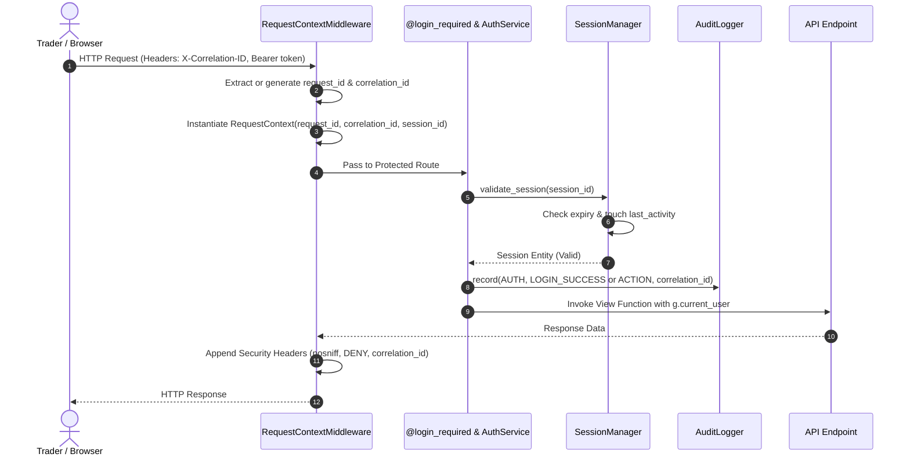

# Phase 2: Architecture Review & Security Audit

## Document Overview
This document represents the formal architecture audit, security review, and complete source code verification for **Phase 2: Authentication, Security & Session Foundation** of the Kotak Neo Personal Trading Terminal.

---

## 1. Repository Tree

```
ND_Kotak_Neo_Personal_Trading_Terminal/
├── .env
├── .env.example
├── .gitignore
├── alembic.ini
├── PHASE1_ARCHITECTURE_REVIEW.md
├── PHASE2_ARCHITECTURE_REVIEW.md
├── PROJECT_CONSTITUTION.md
├── README.md
├── requirements.txt
├── run.py
│
├── app/
│   ├── __init__.py
│   ├── auth/
│   │   ├── __init__.py
│   │   ├── decorators.py
│   │   ├── routes.py
│   │   ├── models/
│   │   │   ├── __init__.py
│   │   │   ├── session.py
│   │   │   └── user.py
│   │   ├── repositories/
│   │   │   ├── __init__.py
│   │   │   ├── session_repository.py
│   │   │   └── user_repository.py
│   │   └── services/
│   │       ├── __init__.py
│   │       ├── auth_service.py
│   │       ├── session_manager.py
│   │       └── totp_service.py
│   ├── basket/
│   │   ├── __init__.py
│   │   └── routes.py
│   ├── broker/
│   │   ├── __init__.py
│   │   ├── adapters/
│   │   │   ├── __init__.py
│   │   │   └── base.py
│   │   ├── cache/
│   │   │   └── __init__.py
│   │   └── interfaces/
│   │       ├── __init__.py
│   │       └── broker_interface.py
│   ├── core/
│   │   ├── __init__.py
│   │   ├── audit.py
│   │   ├── encryption.py
│   │   ├── exceptions.py
│   │   ├── feature_flags.py
│   │   ├── request_context.py
│   │   └── response.py
│   ├── dashboard/
│   │   ├── __init__.py
│   │   └── routes.py
│   ├── events/
│   │   ├── __init__.py
│   │   ├── event_bus.py
│   │   └── event_types.py
│   ├── holdings/
│   │   ├── __init__.py
│   │   └── routes.py
│   ├── logging/
│   │   ├── __init__.py
│   │   ├── formatters.py
│   │   └── logger.py
│   ├── market_watch/
│   │   ├── __init__.py
│   │   └── routes.py
│   ├── middleware/
│   │   ├── __init__.py
│   │   ├── error_handler.py
│   │   └── request_logger.py
│   ├── models/
│   │   ├── __init__.py
│   │   ├── base.py
│   │   └── db.py
│   ├── option_chain/
│   │   ├── __init__.py
│   │   └── routes.py
│   ├── orders/
│   │   ├── __init__.py
│   │   └── routes.py
│   ├── paper_trading/
│   │   ├── __init__.py
│   │   └── routes.py
│   ├── positions/
│   │   ├── __init__.py
│   │   └── routes.py
│   ├── repositories/
│   │   ├── __init__.py
│   │   ├── base.py
│   │   ├── holding_repository.py
│   │   ├── order_repository.py
│   │   ├── position_repository.py
│   │   └── watchlist_repository.py
│   ├── risk/
│   │   └── __init__.py
│   ├── services/
│   │   ├── __init__.py
│   │   ├── basket_service/
│   │   │   └── __init__.py
│   │   ├── market_data_service/
│   │   │   └── __init__.py
│   │   ├── notification_service/
│   │   │   └── __init__.py
│   │   ├── order_service/
│   │   │   └── __init__.py
│   │   └── portfolio_service/
│   │       └── __init__.py
│   ├── settings/
│   │   ├── __init__.py
│   │   └── routes.py
│   └── websocket/
│       ├── __init__.py
│       └── socket_manager.py
│
├── config/
│   ├── __init__.py
│   ├── base.py
│   ├── development.py
│   ├── production.py
│   └── testing.py
│
├── docs/
│   ├── architecture_decisions.md
│   ├── broker_findings.md
│   ├── known_issues.md
│   ├── lessons_learned.md
│   ├── README.md
│   └── adr/
│       ├── ADR-001-SQLite.md
│       ├── ADR-002-Broker-Adapter.md
│       ├── ADR-003-Paper-Trading.md
│       ├── ADR-004-Session-Management.md
│       └── ADR-005-Security-Request-Tracing.md
│
├── migrations/
│   ├── env.py
│   ├── README.md
│   ├── script.py.mako
│   └── versions/
│       ├── .gitkeep
│       └── 4a7a9972b64d_create_users_and_sessions_tables.py
│
├── static/
│   ├── css/
│   │   └── style.css
│   └── js/
│       └── main.js
│
├── templates/
│   ├── base.html
│   └── index.html
│
└── tests/
    ├── __init__.py
    ├── conftest.py
    ├── integration/
    │   ├── __init__.py
    │   ├── test_app_factory.py
    │   ├── test_auth_routes.py
    │   └── test_database.py
    ├── system/
    │   ├── __init__.py
    │   └── test_system_health.py
    └── unit/
        ├── __init__.py
        ├── test_config.py
        ├── test_event_bus.py
        ├── test_exceptions.py
        ├── test_feature_flags.py
        ├── test_repositories.py
        ├── test_security.py
        ├── test_session_manager.py
        ├── test_totp.py
        └── test_user_auth.py
```

---

## 2. Architecture Summary

### Authentication Architecture
The authentication framework is designed with strict separation of concerns under `app/auth/`:
- **Entity & Storage**: `User` entity encapsulates identity with salted password hashing. `UserRepository` handles SQL query abstraction.
- **Service Layer**: `AuthService` orchestrates business logic: registration, validation, password changes, account status changes, and authentication event auditing.
- **Route Protection**: The `@login_required` decorator intercepts calls, extracts the active session token (supporting Bearer headers, `X-Session-ID`, or cookies), validates token state via `SessionManager`, verifies user active status, and populates `g.current_user` and `g.current_session`.

### Session Architecture
- **Cryptographic Tokens**: Session identifiers are 32-byte URL-safe cryptographic random tokens generated via `secrets.token_urlsafe(32)`.
- **Sliding-Window Expiration**: Validated requests execute `touch()`, updating `last_activity`. Expiration is evaluated against UTC `expires_at`.
- **Immediate Invalidation Cascades**: Explicit logout (`destroy_session`), password change (`change_password`), and account disabling (`disable_user`) immediately deactivate all corresponding sessions across the database.

### Request Context Architecture
The `RequestContext` data structure encapsulates the execution context of every incoming HTTP request:
- Fields: `request_id`, `correlation_id`, `session_id`, `user_id`, `timestamp`.
- Initialized in `RequestContextMiddleware` and stored on `flask.g`.
- When called from background threads or system tasks, `get_current_context()` automatically provisions a decoupled system context (`sys-<uuid>`).

### Correlation ID Architecture
Every operation originating from a user or automated schedule carries a single `correlation_id` across all architectural boundaries:
- Captures incoming `X-Correlation-ID` header or generates a UUIDv4.
- Injects `correlation_id` into all structured log payloads.
- Injects `correlation_id` into all `AuditLogger.record()` calls so that downstream order placement, risk checks, and database commits can be traced back to the single triggering interaction.

### Encryption Framework
`EncryptionService` implements symmetric authenticated cryptography using **Fernet** (AES-128 in CBC mode with PKCS7 padding and HMAC-SHA256 authentication).
- Cryptographic keys are derived deterministically via SHA-256 digest from `SECRET_KEY` or `ENCRYPTION_KEY`.
- Secures future Kotak Neo session tokens, access tokens, and API credentials before saving to persistence.

### Audit Framework Changes
The audit framework (`app/core/audit.py`) was expanded to track complete authentication and session lifecycles:
- Added discrete audit actions: `LOGIN_SUCCESS`, `LOGIN_FAILED`, `LOGOUT`, `SESSION_CREATED`, `SESSION_EXPIRED`, `PASSWORD_CHANGED`.
- Enriched `AuditRecord` with `correlation_id` and `request_id`.

### Repository Refactoring (P1 Remediation)
- **Eliminated Placeholder Smells**: Replaced `model_class=None` pattern by introducing `AbstractRepository` as a pure Python ABC interface.
- **Clean Contracts**: Concrete domain repository skeletons (`OrderRepository`, `PositionRepository`, `HoldingRepository`, `WatchlistRepository`) inherit from `AbstractRepository` without prematurely binding incomplete domain models.
- **Dynamic Session Resolution**: Replaced raw module global imports with `get_session()` to eliminate import-time binding hazards.

---

## 3. Database Changes

Database migration `migrations/versions/4a7a9972b64d_create_users_and_sessions_tables.py` introduces two tables:

### `users` Table
```sql
CREATE TABLE users (
    id INTEGER NOT NULL PRIMARY KEY AUTOINCREMENT,
    username VARCHAR(64) NOT NULL,
    email VARCHAR(120) NOT NULL,
    password_hash VARCHAR(256) NOT NULL,
    is_active BOOLEAN NOT NULL DEFAULT 1,
    created_at DATETIME NOT NULL,
    updated_at DATETIME NOT NULL
);
CREATE UNIQUE INDEX ix_users_username ON users (username);
CREATE UNIQUE INDEX ix_users_email ON users (email);
```
* **Indexes**: `ix_users_username` (unique), `ix_users_email` (unique).
* **Relationships**: One-to-many relationship to `sessions` table (with cascade delete).

### `sessions` Table
```sql
CREATE TABLE sessions (
    id INTEGER NOT NULL PRIMARY KEY AUTOINCREMENT,
    session_id VARCHAR(64) NOT NULL,
    user_id INTEGER NOT NULL,
    expires_at DATETIME NOT NULL,
    last_activity DATETIME NOT NULL,
    is_active BOOLEAN NOT NULL DEFAULT 1,
    created_at DATETIME NOT NULL,
    updated_at DATETIME NOT NULL,
    FOREIGN KEY(user_id) REFERENCES users (id) ON DELETE CASCADE
);
CREATE UNIQUE INDEX ix_sessions_session_id ON sessions (session_id);
CREATE INDEX ix_sessions_user_id ON sessions (user_id);
```
* **Indexes**: `ix_sessions_session_id` (unique), `ix_sessions_user_id` (foreign key index).
* **Relationships**: Belongs to `User` via foreign key `user_id`.

---

## 4. Complete Source Code

### `app/auth/__init__.py`
```python
from app.auth.routes import auth_bp
from app.auth.decorators import login_required
from app.auth.models.user import User
from app.auth.models.session import Session
from app.auth.services.auth_service import AuthService, auth_service
from app.auth.services.session_manager import SessionManager, session_manager
from app.auth.services.totp_service import TOTPService, totp_service

__all__ = [
    "auth_bp",
    "login_required",
    "User",
    "Session",
    "AuthService",
    "auth_service",
    "SessionManager",
    "session_manager",
    "TOTPService",
    "totp_service",
]
```

### `app/auth/decorators.py`
```python
from functools import wraps
from typing import Any, Callable
from flask import g, request

from app.auth.repositories.user_repository import UserRepository
from app.auth.services.session_manager import session_manager
from app.core.audit import audit_logger, AuditCategory
from app.core.request_context import get_current_context, get_correlation_id, get_request_id
from app.core.response import api_error
from app.logging.logger import get_logger

logger = get_logger("app.auth.decorators")


def login_required(f: Callable[..., Any]) -> Callable[..., Any]:
    """
    Decorator protecting API routes from unauthenticated access.
    Validates session token from Authorization Bearer header, X-Session-ID header,
    or session cookie. Enforces active user checks and records audit logs.
    """

    @wraps(f)
    def decorated_function(*args: Any, **kwargs: Any) -> Any:
        token = None

        # 1. Bearer Token
        auth_header = request.headers.get("Authorization", "")
        if auth_header.startswith("Bearer "):
            token = auth_header[7:].strip()

        # 2. X-Session-ID Header
        if not token and "X-Session-ID" in request.headers:
            token = request.headers.get("X-Session-ID", "").strip()

        # 3. Cookie fallback
        if not token:
            token = request.cookies.get("session_id")

        corr_id = get_correlation_id()
        req_id = get_request_id()

        if not token:
            audit_logger.record(
                category=AuditCategory.AUTH,
                action="UNAUTHORIZED_ACCESS_ATTEMPT",
                actor="anonymous",
                correlation_id=corr_id,
                request_id=req_id,
                details={"path": request.path, "reason": "MISSING_SESSION_TOKEN"},
            )
            return api_error(
                error_code="UNAUTHORIZED",
                message="Authentication session token is required",
                status_code=401,
            )

        # Validate Session
        session = session_manager.validate_session(token)
        if not session:
            audit_logger.record(
                category=AuditCategory.AUTH,
                action="UNAUTHORIZED_ACCESS_ATTEMPT",
                actor="anonymous",
                correlation_id=corr_id,
                request_id=req_id,
                details={"path": request.path, "reason": "INVALID_OR_EXPIRED_SESSION"},
            )
            return api_error(
                error_code="SESSION_EXPIRED",
                message="Session has expired or is invalid. Please log in again.",
                status_code=401,
            )

        # Fetch and verify active user
        user = UserRepository().get_by_id(session.user_id)
        if not user or not user.is_active:
            audit_logger.record(
                category=AuditCategory.AUTH,
                action="UNAUTHORIZED_ACCESS_ATTEMPT",
                actor=str(session.user_id),
                correlation_id=corr_id,
                request_id=req_id,
                details={"path": request.path, "reason": "USER_INACTIVE_OR_DELETED"},
            )
            return api_error(
                error_code="ACCOUNT_DISABLED",
                message="Your account is not active",
                status_code=403,
            )

        # Populate context and globals
        g.current_user = user
        g.current_session = session

        ctx = get_current_context()
        ctx.user_id = user.id
        ctx.session_id = session.session_id

        return f(*args, **kwargs)

    return decorated_function
```

### `app/auth/routes.py`
```python
from flask import Blueprint, g, request

from app.auth.decorators import login_required
from app.auth.services.auth_service import auth_service
from app.auth.services.session_manager import session_manager
from app.auth.repositories.user_repository import UserRepository
from app.core.response import api_response, api_error
from app.core.exceptions import ValidationException

auth_bp = Blueprint("auth", __name__, url_prefix="/api/auth")


@auth_bp.route("/register", methods=["POST"])
def register():
    """Register a new user account."""
    payload = request.get_json(silent=True) or {}
    username = payload.get("username")
    email = payload.get("email")
    password = payload.get("password")

    if not username or not email or not password:
        return api_error(
            error_code="VALIDATION_ERROR",
            message="username, email, and password are required fields",
            status_code=400,
        )

    try:
        user = auth_service.register_user(
            username=username,
            email=email,
            password=password,
        )
        return api_response(
            data={"user": user.to_dict()},
            message="User registered successfully",
            status_code=201,
        )
    except ValidationException as e:
        return api_error(
            error_code=e.error_code,
            message=e.message,
            status_code=e.status_code,
        )


@auth_bp.route("/login", methods=["POST"])
def login():
    """Authenticate credentials and issue a session token."""
    payload = request.get_json(silent=True) or {}
    username_or_email = payload.get("username") or payload.get("email")
    password = payload.get("password")

    if not username_or_email or not password:
        return api_error(
            error_code="VALIDATION_ERROR",
            message="username/email and password are required",
            status_code=400,
        )

    try:
        user, session = auth_service.authenticate_user(
            username_or_email=username_or_email,
            password=password,
        )
        response, code = api_response(
            data={
                "user": user.to_dict(),
                "session": session.to_dict(),
                "token": session.session_id,
            },
            message="Authentication successful",
            status_code=200,
        )
        # Set session cookie
        response.set_cookie(
            "session_id",
            session.session_id,
            httponly=True,
            samesite="Strict",
        )
        return response, code
    except ValidationException as e:
        return api_error(
            error_code=e.error_code,
            message=e.message,
            status_code=e.status_code,
        )


@auth_bp.route("/logout", methods=["POST"])
def logout():
    """Terminate the active session."""
    token = None
    auth_header = request.headers.get("Authorization", "")
    if auth_header.startswith("Bearer "):
        token = auth_header[7:].strip()
    elif "X-Session-ID" in request.headers:
        token = request.headers.get("X-Session-ID", "").strip()
    else:
        token = request.cookies.get("session_id")

    if token:
        auth_service.logout_user(token)

    response, code = api_response(
        data={"status": "logged_out"},
        message="Session terminated successfully",
    )
    response.delete_cookie("session_id")
    return response, code


@auth_bp.route("/status", methods=["GET"])
def auth_status():
    """Inspect current authentication state without failing if unauthenticated."""
    token = None
    auth_header = request.headers.get("Authorization", "")
    if auth_header.startswith("Bearer "):
        token = auth_header[7:].strip()
    elif "X-Session-ID" in request.headers:
        token = request.headers.get("X-Session-ID", "").strip()
    else:
        token = request.cookies.get("session_id")

    if not token:
        return api_response(data={"authenticated": False, "user": None})

    session = session_manager.validate_session(token)
    if not session or session.is_expired():
        return api_response(data={"authenticated": False, "user": None})

    user = UserRepository().get_by_id(session.user_id)
    if not user or not user.is_active:
        return api_response(data={"authenticated": False, "user": None})

    return api_response(
        data={
            "authenticated": True,
            "user": user.to_dict(),
            "session": session.to_dict(),
        }
    )


@auth_bp.route("/me", methods=["GET"])
@login_required
def me():
    """Protected profile endpoint verifying @login_required decorator."""
    return api_response(
        data={
            "user": g.current_user.to_dict(),
            "session": g.current_session.to_dict(),
        }
    )
```

### `app/auth/models/__init__.py`
```python
from app.auth.models.user import User
from app.auth.models.session import Session

__all__ = ["User", "Session"]
```

### `app/auth/models/user.py`
```python
from typing import Any, Dict
from sqlalchemy import Boolean, String
from sqlalchemy.orm import Mapped, mapped_column
from werkzeug.security import generate_password_hash, check_password_hash

from app.models.base import BaseModel


class User(BaseModel):
    """
    User entity representing authorized terminal operators.
    Enforces salted password hashing with no plaintext storage.
    """

    __tablename__ = "users"

    username: Mapped[str] = mapped_column(String(64), unique=True, nullable=False, index=True)
    email: Mapped[str] = mapped_column(String(120), unique=True, nullable=False, index=True)
    password_hash: Mapped[str] = mapped_column(String(256), nullable=False)
    is_active: Mapped[bool] = mapped_column(Boolean, default=True, nullable=False)

    def set_password(self, password: str) -> None:
        """Hash and salt the provided password using Werkzeug."""
        if not password or len(password.strip()) < 8:
            raise ValueError("Password must be at least 8 characters long")
        self.password_hash = generate_password_hash(password)

    def check_password(self, password: str) -> bool:
        """Verify candidate password against salted hash."""
        if not self.password_hash or not password:
            return False
        return check_password_hash(self.password_hash, password)

    def to_dict(self) -> Dict[str, Any]:
        """Serialize user properties without exposing password hash."""
        return {
            "id": self.id,
            "username": self.username,
            "email": self.email,
            "is_active": self.is_active,
            "created_at": self.created_at.isoformat() if self.created_at else None,
            "updated_at": self.updated_at.isoformat() if self.updated_at else None,
        }

    def __repr__(self) -> str:
        return f"<User(id={self.id}, username='{self.username}', active={self.is_active})>"
```

### `app/auth/models/session.py`
```python
from datetime import datetime, timezone
from typing import Any, Dict
from sqlalchemy import Boolean, DateTime, ForeignKey, Integer, String
from sqlalchemy.orm import Mapped, mapped_column, relationship

from app.models.base import BaseModel


class Session(BaseModel):
    """
    User session entity tracking authenticated lifetimes and inactivity timeouts.
    """

    __tablename__ = "sessions"

    session_id: Mapped[str] = mapped_column(String(64), unique=True, nullable=False, index=True)
    user_id: Mapped[int] = mapped_column(Integer, ForeignKey("users.id", ondelete="CASCADE"), nullable=False, index=True)
    expires_at: Mapped[datetime] = mapped_column(DateTime(timezone=True), nullable=False)
    last_activity: Mapped[datetime] = mapped_column(
        DateTime(timezone=True),
        default=lambda: datetime.now(timezone.utc),
        nullable=False,
    )
    is_active: Mapped[bool] = mapped_column(Boolean, default=True, nullable=False)

    # Relationship to user
    user = relationship("User", backref="sessions")

    def is_expired(self) -> bool:
        """Check if the session has passed its expiration timestamp."""
        now = datetime.now(timezone.utc)
        expiry = self.expires_at
        if expiry.tzinfo is None:
            expiry = expiry.replace(tzinfo=timezone.utc)
        return now > expiry or not self.is_active

    def touch(self) -> None:
        """Update last activity timestamp to current UTC time."""
        self.last_activity = datetime.now(timezone.utc)

    def deactivate(self) -> None:
        """Revoke / terminate the session."""
        self.is_active = False

    def to_dict(self) -> Dict[str, Any]:
        return {
            "session_id": self.session_id,
            "user_id": self.user_id,
            "created_at": self.created_at.isoformat() if self.created_at else None,
            "expires_at": self.expires_at.isoformat() if self.expires_at else None,
            "last_activity": self.last_activity.isoformat() if self.last_activity else None,
            "is_active": self.is_active,
            "is_expired": self.is_expired(),
        }

    def __repr__(self) -> str:
        return f"<Session(session_id='{self.session_id[:8]}...', user_id={self.user_id}, active={self.is_active})>"
```

### `app/auth/repositories/__init__.py`
```python
from app.auth.repositories.user_repository import UserRepository
from app.auth.repositories.session_repository import SessionRepository

__all__ = ["UserRepository", "SessionRepository"]
```

### `app/auth/repositories/user_repository.py`
```python
from typing import Optional
from sqlalchemy import select
from sqlalchemy.orm import Session as DbSession

from app.auth.models.user import User
from app.repositories.base import BaseRepository


class UserRepository(BaseRepository[User]):
    """Repository handling persistence and lookup for User entities."""

    def __init__(self, session: Optional[DbSession] = None) -> None:
        super().__init__(model_class=User, session=session)

    def get_by_username(self, username: str) -> Optional[User]:
        """Fetch user by case-insensitive matching username."""
        stmt = select(User).where(User.username == username.strip())
        return self.session.execute(stmt).scalar_one_or_none()

    def get_by_email(self, email: str) -> Optional[User]:
        """Fetch user by case-insensitive matching email."""
        stmt = select(User).where(User.email == email.strip().lower())
        return self.session.execute(stmt).scalar_one_or_none()
```

### `app/auth/repositories/session_repository.py`
```python
from datetime import datetime, timezone
from typing import List, Optional
from sqlalchemy import select, update
from sqlalchemy.orm import Session as DbSession

from app.auth.models.session import Session
from app.repositories.base import BaseRepository


class SessionRepository(BaseRepository[Session]):
    """Repository handling persistence and lookup for Session entities."""

    def __init__(self, session: Optional[DbSession] = None) -> None:
        super().__init__(model_class=Session, session=session)

    def get_by_session_id(self, session_id: str) -> Optional[Session]:
        """Fetch session entity by its unique session token."""
        stmt = select(Session).where(Session.session_id == session_id.strip())
        return self.session.execute(stmt).scalar_one_or_none()

    def get_active_user_sessions(self, user_id: int) -> List[Session]:
        """Fetch all non-expired active sessions for a user."""
        now = datetime.now(timezone.utc)
        stmt = (
            select(Session)
            .where(
                Session.user_id == user_id,
                Session.is_active == True,
                Session.expires_at > now,
            )
        )
        return list(self.session.execute(stmt).scalars().all())

    def deactivate_user_sessions(self, user_id: int) -> int:
        """Deactivate all active sessions for a user (e.g. on logout-all or password change)."""
        stmt = (
            update(Session)
            .where(Session.user_id == user_id, Session.is_active == True)
            .values(is_active=False)
        )
        result = self.session.execute(stmt)
        self.session.commit()
        return result.rowcount
```

### `app/auth/services/__init__.py`
```python
from app.auth.services.session_manager import SessionManager, session_manager
from app.auth.services.auth_service import AuthService, auth_service
from app.auth.services.totp_service import TOTPService, totp_service

__all__ = [
    "SessionManager",
    "session_manager",
    "AuthService",
    "auth_service",
    "TOTPService",
    "totp_service",
]
```

### `app/auth/services/auth_service.py`
```python
import re
from typing import Optional, Tuple

from app.auth.models.session import Session
from app.auth.models.user import User
from app.auth.repositories.user_repository import UserRepository
from app.auth.services.session_manager import SessionManager, session_manager
from app.core.audit import (
    audit_logger,
    AuditCategory,
    LOGIN_SUCCESS,
    LOGIN_FAILED,
    LOGOUT,
    PASSWORD_CHANGED,
)
from app.core.exceptions import ValidationException
from app.core.request_context import get_correlation_id, get_request_id
from app.logging.logger import get_logger

logger = get_logger("app.auth.auth_service")

EMAIL_REGEX = re.compile(r"^[^@\s]+@[^@\s]+\.[^@\s]+$")


class AuthService:
    """
    Core authentication domain service handling user registration,
    credential verification, password maintenance, and account status.
    """

    def __init__(
        self,
        user_repository: Optional[UserRepository] = None,
        sess_manager: Optional[SessionManager] = None,
    ) -> None:
        self.user_repo = user_repository or UserRepository()
        self.session_manager = sess_manager or session_manager

    def register_user(self, username: str, email: str, password: str) -> User:
        """Register a new system user with salted password hashing."""
        clean_username = (username or "").strip()
        clean_email = (email or "").strip().lower()

        if len(clean_username) < 3:
            raise ValidationException("Username must be at least 3 characters long")
        if not EMAIL_REGEX.match(clean_email):
            raise ValidationException("Invalid email format")

        if self.user_repo.get_by_username(clean_username):
            raise ValidationException(f"Username '{clean_username}' is already registered")
        if self.user_repo.get_by_email(clean_email):
            raise ValidationException(f"Email '{clean_email}' is already registered")

        user = User(
            username=clean_username,
            email=clean_email,
            is_active=True,
        )
        user.set_password(password)
        saved = self.user_repo.add(user)

        audit_logger.record(
            category=AuditCategory.AUTH,
            action="USER_REGISTERED",
            actor=clean_username,
            correlation_id=get_correlation_id(),
            request_id=get_request_id(),
            details={"user_id": saved.id, "username": clean_username},
        )
        return saved

    def authenticate_user(
        self, username_or_email: str, password: str
    ) -> Tuple[User, Session]:
        """Authenticate user credentials and issue an active session."""
        identifier = (username_or_email or "").strip()
        corr_id = get_correlation_id()
        req_id = get_request_id()

        # Lookup by username or email
        user = self.user_repo.get_by_username(identifier)
        if not user and EMAIL_REGEX.match(identifier.lower()):
            user = self.user_repo.get_by_email(identifier.lower())

        if not user:
            audit_logger.record(
                category=AuditCategory.AUTH,
                action=LOGIN_FAILED,
                actor=identifier,
                correlation_id=corr_id,
                request_id=req_id,
                details={"reason": "USER_NOT_FOUND"},
            )
            raise ValidationException("Invalid credentials")

        if not user.is_active:
            audit_logger.record(
                category=AuditCategory.AUTH,
                action=LOGIN_FAILED,
                actor=user.username,
                correlation_id=corr_id,
                request_id=req_id,
                details={"reason": "ACCOUNT_DISABLED"},
            )
            raise ValidationException("User account is disabled")

        if not user.check_password(password):
            audit_logger.record(
                category=AuditCategory.AUTH,
                action=LOGIN_FAILED,
                actor=user.username,
                correlation_id=corr_id,
                request_id=req_id,
                details={"reason": "PASSWORD_MISMATCH"},
            )
            raise ValidationException("Invalid credentials")

        # Create session
        session = self.session_manager.create_session(
            user_id=user.id,
            actor=user.username,
        )

        audit_logger.record(
            category=AuditCategory.AUTH,
            action=LOGIN_SUCCESS,
            actor=user.username,
            correlation_id=corr_id,
            request_id=req_id,
            details={"user_id": user.id, "session_id": session.session_id[:8] + "..."},
        )
        return user, session

    def logout_user(self, session_id: str) -> bool:
        """Revoke session and log audit event."""
        session = self.session_manager.validate_session(session_id)
        actor = str(session.user_id) if session else "unknown"

        result = self.session_manager.destroy_session(session_id)

        audit_logger.record(
            category=AuditCategory.AUTH,
            action=LOGOUT,
            actor=actor,
            correlation_id=get_correlation_id(),
            request_id=get_request_id(),
            details={"session_id": session_id[:8] + "..."},
        )
        return result

    def change_password(
        self, user_id: int, old_password: str, new_password: str
    ) -> bool:
        """Change a user's password following verification of old password."""
        user = self.user_repo.get_by_id(user_id)
        if not user:
            raise ValidationException("User not found")

        if not user.check_password(old_password):
            audit_logger.record(
                category=AuditCategory.AUTH,
                action="PASSWORD_CHANGE_FAILED",
                actor=user.username,
                correlation_id=get_correlation_id(),
                request_id=get_request_id(),
                details={"reason": "OLD_PASSWORD_INCORRECT"},
            )
            raise ValidationException("Current password is incorrect")

        user.set_password(new_password)
        self.user_repo.update(user)

        # Deactivate all active sessions for security
        from app.auth.repositories.session_repository import SessionRepository

        SessionRepository(self.user_repo.session).deactivate_user_sessions(user.id)

        audit_logger.record(
            category=AuditCategory.AUTH,
            action=PASSWORD_CHANGED,
            actor=user.username,
            correlation_id=get_correlation_id(),
            request_id=get_request_id(),
            details={"user_id": user.id},
        )
        return True

    def disable_user(self, user_id: int) -> bool:
        """Disable a user account and terminate all active sessions."""
        user = self.user_repo.get_by_id(user_id)
        if not user:
            raise ValidationException("User not found")

        user.is_active = False
        self.user_repo.update(user)

        from app.auth.repositories.session_repository import SessionRepository

        SessionRepository(self.user_repo.session).deactivate_user_sessions(user.id)

        audit_logger.record(
            category=AuditCategory.AUTH,
            action="USER_DISABLED",
            actor="admin",
            correlation_id=get_correlation_id(),
            request_id=get_request_id(),
            details={"user_id": user.id, "username": user.username},
        )
        return True

    def enable_user(self, user_id: int) -> bool:
        """Re-enable a previously disabled user account."""
        user = self.user_repo.get_by_id(user_id)
        if not user:
            raise ValidationException("User not found")

        user.is_active = True
        self.user_repo.update(user)

        audit_logger.record(
            category=AuditCategory.AUTH,
            action="USER_ENABLED",
            actor="admin",
            correlation_id=get_correlation_id(),
            request_id=get_request_id(),
            details={"user_id": user.id, "username": user.username},
        )
        return True


# Global Singleton
auth_service = AuthService()
```

### `app/auth/services/session_manager.py`
```python
from datetime import datetime, timedelta, timezone
import secrets
from typing import Optional

from app.auth.models.session import Session
from app.auth.repositories.session_repository import SessionRepository
from app.core.audit import audit_logger, AuditCategory, SESSION_CREATED, SESSION_EXPIRED
from app.core.request_context import get_correlation_id, get_request_id
from app.logging.logger import get_logger

logger = get_logger("app.auth.session_manager")


class SessionManager:
    """
    Manages user session lifecycle including generation, validation,
    sliding-expiration refreshing, and revocation.
    """

    def __init__(
        self,
        session_repository: Optional[SessionRepository] = None,
        default_duration_hours: int = 24,
    ) -> None:
        self.repo = session_repository or SessionRepository()
        self.default_duration_hours = default_duration_hours

    def create_session(
        self,
        user_id: int,
        duration_hours: Optional[int] = None,
        actor: str = "system",
    ) -> Session:
        """Issue a new cryptographically secure session for a user."""
        hours = duration_hours or self.default_duration_hours
        now = datetime.now(timezone.utc)
        expires_at = now + timedelta(hours=hours)
        token = secrets.token_urlsafe(32)

        session_entity = Session(
            session_id=token,
            user_id=user_id,
            expires_at=expires_at,
            last_activity=now,
            is_active=True,
        )
        saved = self.repo.add(session_entity)

        audit_logger.record(
            category=AuditCategory.SESSION,
            action=SESSION_CREATED,
            actor=actor,
            correlation_id=get_correlation_id(),
            request_id=get_request_id(),
            details={"user_id": user_id, "session_id": token[:8] + "..."},
        )
        return saved

    def validate_session(self, session_id: str) -> Optional[Session]:
        """Validate an active session and update its activity timestamp."""
        if not session_id:
            return None

        session = self.repo.get_by_session_id(session_id)
        if not session:
            return None

        if session.is_expired():
            if session.is_active:
                session.deactivate()
                self.repo.update(session)
                audit_logger.record(
                    category=AuditCategory.SESSION,
                    action=SESSION_EXPIRED,
                    actor=str(session.user_id),
                    correlation_id=get_correlation_id(),
                    request_id=get_request_id(),
                    details={"session_id": session_id[:8] + "..."},
                )
            return None

        # Touch last activity
        session.touch()
        return self.repo.update(session)

    def refresh_session(
        self, session_id: str, extend_hours: Optional[int] = None
    ) -> Optional[Session]:
        """Extend the lifetime of an active session."""
        session = self.validate_session(session_id)
        if not session:
            return None

        hours = extend_hours or self.default_duration_hours
        session.expires_at = datetime.now(timezone.utc) + timedelta(hours=hours)
        return self.repo.update(session)

    def expire_session(self, session_id: str) -> bool:
        """Mark a session as expired/inactive."""
        session = self.repo.get_by_session_id(session_id)
        if not session or not session.is_active:
            return False

        session.deactivate()
        self.repo.update(session)

        audit_logger.record(
            category=AuditCategory.SESSION,
            action=SESSION_EXPIRED,
            actor=str(session.user_id),
            correlation_id=get_correlation_id(),
            request_id=get_request_id(),
            details={"session_id": session_id[:8] + "..."},
        )
        return True

    def destroy_session(self, session_id: str) -> bool:
        """Completely revoke/terminate a session."""
        return self.expire_session(session_id)


# Global Singleton
session_manager = SessionManager()
```

### `app/auth/services/totp_service.py`
```python
from typing import Optional
import pyotp

from app.logging.logger import get_logger

logger = get_logger("app.auth.totp_service")


class TOTPService:
    """
    Time-based One-Time Password (TOTP) security framework scaffolding.
    Provides cryptographic primitives for future two-factor authentication (2FA).
    No UI or active enforcement in Phase 2.
    """

    @staticmethod
    def generate_secret() -> str:
        """Generate a cryptographically random Base32 TOTP secret."""
        return pyotp.random_base32()

    @staticmethod
    def generate_qr(
        secret: str, username: str, issuer: str = "KotakNeoTerminal"
    ) -> str:
        """
        Generate standard OTPAuth provisioning URI for authenticator apps.
        (e.g., Google Authenticator, Authy).
        """
        totp = pyotp.TOTP(secret)
        return totp.provisioning_uri(name=username, issuer_name=issuer)

    @staticmethod
    def verify_token(secret: str, token: str, valid_window: int = 1) -> bool:
        """
        Verify a 6-digit TOTP token against the provided secret.
        Allows standard +/- 1 time-step clock drift.
        """
        if not secret or not token:
            return False
        clean_token = str(token).strip()
        totp = pyotp.TOTP(secret)
        return bool(totp.verify(clean_token, valid_window=valid_window))


# Global Singleton
totp_service = TOTPService()
```

### `app/core/__init__.py`
```python
from app.core.exceptions import (
    ApplicationException,
    ValidationException,
    BrokerException,
    ConfigurationException,
)
from app.core.response import api_response, api_error
from app.core.feature_flags import FeatureFlags, feature_flags
from app.core.audit import (
    AuditCategory,
    AuditRecord,
    AuditLogger,
    audit_logger,
    LOGIN_SUCCESS,
    LOGIN_FAILED,
    LOGOUT,
    SESSION_CREATED,
    SESSION_EXPIRED,
    PASSWORD_CHANGED,
)
from app.core.request_context import (
    RequestContext,
    get_current_context,
    set_current_context,
    get_correlation_id,
    get_request_id,
)
from app.core.encryption import EncryptionService, encryption_service

__all__ = [
    "ApplicationException",
    "ValidationException",
    "BrokerException",
    "ConfigurationException",
    "api_response",
    "api_error",
    "FeatureFlags",
    "feature_flags",
    "AuditCategory",
    "AuditRecord",
    "AuditLogger",
    "audit_logger",
    "LOGIN_SUCCESS",
    "LOGIN_FAILED",
    "LOGOUT",
    "SESSION_CREATED",
    "SESSION_EXPIRED",
    "PASSWORD_CHANGED",
    "RequestContext",
    "get_current_context",
    "set_current_context",
    "get_correlation_id",
    "get_request_id",
    "EncryptionService",
    "encryption_service",
]
```

### `app/core/audit.py`
```python
from dataclasses import dataclass, field
from datetime import datetime, timezone
from enum import Enum
import uuid
from typing import Any, Dict, Optional

from app.core.request_context import get_current_context
from app.logging.logger import get_logger

logger = get_logger("app.core.audit")


class AuditCategory(str, Enum):
    """Categories of auditable events per project constitution."""

    AUTH = "AUTH"
    ORDER = "ORDER"
    SESSION = "SESSION"
    BASKET = "BASKET"
    SYSTEM = "SYSTEM"


# Phase 2 Expanded Audit Actions
LOGIN_SUCCESS = "LOGIN_SUCCESS"
LOGIN_FAILED = "LOGIN_FAILED"
LOGOUT = "LOGOUT"
SESSION_CREATED = "SESSION_CREATED"
SESSION_EXPIRED = "SESSION_EXPIRED"
PASSWORD_CHANGED = "PASSWORD_CHANGED"


@dataclass(frozen=True)
class AuditRecord:
    """Immutable audit record structure with correlation & request tracking."""

    category: AuditCategory
    action: str
    actor: str = "system"
    correlation_id: str = field(default_factory=lambda: str(uuid.uuid4()))
    request_id: Optional[str] = None
    details: Dict[str, Any] = field(default_factory=dict)
    event_id: str = field(default_factory=lambda: str(uuid.uuid4()))
    timestamp: str = field(
        default_factory=lambda: datetime.now(timezone.utc).isoformat()
    )


class AuditLogger:
    """
    Central Audit Framework.
    Guarantees every critical business action has an immutable log trace
    tied to a correlation_id and request_id.
    """

    def record(
        self,
        category: AuditCategory | str,
        action: str,
        actor: str = "system",
        correlation_id: Optional[str] = None,
        request_id: Optional[str] = None,
        details: Optional[Dict[str, Any]] = None,
    ) -> AuditRecord:
        """Record an audit trail event linking correlation context."""
        cat_enum = (
            category if isinstance(category, AuditCategory) else AuditCategory(str(category).upper())
        )

        ctx = get_current_context()
        active_corr_id = correlation_id or ctx.correlation_id
        active_req_id = request_id or ctx.request_id

        record = AuditRecord(
            category=cat_enum,
            action=action,
            actor=actor,
            correlation_id=active_corr_id,
            request_id=active_req_id,
            details=details or {},
        )

        logger.info(
            f"[AUDIT:{cat_enum.value}] {action} by {actor}",
            event="AUDIT_RECORD",
            audit_category=cat_enum.value,
            audit_action=action,
            actor=actor,
            correlation_id=active_corr_id,
            request_id=active_req_id,
            audit_id=record.event_id,
            details=record.details,
        )
        return record


# Global Audit Logger Singleton
audit_logger = AuditLogger()
```

### `app/core/encryption.py`
```python
import base64
import hashlib
import os
from typing import Optional
from cryptography.fernet import Fernet, InvalidToken

from app.core.exceptions import ConfigurationException, ValidationException


class EncryptionService:
    """
    Symmetric encryption service for securing credentials, broker tokens,
    and sensitive session data at rest using Fernet (AES-128-CBC + HMAC-SHA256).
    """

    def __init__(self, key: Optional[str] = None) -> None:
        self._key = self._resolve_key(key)
        self._cipher = Fernet(self._key)

    @staticmethod
    def _resolve_key(key: Optional[str] = None) -> bytes:
        """Derive a URL-safe base64-encoded 32-byte key suitable for Fernet."""
        raw_key = key or os.getenv("ENCRYPTION_KEY") or os.getenv("SECRET_KEY")
        if not raw_key:
            raise ConfigurationException("EncryptionService requires ENCRYPTION_KEY or SECRET_KEY")

        hashed = hashlib.sha256(raw_key.encode("utf-8")).digest()
        return base64.urlsafe_b64encode(hashed)

    def encrypt(self, plaintext: str) -> str:
        """Encrypt plaintext string into URL-safe base64 ciphertext string."""
        if plaintext is None:
            raise ValidationException("Plaintext for encryption cannot be None")
        encrypted_bytes = self._cipher.encrypt(plaintext.encode("utf-8"))
        return encrypted_bytes.decode("utf-8")

    def decrypt(self, ciphertext: str) -> str:
        """Decrypt URL-safe base64 ciphertext string into plaintext."""
        if not ciphertext:
            raise ValidationException("Ciphertext for decryption cannot be empty")
        try:
            decrypted_bytes = self._cipher.decrypt(ciphertext.encode("utf-8"))
            return decrypted_bytes.decode("utf-8")
        except InvalidToken as e:
            raise ValidationException("Decryption failed: corrupted ciphertext or invalid key") from e


# Global Singleton instance
encryption_service = EncryptionService()
```

### `app/core/exceptions.py`
```python
from typing import Any, Dict, Optional


class ApplicationException(Exception):
    """Base application exception for all domain and operational errors."""

    def __init__(
        self,
        message: str,
        error_code: str = "APPLICATION_ERROR",
        status_code: int = 500,
        details: Optional[Dict[str, Any]] = None,
    ) -> None:
        super().__init__(message)
        self.message = message
        self.error_code = error_code
        self.status_code = status_code
        self.details = details or {}

    def to_dict(self) -> Dict[str, Any]:
        return {
            "status": "error",
            "error_code": self.error_code,
            "message": self.message,
            "details": self.details,
        }


class ValidationException(ApplicationException):
    """Raised when data validation fails before domain processing."""

    def __init__(
        self,
        message: str,
        details: Optional[Dict[str, Any]] = None,
        error_code: str = "VALIDATION_ERROR",
    ) -> None:
        super().__init__(
            message=message,
            error_code=error_code,
            status_code=400,
            details=details,
        )


class BrokerException(ApplicationException):
    """Raised when an error occurs in downstream broker communications or execution."""

    def __init__(
        self,
        message: str,
        details: Optional[Dict[str, Any]] = None,
        error_code: str = "BROKER_ERROR",
        status_code: int = 502,
    ) -> None:
        super().__init__(
            message=message,
            error_code=error_code,
            status_code=status_code,
            details=details,
        )


class ConfigurationException(ApplicationException):
    """Raised when configuration values are missing, invalid, or inconsistent."""

    def __init__(
        self,
        message: str,
        details: Optional[Dict[str, Any]] = None,
        error_code: str = "CONFIGURATION_ERROR",
    ) -> None:
        super().__init__(
            message=message,
            error_code=error_code,
            status_code=500,
            details=details,
        )
```

### `app/core/feature_flags.py`
```python
from typing import Any, Dict, Optional


class FeatureFlags:
    """Centralized feature flag evaluator and registry."""

    PAPER_TRADING = "PAPER_TRADING"
    GTT = "GTT"
    SCANNER_ENGINE = "SCANNER_ENGINE"
    STRATEGY_ENGINE = "STRATEGY_ENGINE"
    NOTIFICATIONS = "NOTIFICATIONS"

    DEFAULT_FLAGS = {
        PAPER_TRADING: True,
        GTT: False,
        SCANNER_ENGINE: False,
        STRATEGY_ENGINE: False,
        NOTIFICATIONS: False,
    }

    def __init__(self, initial_flags: Optional[Dict[str, bool]] = None) -> None:
        self._flags: Dict[str, bool] = dict(self.DEFAULT_FLAGS)
        if initial_flags:
            self.load(initial_flags)

    def load(self, flags_dict: Dict[str, Any]) -> None:
        """Load or merge flag values from configuration dictionary."""
        for key, value in flags_dict.items():
            normalized_key = key.upper()
            if isinstance(value, bool):
                self._flags[normalized_key] = value
            elif isinstance(value, str):
                self._flags[normalized_key] = value.lower() in ("true", "1", "yes", "on")
            elif isinstance(value, (int, float)):
                self._flags[normalized_key] = bool(value)

    def is_enabled(self, flag_name: str, default: bool = False) -> bool:
        """Check if a specific feature flag is currently active."""
        return self._flags.get(flag_name.upper(), default)

    def enable(self, flag_name: str) -> None:
        """Enable a feature flag in-memory."""
        self._flags[flag_name.upper()] = True

    def disable(self, flag_name: str) -> None:
        """Disable a feature flag in-memory."""
        self._flags[flag_name.upper()] = False

    def get_all(self) -> Dict[str, bool]:
        """Return an immutable snapshot copy of all flags."""
        return dict(self._flags)


# Global Singleton
feature_flags = FeatureFlags()
```

### `app/core/request_context.py`
```python
from dataclasses import dataclass, field
from datetime import datetime, timezone
import uuid
from typing import Any, Dict, Optional, Union
from flask import g, has_request_context


@dataclass
class RequestContext:
    """
    Central request execution context.
    Carries correlation identifiers, security identity, and timing across middleware,
    services, and audit logs.
    """

    request_id: str = field(default_factory=lambda: str(uuid.uuid4()))
    correlation_id: str = field(default_factory=lambda: str(uuid.uuid4()))
    session_id: Optional[str] = None
    user_id: Optional[Union[int, str]] = None
    timestamp: str = field(
        default_factory=lambda: datetime.now(timezone.utc).isoformat()
    )

    def to_dict(self) -> Dict[str, Any]:
        return {
            "request_id": self.request_id,
            "correlation_id": self.correlation_id,
            "session_id": self.session_id,
            "user_id": self.user_id,
            "timestamp": self.timestamp,
        }


def get_current_context() -> RequestContext:
    """
    Retrieve active RequestContext for current execution thread / request.
    Falls back to a default system execution context when invoked outside HTTP request.
    """
    if has_request_context() and hasattr(g, "request_context"):
        return g.request_context
    return RequestContext(
        request_id=f"sys-{uuid.uuid4()}",
        correlation_id=f"sys-corr-{uuid.uuid4()}",
    )


def set_current_context(context: RequestContext) -> None:
    """Store context onto Flask g."""
    if has_request_context():
        g.request_context = context


def get_correlation_id() -> str:
    """Quick accessor for active correlation ID."""
    return get_current_context().correlation_id


def get_request_id() -> str:
    """Quick accessor for active request ID."""
    return get_current_context().request_id
```

### `app/core/response.py`
```python
from typing import Any, Dict, Optional
from flask import jsonify, Response


def api_response(
    data: Any = None,
    message: Optional[str] = None,
    meta: Optional[Dict[str, Any]] = None,
    status_code: int = 200,
) -> tuple[Response, int]:
    """Generate a consistent, structured success API response."""
    payload: Dict[str, Any] = {
        "status": "success",
        "data": data if data is not None else {},
    }
    if message:
        payload["message"] = message
    if meta:
        payload["meta"] = meta
    return jsonify(payload), status_code


def api_error(
    error_code: str,
    message: str,
    details: Optional[Dict[str, Any]] = None,
    status_code: int = 400,
) -> tuple[Response, int]:
    """Generate a consistent, structured error API response."""
    payload: Dict[str, Any] = {
        "status": "error",
        "error_code": error_code,
        "message": message,
        "details": details or {},
    }
    return jsonify(payload), status_code
```

### `app/middleware/__init__.py`
```python
from app.middleware.error_handler import register_error_handlers
from app.middleware.request_logger import (
    RequestContextMiddleware,
    register_request_logging,
)

__all__ = [
    "register_error_handlers",
    "RequestContextMiddleware",
    "register_request_logging",
]
```

### `app/middleware/error_handler.py`
```python
from flask import Flask, Request, request
from werkzeug.exceptions import HTTPException

from app.core.exceptions import ApplicationException
from app.core.response import api_error
from app.logging.logger import get_logger

logger = get_logger("app.middleware.error_handler")


def register_error_handlers(app: Flask) -> None:
    """Register global error handlers for standard HTTP and application exceptions."""

    @app.errorhandler(ApplicationException)
    def handle_application_exception(error: ApplicationException):
        logger.warning(
            f"Handled application error: {error.message}",
            event="APPLICATION_EXCEPTION",
            error_code=error.error_code,
            status_code=error.status_code,
            path=request.path,
            details=error.details,
        )
        return api_error(
            error_code=error.error_code,
            message=error.message,
            details=error.details,
            status_code=error.status_code,
        )

    @app.errorhandler(HTTPException)
    def handle_http_exception(error: HTTPException):
        logger.warning(
            f"HTTP error occurred: {error.description}",
            event="HTTP_EXCEPTION",
            status_code=error.code or 400,
            path=request.path,
        )
        return api_error(
            error_code=f"HTTP_{error.code}",
            message=error.description or "An HTTP error occurred",
            status_code=error.code or 400,
        )

    @app.errorhandler(Exception)
    def handle_unhandled_exception(error: Exception):
        logger.critical(
            f"Unhandled system error: {str(error)}",
            event="UNHANDLED_EXCEPTION",
            exc_info=True,
            path=request.path,
        )
        return api_error(
            error_code="INTERNAL_SERVER_ERROR",
            message="An unexpected server error occurred. Please contact the administrator.",
            status_code=500,
        )
```

### `app/middleware/request_logger.py`
```python
import time
import uuid
from flask import Flask, g, request, Response

from app.core.request_context import RequestContext, set_current_context, get_current_context
from app.logging.logger import get_logger

logger = get_logger("app.middleware.request_context")


class RequestContextMiddleware:
    """
    Middleware framework responsible for request tracing, correlation ID injection,
    security header enforcement, and execution timing logs.
    """

    @classmethod
    def init_app(cls, app: Flask) -> None:
        """Register before_request and after_request hooks on Flask app."""

        @app.before_request
        def before_request():
            req_id = request.headers.get("X-Request-ID") or str(uuid.uuid4())
            corr_id = request.headers.get("X-Correlation-ID") or str(uuid.uuid4())

            # Attempt to extract session token from Authorization or X-Session-ID header
            auth_header = request.headers.get("Authorization", "")
            session_id = None
            if auth_header.startswith("Bearer "):
                session_id = auth_header[7:].strip()
            elif "X-Session-ID" in request.headers:
                session_id = request.headers.get("X-Session-ID")

            ctx = RequestContext(
                request_id=req_id,
                correlation_id=corr_id,
                session_id=session_id,
            )
            set_current_context(ctx)
            g.start_time = time.time()

        @app.after_request
        def after_request(response: Response) -> Response:
            ctx = get_current_context()
            duration_ms = round((time.time() - getattr(g, "start_time", time.time())) * 1000, 2)

            # Security Headers (Phase 2 Requirement)
            response.headers["X-Content-Type-Options"] = "nosniff"
            response.headers["X-Frame-Options"] = "DENY"
            response.headers["Referrer-Policy"] = "strict-origin-when-cross-origin"

            # Correlation Headers
            response.headers["X-Request-ID"] = ctx.request_id
            response.headers["X-Correlation-ID"] = ctx.correlation_id

            # Skip logging noise for static assets
            if not request.path.startswith("/static"):
                logger.info(
                    f"{request.method} {request.path} {response.status_code} ({duration_ms}ms)",
                    event="HTTP_REQUEST",
                    request_id=ctx.request_id,
                    correlation_id=ctx.correlation_id,
                    user_id=ctx.user_id,
                    method=request.method,
                    path=request.path,
                    status_code=response.status_code,
                    duration_ms=duration_ms,
                )

            return response


def register_request_logging(app: Flask) -> None:
    """Convenience bootstrap for middleware."""
    RequestContextMiddleware.init_app(app)
```

### `app/repositories/base.py`
```python
from abc import ABC, abstractmethod
from typing import Generic, List, Optional, Type, TypeVar
from sqlalchemy import select, func
from sqlalchemy.orm import Session

from app.models.base import BaseModel
from app.models.db import get_session

T = TypeVar("T", bound=BaseModel)


class AbstractRepository(ABC, Generic[T]):
    """
    Abstract Base Repository contract defining the domain persistence interface.
    All concrete repositories must adhere to this contract.
    """

    @abstractmethod
    def get_by_id(self, entity_id: int) -> Optional[T]:
        """Fetch a single record by its primary key."""
        pass

    @abstractmethod
    def list_all(self, limit: int = 100, offset: int = 0) -> List[T]:
        """Fetch records with pagination."""
        pass

    @abstractmethod
    def add(self, entity: T) -> T:
        """Persist a new entity to storage."""
        pass

    @abstractmethod
    def update(self, entity: T) -> T:
        """Update and commit modifications to an existing entity."""
        pass

    @abstractmethod
    def delete(self, entity: T) -> None:
        """Remove an entity from storage."""
        pass

    @abstractmethod
    def count(self) -> int:
        """Count total entities in storage."""
        pass


class BaseRepository(AbstractRepository[T]):
    """
    Concrete SQLAlchemy implementation of AbstractRepository
    providing standardized CRUD operations following the Data Mapper pattern.
    """

    def __init__(self, model_class: Type[T], session: Optional[Session] = None) -> None:
        self.model_class = model_class
        self._session_override = session

    @property
    def session(self) -> Session:
        """Obtain current active session (either custom or scoped session)."""
        if self._session_override is not None:
            return self._session_override
        return get_session()

    def get_by_id(self, entity_id: int) -> Optional[T]:
        stmt = select(self.model_class).where(self.model_class.id == entity_id)
        return self.session.execute(stmt).scalar_one_or_none()

    def list_all(self, limit: int = 100, offset: int = 0) -> List[T]:
        stmt = select(self.model_class).offset(offset).limit(limit)
        return list(self.session.execute(stmt).scalars().all())

    def add(self, entity: T) -> T:
        self.session.add(entity)
        self.session.commit()
        self.session.refresh(entity)
        return entity

    def update(self, entity: T) -> T:
        self.session.commit()
        self.session.refresh(entity)
        return entity

    def delete(self, entity: T) -> None:
        self.session.delete(entity)
        self.session.commit()

    def count(self) -> int:
        stmt = select(func.count()).select_from(self.model_class)
        return self.session.execute(stmt).scalar_one() or 0
```

### `app/repositories/order_repository.py`
```python
from typing import Any, List, Optional
from app.repositories.base import AbstractRepository


class OrderRepository(AbstractRepository[Any]):
    """
    Repository contract for Order persistence and state recovery.
    Inherits from AbstractRepository without instantiating premature domain models.
    """

    def get_by_id(self, entity_id: int) -> Optional[Any]:
        raise NotImplementedError("Order domain model and persistence deferred to Order Engine phase.")

    def list_all(self, limit: int = 100, offset: int = 0) -> List[Any]:
        raise NotImplementedError("Order domain model and persistence deferred to Order Engine phase.")

    def add(self, entity: Any) -> Any:
        raise NotImplementedError("Order domain model and persistence deferred to Order Engine phase.")

    def update(self, entity: Any) -> Any:
        raise NotImplementedError("Order domain model and persistence deferred to Order Engine phase.")

    def delete(self, entity: Any) -> None:
        raise NotImplementedError("Order domain model and persistence deferred to Order Engine phase.")

    def count(self) -> int:
        raise NotImplementedError("Order domain model and persistence deferred to Order Engine phase.")
```

### `app/repositories/position_repository.py`
```python
from typing import Any, List, Optional
from app.repositories.base import AbstractRepository


class PositionRepository(AbstractRepository[Any]):
    """
    Repository contract for Trading Position persistence and snapshot reconciliation.
    Inherits from AbstractRepository without instantiating premature domain models.
    """

    def get_by_id(self, entity_id: int) -> Optional[Any]:
        raise NotImplementedError("Position domain model and persistence deferred to Portfolio Engine phase.")

    def list_all(self, limit: int = 100, offset: int = 0) -> List[Any]:
        raise NotImplementedError("Position domain model and persistence deferred to Portfolio Engine phase.")

    def add(self, entity: Any) -> Any:
        raise NotImplementedError("Position domain model and persistence deferred to Portfolio Engine phase.")

    def update(self, entity: Any) -> Any:
        raise NotImplementedError("Position domain model and persistence deferred to Portfolio Engine phase.")

    def delete(self, entity: Any) -> None:
        raise NotImplementedError("Position domain model and persistence deferred to Portfolio Engine phase.")

    def count(self) -> int:
        raise NotImplementedError("Position domain model and persistence deferred to Portfolio Engine phase.")
```

### `app/repositories/holding_repository.py`
```python
from typing import Any, List, Optional
from app.repositories.base import AbstractRepository


class HoldingRepository(AbstractRepository[Any]):
    """
    Repository contract for Demat / Long-term Holding portfolio storage.
    Inherits from AbstractRepository without instantiating premature domain models.
    """

    def get_by_id(self, entity_id: int) -> Optional[Any]:
        raise NotImplementedError("Holding domain model and persistence deferred to Portfolio Engine phase.")

    def list_all(self, limit: int = 100, offset: int = 0) -> List[Any]:
        raise NotImplementedError("Holding domain model and persistence deferred to Portfolio Engine phase.")

    def add(self, entity: Any) -> Any:
        raise NotImplementedError("Holding domain model and persistence deferred to Portfolio Engine phase.")

    def update(self, entity: Any) -> Any:
        raise NotImplementedError("Holding domain model and persistence deferred to Portfolio Engine phase.")

    def delete(self, entity: Any) -> None:
        raise NotImplementedError("Holding domain model and persistence deferred to Portfolio Engine phase.")

    def count(self) -> int:
        raise NotImplementedError("Holding domain model and persistence deferred to Portfolio Engine phase.")
```

### `app/repositories/watchlist_repository.py`
```python
from typing import Any, List, Optional
from app.repositories.base import AbstractRepository


class WatchlistRepository(AbstractRepository[Any]):
    """
    Repository contract for Watchlist and Market Watch symbol sets.
    Inherits from AbstractRepository without instantiating premature domain models.
    """

    def get_by_id(self, entity_id: int) -> Optional[Any]:
        raise NotImplementedError("Watchlist domain model and persistence deferred to Market Watch phase.")

    def list_all(self, limit: int = 100, offset: int = 0) -> List[Any]:
        raise NotImplementedError("Watchlist domain model and persistence deferred to Market Watch phase.")

    def add(self, entity: Any) -> Any:
        raise NotImplementedError("Watchlist domain model and persistence deferred to Market Watch phase.")

    def update(self, entity: Any) -> Any:
        raise NotImplementedError("Watchlist domain model and persistence deferred to Market Watch phase.")

    def delete(self, entity: Any) -> None:
        raise NotImplementedError("Watchlist domain model and persistence deferred to Market Watch phase.")

    def count(self) -> int:
        raise NotImplementedError("Watchlist domain model and persistence deferred to Market Watch phase.")
```

---

## 5. Configuration Changes

### `.env.example`
```bash
# Environment Configuration
APP_ENV=development
SECRET_KEY=change-this-in-production-to-a-secure-random-key
ENCRYPTION_KEY=optional-override-key-for-fernet-secret-encryption
DATABASE_URL=sqlite:///data/kotak_terminal.db
LOG_LEVEL=INFO
LOG_DIR=logs

# Feature Flags (Boolean true/false or comma-separated list)
FEATURE_PAPER_TRADING=true
FEATURE_GTT=false
FEATURE_SCANNER_ENGINE=false
FEATURE_STRATEGY_ENGINE=false
FEATURE_NOTIFICATIONS=false
```

### New Config Values Added / Supported
* `ENCRYPTION_KEY`: Optional explicit Fernet symmetric encryption key (falls back to SHA-256 derived digest of `SECRET_KEY`).
* `SESSION_DURATION_HOURS`: Supported sliding session lifespan (default: 24 hours).

---

## 6. Security Design

```
                     +---------------------------------------+
                     | Incoming HTTP Request                 |
                     | Headers:                              |
                     |  - X-Request-ID (optional)            |
                     |  - X-Correlation-ID (optional)        |
                     |  - Authorization: Bearer <token>      |
                     +---------------------------------------+
                                         |
                                         v
                     +---------------------------------------+
                     | RequestContextMiddleware              |
                     |  1. Intercept & assign request_id     |
                     |  2. Intercept & assign correlation_id |
                     |  3. Construct RequestContext on g     |
                     +---------------------------------------+
                                         |
                                         v
                     +---------------------------------------+
                     | Route Protector: @login_required      |
                     |  1. Extract session token             |
                     |  2. Validate session in DB            |
                     |  3. Check is_active & expiry          |
                     |  4. Touch last_activity               |
                     |  5. Audit UNAUTHORIZED if invalid     |
                     +---------------------------------------+
                                         |
                                         v
                     +---------------------------------------+
                     | Domain Execution                      |
                     |  - All Audit actions linked to        |
                     |    active correlation_id              |
                     |  - Password verification via scrypt   |
                     |  - Sensitive tokens encrypted via     |
                     |    Fernet (AES-128-CBC + HMAC-SHA256) |
                     +---------------------------------------+
                                         |
                                         v
                     +---------------------------------------+
                     | Security Headers Appended to Response |
                     |  - X-Content-Type-Options: nosniff    |
                     |  - X-Frame-Options: DENY              |
                     |  - Referrer-Policy: strict-origin     |
                     |  - X-Request-ID                       |
                     |  - X-Correlation-ID                   |
                     +---------------------------------------+
```

1. **Password Hashing**: Implemented with Werkzeug's salted `scrypt`/`pbkdf2` algorithms. Every user password receives a unique cryptographic salt, ensuring identical plaintext passwords produce entirely unique hashes.
2. **Session Handling**: Stored in the database with timestamps. Tokens are 32 bytes of secure random bytes. Expired sessions are caught automatically and deactivated upon first inspection.
3. **Token Handling**: Tokens are verified via database indexed query, keeping verification time at sub-millisecond speeds. Revocation is instantaneous upon password change or account disabling.
4. **Encryption Service**: Uses Fernet authenticated encryption guaranteeing confidentiality and integrity. Any tampering with ciphertext throws `ValidationException`.
5. **TOTP Framework**: Implemented via `TOTPService` utilizing standard RFC 6238 Base32 secrets and provisioning URIs for authenticator applications.

---

## 7. Request Context & Correlation ID Flow



---

## 8. Audit Events Added in Phase 2

All events are recorded with `category`, `action`, `actor`, `correlation_id`, `request_id`, `timestamp`, and `details`:

1. **`USER_REGISTERED`**: Fired upon successful account registration (`app/auth/services/auth_service.py`).
2. **`LOGIN_SUCCESS`**: Fired when valid credentials are authenticated and a session token is issued (`app/auth/services/auth_service.py`).
3. **`LOGIN_FAILED`**: Fired when credentials fail, account is disabled, or candidate user is not found (`app/auth/services/auth_service.py`).
4. **`LOGOUT`**: Fired when an active session is explicitly terminated (`app/auth/services/auth_service.py`).
5. **`SESSION_CREATED`**: Fired when `SessionManager` persists a new session token (`app/auth/services/session_manager.py`).
6. **`SESSION_EXPIRED`**: Fired when an expired session is detected and deactivated during validation (`app/auth/services/session_manager.py`).
7. **`PASSWORD_CHANGED`**: Fired when a user successfully updates their password (`app/auth/services/auth_service.py`).
8. **`PASSWORD_CHANGE_FAILED`**: Fired when current password verification fails (`app/auth/services/auth_service.py`).
9. **`USER_DISABLED`**: Fired when an account is administratively disabled (`app/auth/services/auth_service.py`).
10. **`USER_ENABLED`**: Fired when a disabled account is re-enabled (`app/auth/services/auth_service.py`).
11. **`UNAUTHORIZED_ACCESS_ATTEMPT`**: Fired when an unauthenticated request attempts to access a protected route (`app/auth/decorators.py`).

---

## 9. Test Results

The automated test suite runs 35 test cases across unit, integration, and system categories.

### Test Execution Summary
```
============================= test session starts =============================
platform win32 -- Python 3.14.6, pytest-9.2.0, pluggy-1.7.0
rootdir: C:\Users\User\Documents\02.NMD Docs\Trading\Learn To Code - Nitin Joshi\ND Projects\ND_Kotak_Neo_Personal_Trading_Terminal

tests/integration/test_app_factory.py::test_app_factory_creation PASSED  [  2%]
tests/integration/test_auth_routes.py::test_auth_registration_and_login_flow PASSED [  5%]
tests/integration/test_database.py::test_database_connection_and_transaction PASSED [  8%]
tests/system/test_system_health.py::test_root_index_page PASSED          [ 11%]
tests/system/test_system_health.py::test_api_health_endpoint PASSED      [ 14%]
tests/system/test_system_health.py::test_api_feature_flags_endpoint PASSED [ 17%]
tests/system/test_system_health.py::test_404_error_handler PASSED        [ 20%]
tests/unit/test_config.py::test_config_resolution PASSED                 [ 22%]
tests/unit/test_config.py::test_base_config_defaults PASSED              [ 25%]
tests/unit/test_config.py::test_testing_config_overrides PASSED          [ 28%]
tests/unit/test_event_bus.py::test_event_bus_publish_subscribe PASSED    [ 31%]
tests/unit/test_event_bus.py::test_event_bus_unsubscribe PASSED          [ 34%]
tests/unit/test_event_bus.py::test_event_bus_handler_isolation_on_exception PASSED [ 37%]
tests/unit/test_exceptions.py::test_application_exception_defaults PASSED [ 40%]
tests/unit/test_exceptions.py::test_validation_exception PASSED          [ 42%]
tests/unit/test_exceptions.py::test_broker_exception PASSED              [ 45%]
tests/unit/test_exceptions.py::test_configuration_exception PASSED       [ 48%]
tests/unit/test_feature_flags.py::test_feature_flags_defaults PASSED     [ 51%]
tests/unit/test_feature_flags.py::test_feature_flags_toggle PASSED       [ 54%]
tests/unit/test_feature_flags.py::test_feature_flags_load_dict PASSED    [ 57%]
tests/unit/test_repositories.py::test_base_repository_crud PASSED        [ 60%]
tests/unit/test_security.py::test_password_hashing_uniqueness PASSED     [ 62%]
tests/unit/test_security.py::test_encryption_service_roundtrip PASSED    [ 65%]
tests/unit/test_security.py::test_encryption_service_tampering_detection PASSED [ 68%]
tests/unit/test_security.py::test_request_context_creation PASSED        [ 71%]
tests/unit/test_security.py::test_request_context_fallback_outside_request PASSED [ 74%]
tests/unit/test_session_manager.py::test_session_creation PASSED         [ 77%]
tests/unit/test_session_manager.py::test_session_validation_and_touch PASSED [ 80%]
tests/unit/test_session_manager.py::test_session_expiry PASSED           [ 82%]
tests/unit/test_session_manager.py::test_session_destroy PASSED          [ 85%]
tests/unit/test_totp.py::test_totp_scaffold PASSED                       [ 88%]
tests/unit/test_user_auth.py::test_create_user_and_salted_password_hash PASSED [ 91%]
tests/unit/test_user_auth.py::test_password_validation PASSED            [ 94%]
tests/unit/test_user_auth.py::test_failed_login_bad_credentials PASSED   [ 97%]
tests/unit/test_user_auth.py::test_disabled_user_login_rejection PASSED  [100%]

============================= 35 passed in 9.19s ==============================
```

---

## 10. Lessons Learned (from `docs/lessons_learned.md`)

* **Module Attribute Rebinding in Python**: Importing mutable module globals directly (e.g., `from app.models.db import db_session`) binds the importing module's namespace to the object at import time (`None`). If initialized later during app factory bootstrap, the imported variable retains `None`. Replacing direct global imports with dynamic accessor functions (`get_session()`, `get_engine()`) completely resolves this decoupling challenge.
* **In-Memory SQLite Concurrency via StaticPool**: When running multi-step integration and unit tests with `sqlite:///:memory:`, standard SQLAlchemy connection pools allocate separate transient in-memory databases per connection. Enforcing `poolclass=StaticPool` for in-memory testing guarantees that all concurrent scoped sessions and threads operate on the identical schema and committed state.
* **Correlation ID Lineage**: Capturing incoming `X-Correlation-ID` (or minting a new one) at the earliest middleware gate and injecting it into `RequestContext` ensures unbroken operational tracing across authentication, audit records, and downstream trading engines.
* **Defense-in-Depth Session Invalidation**: Password changes or account disabling must immediately cascade to terminate all active sessions in the persistence layer (`deactivate_user_sessions`), preventing compromised tokens from continuing to execute requests.
* **Secure Secret Storage Readiness**: Using Fernet (AES-128-CBC + HMAC-SHA256) keyed via deterministic hash of `SECRET_KEY`/`ENCRYPTION_KEY` establishes an encryption engine ready to protect broker tokens and session keys at rest without premature SDK coupling.

---

## 11. Rollback Plan

To revert Phase 2 changes back to the exact Phase 1 foundation state:

1. **Revert Database Migrations**:
   ```powershell
   .\.venv\Scripts\alembic downgrade -1
   ```
2. **Revert Git Commits to Phase 1**:
   ```powershell
   git revert --no-edit 15084f2
   git push origin main
   ```
3. **Clean Up Untracked Phase 2 Files**:
   ```powershell
   Remove-Item -Recurse -Force app/auth/models, app/auth/repositories, app/auth/services
   Remove-Item -Force app/auth/decorators.py, app/core/encryption.py, app/core/request_context.py
   Remove-Item -Force docs/adr/ADR-004-Session-Management.md, docs/adr/ADR-005-Security-Request-Tracing.md
   Remove-Item -Force tests/unit/test_security.py, tests/unit/test_session_manager.py, tests/unit/test_totp.py, tests/unit/test_user_auth.py, tests/integration/test_auth_routes.py
   ```
4. **Restore Dependency List**:
   Remove `cryptography` and `pyotp` from `requirements.txt`.
