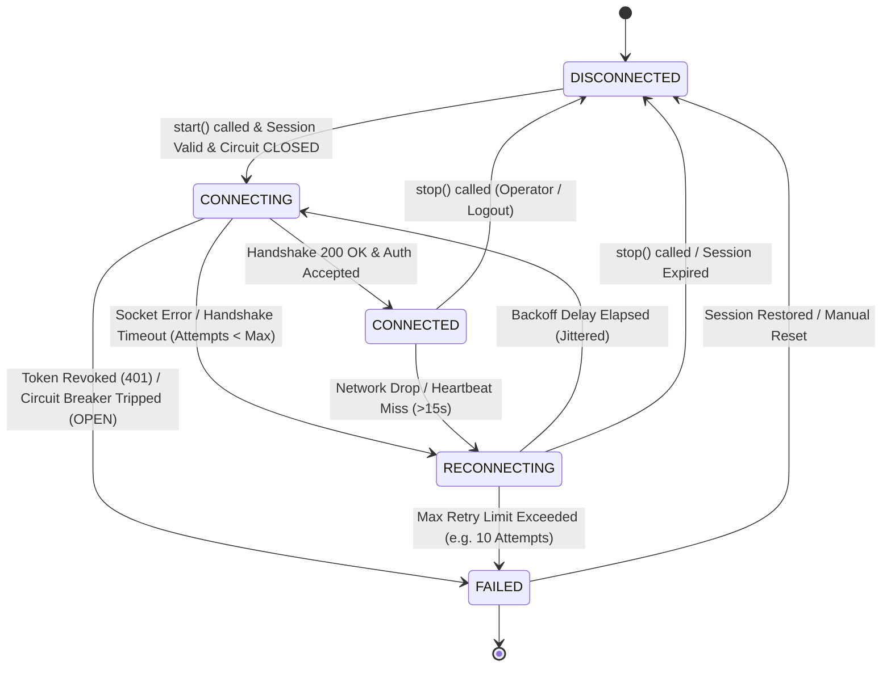

# Phase 4 Architectural Design Specification
## WebSocket Supervisor & Real-Time Connectivity Foundation

**Document Version:** 1.1.0  
**Phase:** Phase 4 — WebSocket Supervisor & Real-Time Connectivity Foundation  
**Target Milestone:** Milestone M2  
**Baseline Dependency:** Milestone M1 Baseline Locked & Tagged (`M1_BASELINE`, commit `4d9341a`)  
**Status:** Architectural Design (Pre-Implementation)  
**Implementation Constraint:** Design specification only — **Zero production code generated in this phase**.  

---

## Scope Exclusions (Strict Project Governance)

In compliance with the **Project Constitution**, the following trading and domain modules are **strictly excluded** from Phase 4:
- ❌ **No Market Watch**: No instrument master bulk sync or watchlist UI.
- ❌ **No Order Management**: No `place_order`, `modify_order`, or `cancel_order`.
- ❌ **No Portfolio Services**: No holdings, margin queries, or open positions.
- ❌ **No Derivatives Analytics**: No option chain matrix, strike resolution, or Greek computations.
- ❌ **No Tick Display / UI Visualization**: No web ticker components, charts, or browser socket rooms.

Phase 4 is dedicated exclusively to the **WebSocket Supervisor, Connection State Machine, Heartbeat Watchdog, Telemetry Metrics Tracking, Subscription Registry, Broker Circuit Breaker, and Cache TTL Engine**.

---

## 1. WebSocket Manager Architecture

### 1.1 Structural Overview
The WebSocket Supervisor acts as the autonomous lifecycle guardian for real-time binary streaming from Kotak Neo (`SFeed`). It isolates low-level asynchronous socket I/O from Flask's WSGI synchronous request threads, guaranteeing that streaming drops, network reconnects, and socket failures never block or destabilize the terminal application.

```
+-----------------------------------------------------------------------------------------------+
|                                    APPLICATION CONTEXT (Flask)                                |
|   BrokerSessionManager       EventBus (Pub/Sub)       AuditLogger       BrokerHealthService   |
+-------------------+--------------------+--------------------+--------------------+------------+
                    |                    ^                    ^                    ^
                    v                    |                    |                    |
+-------------------+--------------------+--------------------+--------------------+------------+
|                                    WEBSOCKET SUPERVISOR LAYER                                 |
|                                                                                               |
|  +-----------------------------------------------------------------------------------------+  |
|  |                            WebSocketSupervisor (Thread Guardian)                        |  |
|  |  - Background Daemon Thread running dedicated asyncio event loop                        |  |
|  |  - State transition coordinator (DISCONNECTED <-> CONNECTING <-> CONNECTED ...)        |  |
|  |  - Supervised Start, Stop, Pause, and Restart hooks                                     |  |
|  +--------------------------------------------+--------------------------------------------+  |
|                                               |                                               |
|         +-------------------------------------+-------------------------------------+         |
|         v                                     v                                     v         |
|  +--------------------------------+   +--------------------------------+   +---------------+  |
|  |       KotakStreamAdapter       |   |       SubscriptionManager      |   | CircuitBreaker|  |
|  | - Encapsulates SFeed WebSocket |   | - In-memory Scrip Token Index  |   | - 3-State     |  |
|  | - Binary Packet Framing        |   | - Reference counting (0 <-> 1) |   |   Protection  |  |
|  | - Token Auth Handshake         |   | - Quota Guard (<= 3,000 scrips)|   | - Cooldown    |  |
|  | - Exponential Backoff Loop     |   | - Auto-Resubscribe on Reconnect|   |   Trip Guard  |  |
|  +----------------+---------------+   +--------------------------------+   +---------------+  |
|                   |                                                                           |
|         +---------+---------+                                                                 |
|         v                   v                                                                 |
|  +----------------+  +--------------------------------+                                       |
|  |HeartbeatWatchdog| |  WebSocketTelemetryTracker     |                                       |
|  | - Ping / Pong  |  |  - Connection Count            |                                       |
|  | - 15s Timeout  |  |  - Reconnect Count             |                                       |
|  | - Hard Reset   |  |  - Heartbeat Miss Count        |                                       |
|  +----------------+  |  - Average Reconnect Time      |                                       |
|                      |  - Last Connected Time         |                                       |
|                      +--------------------------------+                                       |
+-----------------------------------------------------------------------------------------------+
                                                |
                                                v
                              [ Kotak Neo SFeed Streaming Server ]
```

### 1.2 Architectural Component Responsibilities

1. **`WebSocketSupervisor`**:
   - Spawns and manages a dedicated, isolated background thread running a Python `asyncio` event loop.
   - Binds to `BrokerSessionManager` events: automatically starts streaming when a broker session is established or recovered, and halts streaming when the broker session is destroyed or expires.
   - Enforces single-instance thread safety across all socket operations.

2. **`KotakStreamAdapter`**:
   - Conforms strictly to **Project Constitution Rule 1** (Broker SDK calls encapsulated within adapter layer).
   - Manages raw WebSocket connection to Kotak Neo's `SFeed` server using credentials passed from `BrokerSessionManager`.
   - Implements recursion-free, infinite-loop reconnection with randomized exponential backoff jitter.

3. **`WebSocketTelemetryTracker` (Explicit Metrics)**:
   - Tracks operational health metrics: **Connection Count**, **Reconnect Count**, **Heartbeat Miss Count**, **Average Reconnect Time**, and **Last Successful Connection Time**.
   - Maintains rolling window moving averages without memory accumulation.
   - Exposes diagnostic snapshots via thread-safe accessors for `/api/broker/status`.

4. **`SubscriptionManager`**:
   - Serves as the authoritative in-memory registry of all instrument tokens requested by the system.
   - Enforces Kotak Neo's platform limit of **3,000 concurrent scrip tokens**.
   - Maintains reference counting: tokens are only subscribed on the wire when their reference count increases from $0 \to 1$, and unsubscribed when count drops to $0$.
   - Automatically replays all active subscriptions upon socket reconnection.

5. **`BrokerCircuitBreaker` (Phase 3 Audit Item)**:
   - Tracks network and API failure rates over a sliding 30-second window.
   - Trips to `OPEN` after repeated consecutive connection failures, preventing connection storms and API rate-limiting penalties (HTTP 429).

6. **`HeartbeatWatchdog`**:
   - Schedules periodic ping frames and measures pong return latency.
   - Detects "silent-dead" half-open TCP connections and triggers forceful teardown and reconnection.

---

## 2. Connection State Machine

The WebSocket supervisor enforces an explicit 5-state deterministic state machine.



### 2.1 State Definitions & Invariants

| State | Description | Invariants & Operational Rules |
|---|---|---|
| `DISCONNECTED` | Socket is closed; background thread idle or stopped. | No network traffic; no active heartbeat timers; subscriptions remain registered in memory but unstreamed. |
| `CONNECTING` | TCP handshake and authentication framing in progress. | Timeout enforced at 10 seconds. Circuit breaker failure counter armed. |
| `CONNECTED` | WebSocket authenticated and streaming. | Heartbeat watchdog active; subscription replay completed; circuit breaker failure counter reset to 0; `connection_count` incremented. |
| `RECONNECTING` | Connection severed; scheduled for retry. | Non-blocking sleep with exponential backoff and jitter ($1\text{s}, 2\text{s}, 4\text{s}, \dots, 30\text{s}$). Subscriptions preserved; `reconnect_count` incremented. |
| `FAILED` | Unrecoverable failure or circuit breaker tripped. | Auto-retry suspended; terminal error logged to audit sink; requires operator intervention or session refresh. |

### 2.2 State Transition Matrix

| Current State | Event / Trigger | Target State | Action / Side Effect |
|---|---|---|---|
| `DISCONNECTED` | `SUPERVISOR_START` | `CONNECTING` | Verify broker session; check Circuit Breaker; spawn async worker. |
| `CONNECTING` | `AUTH_SUCCESS` | `CONNECTED` | Emit `WS_CONNECTED`; start HeartbeatWatchdog; record `last_connected_time`; increment `connection_count`; compute reconnect duration if recovering. |
| `CONNECTING` | `HANDSHAKE_TIMEOUT` | `RECONNECTING` | Record failure in Circuit Breaker; start reconnect stopwatch; emit `WS_RECONNECTING`. |
| `CONNECTING` | `AUTH_REJECTED_401` | `FAILED` | Publish `BROKER_SESSION_EXPIRED`; trip Circuit Breaker; emit `WS_FAILED`. |
| `CONNECTED` | `SOCKET_CLOSED` | `RECONNECTING` | Increment `reconnect_count`; start reconnect stopwatch; cancel heartbeat timer; schedule reconnect. |
| `CONNECTED` | `HEARTBEAT_TIMEOUT` | `RECONNECTING` | Increment `heartbeat_miss_count`; force close TCP socket; emit `WS_HEARTBEAT_MISSED`; schedule reconnect. |
| `CONNECTED` | `SUPERVISOR_STOP` | `DISCONNECTED` | Clean WS close (code 1000); cancel tasks; emit `WS_DISCONNECTED`. |
| `RECONNECTING` | `BACKOFF_EXPIRED` | `CONNECTING` | Increment attempt counter; initiate fresh socket handshake. |
| `RECONNECTING` | `MAX_ATTEMPTS_EXCEEDED`| `FAILED` | Trip Circuit Breaker to `OPEN`; emit `WS_FAILED`; audit failure. |
| `FAILED` | `CIRCUIT_RESET` | `DISCONNECTED` | Ready for next start request. |

---

## 3. Heartbeat Framework

### 3.1 Design Principles
Real-time trading connections frequently suffer from **half-open TCP sockets**—where the local operating system believes the socket is alive, but intermediate network infrastructure (firewalls, NAT gateways, cellular towers) has dropped the connection without sending a `FIN`/`RST` packet.

### 3.2 Liveness Specifications
- **Ping Frequency ($T_{\text{ping}}$)**: 5 seconds.
- **Heartbeat Timeout ($T_{\text{timeout}}$)**: 15 seconds.
- **Miss Threshold ($N_{\text{miss}}$)**: 3 consecutive missed heartbeat intervals.

### 3.3 Heartbeat Workflow
1. The `HeartbeatWatchdog` maintains `last_rx_timestamp` (updated upon receiving any valid data frame, tick, or pong frame).
2. Every 5 seconds, an async timer evaluates:
   $$\Delta t = t_{\text{current}} - t_{\text{last\_rx}}$$
3. If $\Delta t > 5\text{s}$, the supervisor transmits an explicit application ping frame to Kotak SFeed.
4. If $\Delta t \ge 15\text{s}$, the watchdog declares the connection dead:
   - Increments `heartbeat_miss_count` on `WebSocketTelemetryTracker`.
   - Emits audit log: `[AUDIT:BROKER] WS_HEARTBEAT_TIMEOUT`.
   - Forcibly calls `socket.close()` with abortive TCP reset.
   - Transitions state machine to `RECONNECTING`.

---

## 4. WebSocket Telemetry & Explicit Metrics Tracking

To guarantee complete visibility into socket stability, connection health, and carrier latency during live market sessions, the supervisor integrates a dedicated telemetry tracker.

### 4.1 Tracked Metrics Specification

| Metric Name | Identifier | Data Type | Initialization | Calculation & Update Trigger |
|---|---|---|---|---|
| **Connection Count** | `connection_count` | `Integer` | `0` | Incremented by 1 every time the socket successfully transitions to `CONNECTED` (both initial connection and recoveries). |
| **Reconnect Count** | `reconnect_count` | `Integer` | `0` | Incremented by 1 every time the socket transitions from `CONNECTED` to `RECONNECTING` due to dropped sockets, network drops, or timeouts. |
| **Heartbeat Miss Count** | `heartbeat_miss_count` | `Integer` | `0` | Incremented by 1 each time the 15-second heartbeat silence threshold is breached without receiving a data tick or pong. |
| **Average Reconnect Time** | `avg_reconnect_time_ms` | `Float` | `0.0` | Cumulative Moving Average (CMA) of time elapsed between entering `RECONNECTING` and successfully re-entering `CONNECTED`. |
| **Last Successful Connection Time** | `last_connected_time` | `ISO-8601 String / UTC datetime` | `None` | Stored upon every successful transition to `CONNECTED`. |

### 4.2 Mathematical Model for Average Reconnect Time
To avoid unbounded memory growth from storing individual reconnect duration arrays, the tracker calculates a **Cumulative Moving Average (CMA)**:

$$\bar{T}_{k} = \bar{T}_{k-1} + \frac{T_{k} - \bar{T}_{k-1}}{k}$$

Where:
- $k$ is the current successful reconnection index.
- $T_{k}$ is the duration (in milliseconds) of the $k$-th reconnection attempt:
  $$T_{k} = (t_{\text{connected}} - t_{\text{reconnect\_start}}) \times 1000$$
- $\bar{T}_{k}$ is the updated `avg_reconnect_time_ms`.

### 4.3 Data Structure & Encapsulation
```python
@dataclass
class WebSocketMetrics:
    connection_count: int = 0
    reconnect_count: int = 0
    heartbeat_miss_count: int = 0
    avg_reconnect_time_ms: float = 0.0
    last_connected_time: Optional[str] = None
    total_reconnect_samples: int = 0
    current_reconnect_start: Optional[float] = None
```

### 4.4 Diagnostic Payload Exposure
The telemetry snapshot is exposed via `BrokerHealthService` and the diagnostic route `GET /api/broker/status`:

```json
{
  "status": "AUTHENTICATED",
  "streaming": {
    "state": "CONNECTED",
    "metrics": {
      "connection_count": 4,
      "reconnect_count": 3,
      "heartbeat_miss_count": 1,
      "avg_reconnect_time_ms": 1420.50,
      "last_connected_time": "2026-11-06T05:14:32.105420+00:00"
    }
  }
}
```

---

## 5. Subscription Manager

### 5.1 Quota & Concurrency Governance
Kotak Neo strictly enforces a **maximum quota of 3,000 concurrent scrip tokens per WebSocket connection**. Violating this limit results in broker-side socket termination.

### 5.2 Reference Counting Model
Multiple future terminal modules (e.g. Market Watch, Strategy Engine, Risk Monitor) may independently request streaming for identical instruments (e.g. `NSE:RELIANCE` or `NFO:NIFTY26OCT24000CE`).
- `SubscriptionManager` maintains:
  ```python
  token_registry: Dict[str, SubscriptionEntry]
  ```
  Where `SubscriptionEntry` tracks:
  - `token_id`: Kotak Neo unique scrip identifier (e.g. `"11536"`).
  - `exchange_segment`: Exchange segment string (`"nse_cm"`, `"nse_fo"`, etc.).
  - `ref_count`: Number of active system components subscribing to this scrip.
  - `subscribed_at`: UTC timestamp of initial wire subscription.

### 5.3 Subscription Logic & Quota Enforcement
```
Component Requests Token T
            |
            v
  Token T in Registry?
     |              |
   (Yes)           (No)
     |              |
     v              v
Ref Count += 1   Current Total < 3000?
(No wire call)      |              |
                  (Yes)           (No)
                    |              |
                    v              v
             Ref Count = 1    Reject with QuotaExceededException
             Send ws.subscribe()
```

### 5.4 Automated Resubscription on Reconnection
When the WebSocket connection drops and recovers (`RECONNECTING` $\to$ `CONNECTED`), the `SubscriptionManager`:
1. Collects all registered tokens where `ref_count > 0`.
2. Batches tokens into chunks of 500 scrips to prevent packet fragmentation.
3. Transmits batch subscription frames in sequence.
4. Verifies broker subscription acknowledgments (`ack_symbol: true`).

---

## 6. Broker Circuit Breaker (Phase 3 Carry-Forward)

### 6.1 Motivation & Rationale
During severe broker maintenance windows or exchange matching engine outages, naive algorithmic trading terminals repeatedly hammer broker endpoints with reconnect attempts, resulting in IP bans, API rate-limiting (HTTP 429), and CPU saturation.

### 6.2 Circuit Breaker Specification

```
+-------------------------------------------------------------------------+
|                               CLOSED (Normal)                           |
|       - Requests and connections execute normally                       |
|       - Consecutive failures counted in sliding 30-second window       |
+------------------------------------+------------------------------------+
                                     |
               Failures >= 3 or Error Rate >= 50% over 10 calls
                                     |
                                     v
+-------------------------------------------------------------------------+
|                                OPEN (Tripped)                           |
|       - Fail-fast immediately without touching network                  |
|       - Raises BrokerCircuitBreakerOpenException                        |
|       - Enforces cooldown timeout: 30 seconds                           |
+------------------------------------+------------------------------------+
                                     |
                           Cooldown timer expires
                                     |
                                     v
+-------------------------------------------------------------------------+
|                              HALF-OPEN (Canary)                         |
|       - Allows exactly 1 canary connection attempt                      |
|       - Success -> Transitions to CLOSED (Reset failure count)          |
|       - Failure -> Transitions to OPEN (Cooldown doubled to 60s)        |
+-------------------------------------------------------------------------+
```

### 6.3 Configuration Parameters
- `CIRCUIT_FAILURE_THRESHOLD = 3` (consecutive failures to trip).
- `CIRCUIT_WINDOW_SECONDS = 30` (rolling evaluation window).
- `CIRCUIT_COOLDOWN_SECONDS = 30` (quarantine duration).
- `CIRCUIT_HALF_OPEN_CANARY_COUNT = 1` (trial requests).

---

## 7. Cache TTL Design (Phase 3 Carry-Forward)

### 7.1 Motivation & Rationale
Phase 3 introduced `BrokerCache` with thread-safe `threading.RLock`, but cached entries (capabilities, session metadata) lacked automated time-to-live expiration policies, requiring manual purging.

### 7.2 TTL Architecture & Policy Matrix

`BrokerCache` will be upgraded with segmented, timestamped entries:

| Cache Partition | TTL Duration | Eviction Policy | Rationale |
|---|---|---|---|
| `capabilities` | **24 Hours** (`86,400s`) | Lazy on-read + Daily refresh | Exchange segment rules change only on daily scrip master cycles. |
| `session_meta` | **8 Hours** (`28,800s`) | Sliding TTL + Session sync | Matches Kotak Neo token lifespan. |
| `health_stats` | **5 Seconds** (`5s`) | Aggressive eviction | Latency and diagnostic states must reflect near-real-time reality. |

### 7.3 Mechanics
1. **Entry Envelope**: Each cached item is stored as:
   ```python
   CacheEntry(value=Any, expires_at=datetime, created_at=datetime)
   ```
2. **Lazy Read-Time Eviction**: When `get(key)` is invoked:
   - If `UTC_NOW > entry.expires_at`, discard the item, emit debug log, and return `None`.
3. **Active Sweeper Task**: A lightweight cleanup method runs during low-frequency health checks to evict orphaned stale entries.
4. **Data Isolation**: Tick data, order books, and depth quotes are **strictly prohibited** from `BrokerCache`.

---

## 8. Event Bus Integration

Phase 4 defines and integrates the following asynchronous events into `app/events/event_types.py`:

```python
# Phase 4 Real-Time & Streaming Events
WS_STATE_CHANGED = "WS_STATE_CHANGED"
WS_CONNECTED = "WS_CONNECTED"
WS_DISCONNECTED = "WS_DISCONNECTED"
WS_HEARTBEAT_MISSED = "WS_HEARTBEAT_MISSED"
WS_SUBSCRIPTION_ADDED = "WS_SUBSCRIPTION_ADDED"
WS_SUBSCRIPTION_REMOVED = "WS_SUBSCRIPTION_REMOVED"
CIRCUIT_BREAKER_TRIPPED = "CIRCUIT_BREAKER_TRIPPED"
CIRCUIT_BREAKER_RESET = "CIRCUIT_BREAKER_RESET"
```

### 8.1 Event Payloads & Decoupling Contracts
- `WS_STATE_CHANGED`:
  ```json
  {
    "previous_state": "CONNECTING",
    "current_state": "CONNECTED",
    "timestamp": "2026-11-06T05:00:00.000000+00:00",
    "details": "Handshake 200 OK",
    "connection_count": 1
  }
  ```
- `CIRCUIT_BREAKER_TRIPPED`:
  ```json
  {
    "breaker": "KOTAK_STREAMING",
    "state": "OPEN",
    "consecutive_failures": 3,
    "cooldown_seconds": 30,
    "timestamp": "2026-11-06T05:00:15.000000+00:00"
  }
  ```

---

## 9. Session Recovery Integration

### 9.1 Seamless Handshake with Phase 3 Session Lifecycle
The `WebSocketSupervisor` hooks directly into the Phase 3 `BrokerSessionManager`:

1. **Terminal Cold-Start / Recovery**:
   - `BrokerSessionManager.restore_session(user_id, adapter)` recovers and validates the decrypted token against Kotak Neo REST API.
   - Upon dispatch of `BROKER_SESSION_RESTORED`, `WebSocketSupervisor` receives the notification, retrieves the valid session token, and automatically transitions `DISCONNECTED` $\to$ `CONNECTING`.
2. **Broker Session Revocation / Expiration**:
   - If `BrokerSessionManager` detects session expiry or the broker returns HTTP 401, it fires `BROKER_SESSION_EXPIRED`.
   - `WebSocketSupervisor` immediately shuts down the WebSocket connection with close code 1000, cancels backoff reconnection loops, and transitions to `DISCONNECTED` with reason `"BROKER_SESSION_EXPIRED"`.
   - Prevents unauthorized socket spamming with dead tokens.

---

## 10. Database Changes

### 10.1 Zero Database Alterations Required
In strict alignment with the **Project Constitution**:
- Real-time streaming states (`CONNECTING`, `CONNECTED`, `RECONNECTING`) are **volatile and transient**.
- Active subscription counts and reference counts exist strictly in memory.
- Network latency metrics and heartbeat miss counters are diagnostic.
- Storing high-frequency socket states in SQLite would cause severe disk I/O bottlenecks and transaction lock contention.

> [!NOTE]
> **Database Revision Status**: The database schema remains locked at **`6b0dd678a5e4 (head)`**. Zero Alembic migrations are required for Phase 4.

---

## 11. Test Strategy

To guarantee enterprise-grade reliability, Phase 4 will employ a comprehensive four-tier testing strategy:

### 11.1 Unit Testing Suite (`tests/unit/test_websocket_supervisor.py`)
- **State Machine Verification**: Test all valid and invalid transitions (e.g. verifying `CONNECTED` cannot jump directly to `DISCONNECTED` without clean shutdown).
- **Heartbeat Expiration**: Fast-forward mock timestamps to simulate 15-second silence; verify watchdog triggers abortive socket closure and increments `heartbeat_miss_count`.
- **Subscription Registry & Reference Counting**:
  - Test adding token $T_1$ twice; verify `ref_count == 2` and wire call invoked exactly once.
  - Test decrementing to 0; verify unsubscribe invoked.
  - Test quota violation (>3,000 tokens); verify `QuotaExceededException` raised.

### 11.2 Telemetry Metrics Suite (`tests/unit/test_websocket_telemetry.py`)
- **Metric Increment Verification**: Verify `connection_count` increments on initial connect and every reconnect.
- **Reconnect Counting**: Verify `reconnect_count` increments on unexpected disconnects.
- **Heartbeat Miss Increment**: Verify `heartbeat_miss_count` increments on watchdog timeouts.
- **CMA Calculation Accuracy**: Simulate 3 reconnect cycles with known durations (e.g. 1000ms, 2000ms, 1500ms); verify `avg_reconnect_time_ms == 1500.0`.
- **Timestamp Integrity**: Verify `last_connected_time` matches UTC ISO-8601 format and updates on each successful connection.

### 11.3 Circuit Breaker Suite (`tests/unit/test_circuit_breaker.py`)
- Test consecutive failure accumulation.
- Verify transition from `CLOSED` to `OPEN` after 3 failures.
- Verify fail-fast behavior in `OPEN` state (zero network calls executed).
- Test cooldown expiry transition to `HALF-OPEN` and subsequent recovery on successful canary attempt.

### 11.4 Cache TTL Suite (`tests/unit/test_cache_ttl.py`)
- Test lazy eviction of expired items on read.
- Test concurrency and thread safety under simultaneous multi-threaded reads and writes using `threading.RLock`.

### 11.5 Mock Asynchronous Integration Suite (`tests/integration/test_stream_integration.py`)
- Implement a mock asynchronous WebSocket server using `pytest-asyncio` and `websockets`.
- Simulate complete session restoration $\to$ socket handshake $\to$ subscription replay $\to$ disconnect $\to$ exponential backoff reconnect $\to$ metrics verification.

---

## 12. Rollback Strategy

Because Phase 4 introduces **zero database schema changes**, rollback is instantaneous, deterministic, and safe:

1. **Stop Active Streaming Tasks**:
   - Gracefully invoke `WebSocketSupervisor.stop()` to close open sockets and terminate background threads.
2. **Git Rollback**:
   - Reset the working tree cleanly to the immutable Milestone M1 tag:
     ```bash
     git checkout main
     git reset --hard M1_BASELINE
     ```
3. **Verification**:
   - Run the locked M1 test suite to confirm 100% baseline operational status:
     ```bash
     pytest -v
     ```
   - Schema remains at `6b0dd678a5e4` with zero migration downgrade needed.

---

## 13. Architectural Compliance & Sign-Off Checklist

| Requirement | Implementation Strategy in Phase 4 Design | Compliance |
|---|---|---|
| **No SDK Leakage** | `KotakStreamAdapter` strictly encapsulates all streaming SDK calls | **YES** (Rule 1) |
| **Audit Everything** | State transitions and disconnects logged under `AuditCategory.BROKER` | **YES** (Rule 2) |
| **State Recovery** | Auto-resubscribes active token registry upon reconnect | **YES** (Rule 3) |
| **Circuit Breaker** | 3-state sliding-window breaker prevents API storming | **YES** (Audit Carry-Forward) |
| **Cache TTL** | Dual-layer TTL with lazy expiration in `BrokerCache` | **YES** (Audit Carry-Forward) |
| **Explicit Telemetry** | Connection Count, Reconnect Count, Heartbeat Miss Count, Avg Reconnect Time, Last Connected Time | **YES** (Section 4) |
| **Zero Orders** | No order endpoints or methods designed | **STRICT COMPLIANCE** |
| **Zero Market Watch** | No scrip master sync or live display rooms designed | **STRICT COMPLIANCE** |
| **Zero Holdings/Positions** | No portfolio retrieval designed | **STRICT COMPLIANCE** |
| **Zero Code in Spec Turn** | Design specification only; no executable Python code generated | **STRICT COMPLIANCE** |

---

*Phase 4 Design Specification v1.1.0 complete. Awaiting user review and authorization before generating implementation tasks.*
