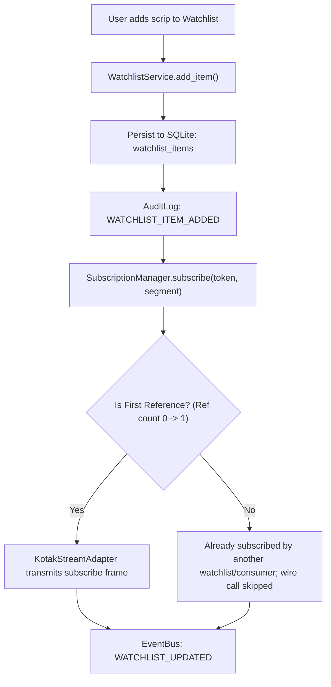

# Phase 5 Architectural Design Specification
## Market Watch Foundation

**Document Version:** 1.0.0  
**Phase:** Phase 5 — Market Watch Foundation  
**Target Milestone:** Milestone M2  
**Baseline Dependency:** Milestone M1 Baseline Locked & Tagged (`M1_BASELINE`, commit `4d9341a`), Phase 4 Streaming Foundation Complete (`d4d9cb5`)  
**Status:** Architectural Design (Pre-Implementation)  
**Implementation Constraint:** **Design specification only — Zero production code generated in this phase**.  

---

## Scope Exclusions (Strict Project Governance)

In compliance with the **PROJECT_CONSTITUTION** and explicit user instructions, the following trading and domain modules are **strictly excluded** from Phase 5:
- ❌ **No Order Placement**: No `place_order`, `modify_order`, `cancel_order`, or execution buffers.
- ❌ **No Holdings**: No portfolio holdings sync, demat balances, or unrealized long-term P&L.
- ❌ **No Positions**: No open position tracking, intraday MTM calculations, or auto-square-off watchers.
- ❌ **No Option Chain**: No option chain matrix tables, multi-strike scrapers, or IV/Greek calculation engines.
- ❌ **No Order Baskets**: No multi-leg order basket builders or margin-benefit sequencers.

Phase 5 is dedicated exclusively to the **Market Watch Foundation**: Daily Scrip Master synchronization, fast token search/indexing, multi-watchlist management, real-time touchline tick ingestion, exchange price scaling, and memory-cached quote distribution.

---

## 1. Executive Summary & Architectural Objectives

Phase 4 established the **WebSocket Supervisor** and real-time connectivity layer with automated heartbeat monitoring, circuit breaker isolation, and subscription registry batching. 

Phase 5 builds directly on this foundation by establishing the terminal's **Market Watch Engine**. A robust market watch is the primary sensory organ of any trading system:
1. **Instrument Master Synchronization**: Automated, resilient ingestion and indexing of official Kotak Neo exchange master files (`nse_cm`, `bse_cm`, `nse_fo`, `bse_fo`).
2. **Sub-millisecond Search & Filtering**: Fast in-memory token lookup supporting fuzzy trading symbol, company name, exchange segment, and scrip token queries.
3. **Dynamic Multi-Watchlist Domain**: Persistent user-defined watchlists with reordering, scrip addition/removal, and quota enforcement.
4. **Real-time Price Stream Ingestion**: Seamless bridging between the Phase 4 `SubscriptionManager`, Kotak Neo `SFeed` touchline packets, exchange price scaling (dividers), and an in-memory LTP/OHLC cache.
5. **Special Index Handling**: Dedicated handling for spot indices (`Nifty 50`, `NIFTY BANK`, `SENSEX`) adhering to Kotak Neo SFeed protocol specifications (exact name strings, `change` field parsing).

---

## 2. High-Level System Architecture

```
+---------------------------------------------------------------------------------------------------+
|                                      PRESENTATION & REST API                                      |
|    GET /api/marketwatch/search            GET /api/marketwatch/watchlists                         |
|    GET /api/marketwatch/quotes            POST /api/marketwatch/watchlists                        |
|    POST /api/marketwatch/watchlists/<id>/items   DELETE /api/marketwatch/watchlists/<id>/items/<item_id>  |
+-------------------------------------------------+-------------------------------------------------+
                                                  |
                                                  v
+---------------------------------------------------------------------------------------------------+
|                                    MARKET WATCH SERVICE LAYER                                     |
|                                                                                                   |
|   +------------------------------------+             +----------------------------------------+   |
|   |         WatchlistService           |             |           InstrumentService            |   |
|   | - Multi-watchlist CRUD & ordering  |             | - Daily Scrip Master Sync (Kotak Neo)  |   |
|   | - Quota Guard (<= 50 scrips/list)  |             | - In-memory Prefix & Token Trie/Index  |   |
|   | - Dynamic Wire Subscription Hook   |             | - Fast Search (Symbol/Token/Segment)   |   |
|   +-----------------+------------------+             +-------------------+--------------------+   |
|                     |                                                    |                        |
|                     v                                                    v                        |
|   +-------------------------------------------------------------------------------------------+   |
|   |                                  MarketWatchPriceEngine                                   |   |
|   | - Ingests SFeedScrip & SFeedIndex binary frames from KotakStreamAdapter                   |   |
|   | - Applies Exchange Price Dividers (Scalers) to raw integer prices                         |   |
|   | - Non-blocking In-Memory LTP / Touchline Cache (LTP, OHLC, Volume, Net Change)            |   |
|   | - Special Index Normalizer ("Nifty 50", "NIFTY BANK", "SENSEX")                           |   |
|   +-----------------+----------------------------------------------------+--------------------+   |
+---------------------+----------------------------------------------------+------------------------+
                      |                                                    |
                      v (Subscribe / Unsubscribe)                          v (LTP Updates)
+------------------------------------+             +------------------------------------------------+
|        PHASE 4 FOUNDATION          |             |                CORE FOUNDATION                 |
|  SubscriptionManager (Ref-counted) |             |  EventBus: WATCHLIST_UPDATED, TICK_INGESTED    |
|  WebSocketSupervisor (Async Loop)  |             |  AuditLogger: WATCHLIST_MUTATION, SCRIP_SYNC   |
|  BrokerCache (Partitioned TTL)     |             |  SQLite Database: watchlists, watchlist_items  |
+------------------------------------+             +------------------------------------------------+
```

---

## 3. Detailed Component Design

### 3.1. Scrip Master & Instrument Search Architecture

Kotak Neo publishes daily updated instrument master lists containing security tokens, lot sizes, tick sizes, trading symbols, and segment identifiers.

#### 3.1.1. Ingestion Strategy
- **Ground Truth Source**: Kotak Neo official daily scrip master endpoints (`https://lapi.kotakneo.com/` or official S3 master download URLs per segment: `nse_cm.csv`, `bse_cm.csv`, `nse_fo.csv`, `bse_fo.csv`).
- **Cache-First Local Storage**: Scrip files are downloaded once per trading day ($T-0$) during the morning initialization pre-warmup. Compressed parquet or indexed SQLite backing stores ensure fast reboot times (< 1.5 seconds) without re-downloading across terminal restarts.
- **Master Schema Fields**:
  - `instrument_token` (String, PK in search index, e.g., `"26000"`, `"11536"`)
  - `exchange_segment` (String, e.g., `"nse_cm"`, `"bse_cm"`, `"nse_fo"`, `"bse_fo"`)
  - `trading_symbol` (String, e.g., `"RELIANCE-EQ"`, `"NIFTY24DEC24500CE"`)
  - `symbol_name` (String, e.g., `"RELIANCE"`, `"NIFTY"`)
  - `display_name` (String, e.g., `"Reliance Industries Ltd"`)
  - `lot_size` (Integer, e.g., `1` for equity, `25` for NIFTY)
  - `tick_size` (Float, e.g., `0.05`)
  - `instrument_type` (String, e.g., `"EQ"`, `"INDEX"`, `"FUTIDX"`, `"OPTIDX"`)
  - `expiry_date` (Optional Date, e.g., `"2024-12-26"`)
  - `strike_price` (Optional Float, e.g., `24500.0`)
  - `option_type` (Optional String, e.g., `"CE"`, `"PE"`)

#### 3.1.2. In-Memory Search Indexing
- **Structure**: Bi-directional in-memory dictionary and prefix tree (Trie) enabling sub-millisecond search across >100,000 instruments:
  - `_by_token: Dict[Tuple[str, str], Instrument]`
  - `_by_symbol: Dict[str, List[Instrument]]`
  - `_prefix_index: Dict[str, Set[Tuple[str, str]]]`
- **Query Optimization**: Queries like `?q=RELI&segment=nse_cm` match prefixes in $<2\text{ms}$ returning ranked results (Equity first, then active Futures, sorted by liquidity).

---

### 3.2. Multi-Watchlist Domain Model

Users can manage multiple customizable watchlists (e.g., `"Indices"`, `"Main Portfolio"`, `"Breakout Watch"`).

#### 3.2.1. Watchlist Constraints & Safeguards
- **Max Watchlists per User**: 10 watchlists.
- **Max Scrips per Watchlist**: 50 instruments (preventing UI overwhelm and keeping domestic wire subscriptions compact).
- **Duplicate Prevention**: Unique constraint on `(watchlist_id, instrument_token, exchange_segment)`.
- **Display Order**: Integer `position` field allows drag-and-drop or user reordering.

#### 3.2.2. Dynamic Wire Subscription Lifecycle
When a user adds or removes a scrip:


Conversely, when an item is removed from a watchlist, `SubscriptionManager.unsubscribe(token, segment)` is invoked. Only when reference count drops to 0 is an upstream wire unsubscription frame transmitted.

---

### 3.3. Real-Time Price Ingestion Engine (`MarketWatchPriceEngine`)

The price engine ingests raw tick packets emitted by Kotak Neo `SFeed` WebSocket via `KotakStreamAdapter`.

#### 3.3.1. Kotak Neo SFeed Packet Architecture & Scalers
Kotak Neo broadcasts prices as fixed-point integers to save bandwidth. Scalers (dividers) must be applied systematically:

| Segment | Raw LTP Format | Divider | Resulting Price Precision |
|---|---|---|---|
| `nse_cm` | Integer (e.g., `254050`) | `100.0` | `2540.50` (2 decimals) |
| `bse_cm` | Integer (e.g., `7850000`) | `100.0` | `78500.00` (2 decimals) |
| `nse_fo` | Integer (e.g., `12450`) | `100.0` | `124.50` (2 decimals) |
| `bse_fo` | Integer (e.g., `5400`) | `100.0` | `54.00` (2 decimals) |
| `cde_fo` (Currency) | Integer (e.g., `834525`) | `10000.0` | `83.4525` (4 decimals) |

#### 3.3.2. Special Spot Index Handling (Cardinal Rule)
Per the verified Kotak Neo SDK guidelines:
1. **Subscription Token Format**: Indices cannot be subscribed via numeric exchange tokens. They **must** be subscribed using their exact index name strings:
   - `"Nifty 50"` (not `"26000"`)
   - `"Nifty Bank"` (not `"26001"`)
   - `"SENSEX"` (not `"1"`)
2. **Payload Parsing Quirk**: In `SFeedIndex` packets, the net price change attribute is named `change`, **not** `net_change`. The `MarketWatchPriceEngine` must explicitly normalize `change` into standard terminal touchline models.

#### 3.3.3. In-Memory Quote/LTP Snapshot Structure
```python
@dataclass
class MarketQuote:
    instrument_token: str
    exchange_segment: str
    trading_symbol: str
    ltp: float
    open: float
    high: float
    low: float
    close: float
    volume: int
    net_change: float
    percent_change: float
    last_trade_time: Optional[str]
    bid: float
    ask: float
    bid_qty: int
    ask_qty: int
    updated_at: float  # epoch timestamp
```
- **Thread Safety**: Backed by a fine-grained `threading.RLock()` ensuring lock contention between high-frequency socket writes and REST API reads is $< 0.05\text{ms}$.

---

## 4. Database Schema Changes

Phase 5 requires two new relational tables managed via **Alembic migration `003_create_market_watch_tables.py`**.

### 4.1. `watchlists` Table

Stores top-level watchlist containers belonging to users.

| Column | Type | Constraints | Description |
|---|---|---|---|
| `id` | `VARCHAR(36)` | PK, Not Null | Unique UUID primary key |
| `user_id` | `VARCHAR(36)` | FK -> `users.id`, Not Null, Indexed | Owner of the watchlist |
| `name` | `VARCHAR(64)` | Not Null | User-visible watchlist name (e.g., "Nifty 50") |
| `position` | `INTEGER` | Not Null, Default `0` | UI display ordering index |
| `is_default` | `BOOLEAN` | Not Null, Default `False` | True if primary default watchlist |
| `created_at` | `DATETIME` | Not Null | Creation timestamp (UTC) |
| `updated_at` | `DATETIME` | Not Null | Last update timestamp (UTC) |

**Constraints & Indexes**:
- Index: `ix_watchlists_user_id` on `(user_id)`
- Unique Index: `uix_watchlists_user_name` on `(user_id, name)`

### 4.2. `watchlist_items` Table

Stores individual instrument scrips pinned inside a watchlist.

| Column | Type | Constraints | Description |
|---|---|---|---|
| `id` | `VARCHAR(36)` | PK, Not Null | Unique UUID primary key |
| `watchlist_id` | `VARCHAR(36)` | FK -> `watchlists.id` (ON DELETE CASCADE), Not Null, Indexed | Parent watchlist reference |
| `instrument_token` | `VARCHAR(32)` | Not Null, Indexed | Broker exchange instrument token |
| `exchange_segment` | `VARCHAR(16)` | Not Null | Segment code (`nse_cm`, `bse_cm`, etc.) |
| `trading_symbol` | `VARCHAR(64)` | Not Null | Canonical exchange symbol |
| `display_name` | `VARCHAR(128)` | Nullable | Human-friendly scrip name |
| `position` | `INTEGER` | Not Null, Default `0` | Row position within the watchlist |
| `created_at` | `DATETIME` | Not Null | Row creation timestamp (UTC) |

**Constraints & Indexes**:
- Index: `ix_watchlist_items_watchlist_id` on `(watchlist_id)`
- Index: `ix_watchlist_items_token_seg` on `(instrument_token, exchange_segment)`
- Unique Constraint: `uix_watchlist_item_unique` on `(watchlist_id, instrument_token, exchange_segment)`

---

## 5. Event Bus & Audit Integration

### 5.1. Event Bus Constants (`app/events/event_types.py`)

| Event Constant | Channel Name | Payload Description |
|---|---|---|
| `WATCHLIST_CREATED` | `"watchlist.created"` | `{"watchlist_id": str, "user_id": str, "name": str}` |
| `WATCHLIST_DELETED` | `"watchlist.deleted"` | `{"watchlist_id": str, "user_id": str}` |
| `WATCHLIST_ITEM_ADDED` | `"watchlist.item_added"` | `{"watchlist_id": str, "instrument_token": str, "exchange_segment": str}` |
| `WATCHLIST_ITEM_REMOVED` | `"watchlist.item_removed"` | `{"watchlist_id": str, "instrument_token": str, "exchange_segment": str}` |
| `SCRIP_MASTER_SYNCED` | `"marketwatch.scrip_master_synced"` | `{"total_instruments": int, "segments": List[str], "timestamp": str}` |
| `PRICE_TICK_INGESTED` | `"marketwatch.tick_ingested"` | `{"token": str, "segment": str, "ltp": float, "percent_change": float}` |

### 5.2. Audit Trail Actions (`app/core/audit.py`)

All watchlist management actions are recorded in the audit trail linked to the user's active session and correlation IDs:
- `WATCHLIST_CREATED`: Logged when a new watchlist container is created.
- `WATCHLIST_DELETED`: Logged when a watchlist is removed.
- `WATCHLIST_ITEM_ADDED`: Logged when an instrument is pinned.
- `WATCHLIST_ITEM_REMOVED`: Logged when an instrument is unpinned.
- `SCRIP_MASTER_DOWNLOAD`: Logged when daily master sync completes or fails.

---

## 6. REST API Design Specification

A dedicated blueprint `marketwatch_bp` (`/api/marketwatch/`) will be introduced:

### 6.1. Scrip Search & Lookup
- `GET /api/marketwatch/search`:
  - **Query Params**: `q` (Search query string, min 2 chars), `segment` (Optional: `nse_cm`, `nse_fo`), `limit` (Default 20, max 50).
  - **Response `200 OK`**:
    ```json
    {
      "success": true,
      "results": [
        {
          "instrument_token": "11536",
          "exchange_segment": "nse_cm",
          "trading_symbol": "TCS-EQ",
          "display_name": "Tata Consultancy Services Ltd",
          "lot_size": 1,
          "tick_size": 0.05
        }
      ]
    }
    ```

### 6.2. Watchlist Management
- `GET /api/marketwatch/watchlists`: Return all watchlists for authenticated user with their items and cached LTPs.
- `POST /api/marketwatch/watchlists`: Create a new watchlist (`{"name": "Banking"}`).
- `DELETE /api/marketwatch/watchlists/<watchlist_id>`: Delete watchlist and auto-unsubscribe orphaned items.
- `POST /api/marketwatch/watchlists/<watchlist_id>/items`: Add instrument (`{"instrument_token": "26000", "exchange_segment": "nse_cm", "trading_symbol": "Nifty 50"}`).
- `DELETE /api/marketwatch/watchlists/<watchlist_id>/items/<item_id>`: Remove instrument from watchlist.
- `PUT /api/marketwatch/watchlists/<watchlist_id>/reorder`: Reorder items (`{"item_ids": ["uuid-1", "uuid-2"]}`).

### 6.3. Real-Time Quotes Snapshot
- `GET /api/marketwatch/quotes`:
  - **Query Params**: `tokens=nse_cm:26000,nse_cm:11536`
  - **Response `200 OK`**:
    ```json
    {
      "success": true,
      "quotes": {
        "nse_cm:26000": {
          "trading_symbol": "Nifty 50",
          "ltp": 24350.60,
          "open": 24280.00,
          "high": 24385.20,
          "low": 24250.10,
          "close": 24200.00,
          "net_change": 150.60,
          "percent_change": 0.62,
          "volume": 0,
          "updated_at": 1730894000.123
        }
      }
    }
    ```

---

## 7. Testing Strategy

Phase 5 implementation will be validated through comprehensive automated tests:

### 7.1. Unit Testing
1. **Instrument Search & Trie Indexing**:
   - Verify prefix matching, exact token resolution, segment filtering, and result ranking.
   - Benchmark: $< 5\text{ms}$ search latency over 100,000 mocked scrips.
2. **Watchlist Quota & Deduplication**:
   - Verify max 10 watchlists per user limit.
   - Verify max 50 scrips per watchlist limit (`SubscriptionQuotaExceededException` or `ValidationException`).
   - Verify duplicate item insertion rejection.
3. **Price Scaler & Normalizer**:
   - Verify `nse_cm` divider ($100.0$), `cde_fo` divider ($10000.0$), and index price parsing.
   - Verify index tick normalization (`change` $\to$ `net_change`).
4. **Subscription Lifecycle Synchronization**:
   - Verify adding scrip calls `subscription_manager.subscribe()`.
   - Verify removing scrip calls `subscription_manager.unsubscribe()`.
   - Verify deleting entire watchlist decrements ref counts for all child items.

### 7.2. Integration Testing
1. **Watchlist REST API Workflow**:
   - End-to-end user session: Create watchlist $\to$ Add scrip $\to$ Fetch quotes $\to$ Reorder $\to$ Delete item $\to$ Delete watchlist.
2. **Database Cascade Deletion**:
   - Confirm deleting a watchlist automatically removes all foreign key references in `watchlist_items`.

---

## 8. Rollback Strategy

If Phase 5 introduces regressions or requires rollbacks:
1. **Database Rollback**:
   - Run Alembic downgrade command:
     ```bash
     flask db downgrade -1
     ```
   - This cleanly drops `watchlist_items` and `watchlists` tables without affecting `broker_sessions` or `users`.
2. **Git Reversion**:
   - `git checkout M1_BASELINE` or revert the Phase 5 commit.
3. **State Isolation**:
   - No trading positions, orders, or core broker sessions are touched by Phase 5, guaranteeing zero risk to capital or account authentication integrity.

---

## 9. Phase 5 Implementation Blueprint & File Layout

When Phase 5 implementation is approved, the following modules will be created:

```text
app/marketwatch/
├── __init__.py
├── models/
│   ├── __init__.py
│   ├── watchlist.py                    # Watchlist & WatchlistItem SQLAlchemy models
│   └── instrument.py                   # In-memory Instrument dataclass
├── repositories/
│   ├── __init__.py
│   ├── watchlist_repository.py         # DB CRUD queries for watchlists
│   └── instrument_repository.py        # In-memory Scrip Master Trie & index
├── services/
│   ├── __init__.py
│   ├── instrument_service.py           # Scrip Master sync & search logic
│   ├── watchlist_service.py            # Watchlist lifecycle & subscription hook
│   └── price_engine.py                 # Tick scaling, SFeed routing & LTP cache
└── routes.py                           # REST Blueprint: /api/marketwatch/*

migrations/versions/
└── 003_create_market_watch_tables.py   # Database migration for watchlists
```

---

## 10. Summary & Sign-off Gate

Phase 5 design adheres strictly to the **Project Constitution**, respects the **M1 Baseline**, and builds directly on Phase 4 streaming primitives while firmly maintaining all scope exclusions (no orders, no holdings, no positions, no option chain).

**Design Status**: Complete and ready for User Architecture Review. Zero production code has been generated.

