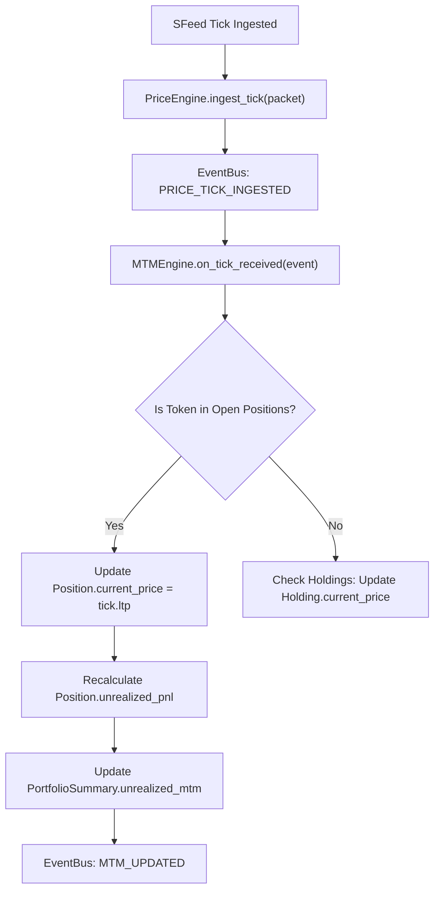

# Phase 6 Architectural Design Specification
## Portfolio Foundation

**Document Version:** 1.0.0  
**Phase:** Phase 6 — Portfolio Foundation  
**Target Milestone:** Milestone M2  
**Baseline Dependency:** Milestone M1 Baseline Locked & Tagged (`M1_BASELINE`, commit `4d9341a`), Phase 4 Streaming Foundation (`d4d9cb5`), Phase 5 Market Watch Foundation (`68d46ca`)  
**Status:** Architectural Design (Pre-Implementation)  
**Implementation Constraint:** **Design specification only — Zero production code generated in this phase**.  

---

## Scope Exclusions (Strict Project Governance)

In compliance with the **PROJECT_CONSTITUTION** and explicit user directives, the following trading and domain modules are **strictly excluded** from Phase 6:
- ❌ **No Place Order**: No `place_order`, order entry buffers, or execution staging.
- ❌ **No Modify Order**: No `modify_order` or order quantity/price revision handlers.
- ❌ **No Cancel Order**: No `cancel_order` or mass-cancel square-off triggers.
- ❌ **No Basket Orders**: No multi-leg order basket builders or margin-benefit sequencers.
- ❌ **No Option Chain**: No option chain matrix tables, multi-strike scrapers, or Greek calculation engines.

Phase 6 is dedicated exclusively to the **Portfolio Foundation**: Long-term Demat Holdings, Intraday & Overnight Net Positions, Funds & Margin limits, Mark-to-Market (MTM) and Realized/Unrealized PnL calculation engines, Portfolio Summary aggregation, and low-latency cache synchronization with Phase 5's live touchline quote feeds.

---

## 1. Executive Summary & Architectural Objectives

Phase 5 established the **Market Watch Foundation** (Scrip Master search, multi-watchlists, exchange scalers, and the real-time `MarketWatchPriceEngine`).

Phase 6 introduces the terminal's **Portfolio Foundation**, responsible for reconciling capital, demat custody, open market exposure, and real-time PnL. The primary objectives are:

1. **Holdings Domain**: Reconcile equity Demat account holdings from Kotak Neo (`client.holdings()`), capturing total quantity, T1 pending shares, collateral pledged quantity, average acquisition cost, invested valuation, current market valuation, and total/day PnL.
2. **Positions Domain (Day & Net Positions)**: Ingest open trading positions across cash (`nse_cm`, `bse_cm`) and derivatives (`nse_fo`, `bse_fo`, `cde_fo`) with polymorphic unpacking and product type segregation (`MIS`, `NRML`, `CNC`).
3. **The Golden Rule of State Reconciliation**: Absence of a position record in API responses must evaluate to `None` (Undetermined/Unknown), **never** to `0` (Zero Open Quantity), preventing accidental loss of protective stops or false manual square-off assumptions.
4. **Funds & Margin Limits**: Query and normalize cash balances, collateral haircuts, span margins, exposure margins, and available trading limits (`client.limits()` / `client.margin_required()`).
5. **Real-Time Mark-to-Market (MTM) Engine**: Dynamically bind open positions to Phase 5's `MarketWatchPriceEngine` and WebSocket touchline ticks to compute sub-millisecond unrealized and total PnL.
6. **Portfolio Summary Aggregator**: Aggregate high-level terminal metrics: Total Invested Value, Current Portfolio Value, Realized PnL, Unrealized MTM, Overall Daily PnL, Total Margin Available, and Margin Utilization Percentage.
7. **Resilient Caching & Refresh Strategy**: Combine lightweight TTL caching (5-10s) with event-driven MTM recalculation on incoming ticks to minimize broker API rate-limiting while providing continuous live PnL updates.

---

## 2. High-Level System Architecture

```
+---------------------------------------------------------------------------------------------------+
|                                      PRESENTATION & REST API                                      |
|    GET /api/portfolio/summary                 GET /api/portfolio/holdings                         |
|    GET /api/portfolio/positions               GET /api/portfolio/margins                          |
|    POST /api/portfolio/refresh                GET /api/portfolio/pnl                              |
+-------------------------------------------------+-------------------------------------------------+
                                                  |
                                                  v
+---------------------------------------------------------------------------------------------------+
|                                   PORTFOLIO FOUNDATION LAYER                                      |
|                                                                                                   |
|   +------------------------------------+             +----------------------------------------+   |
|   |          HoldingsService           |             |            PositionsService            |   |
|   | - Demat balance reconciliation     |             | - Day & Net position reconciliation    |   |
|   | - T1 and pledged share accounting  |             | - MIS / NRML / CNC product grouping    |   |
|   | - Invested value vs current value  |             | - Polymorphic payload extractor        |   |
|   +-----------------+------------------+             | - Fail-Safe Default: None != 0         |   |
|                     |                                +-------------------+--------------------+   |
|                     |                                                    |                        |
|                     +-----------------------+----------------------------+                        |
|                                             |                                                     |
|                                             v                                                     |
|   +-------------------------------------------------------------------------------------------+   |
|   |                                     MTMEngine & PnL                                       |   |
|   | - Computes Realized PnL: closed_qty * (sell_price - buy_price)                            |   |
|   | - Computes Unrealized MTM: net_qty * (live_ltp - open_avg_price)                          |   |
|   | - Ingests live touchlines from Phase 5 MarketWatchPriceEngine                             |   |
|   +-----------------------------------------+-------------------------------------------------+   |
|                                             |                                                     |
|                                             v                                                     |
|   +-------------------------------------------------------------------------------------------+   |
|   |                                PortfolioSummaryAggregator                                 |   |
|   | - Total Invested Value | Current Valuation | Realized PnL | Unrealized MTM                |   |
|   | - Available Cash & Margin Limit | Total Margin Utilized | Margin Utilization %            |   |
|   +-------------------------------------------------------------------------------------------+   |
+---------------------------------------------+-----------------------------------------------------+
                                              |
                                              v
+---------------------------------------------------------------------------------------------------+
|                                      DEPENDENCY BRIDGES                                           |
|   BrokerInterface (Kotak Neo Adapter)          MarketWatchPriceEngine (Phase 5 Live Quotes)       |
|   BrokerCache (Partitioned TTL: 5s - 10s)      EventBus: PORTFOLIO_REFRESHED, MTM_UPDATED         |
|   AuditLogger: PORTFOLIO_SNAPSHOT, MARGIN_SYNC  SQLite Database: portfolio_snapshots (Optional)   |
+---------------------------------------------------------------------------------------------------+
```

---

## 3. Domain Model Specifications

### 3.1. Holdings Domain (`Holding`)

Represents custody of cash equities held in the user's Demat account:

```python
@dataclass
class Holding:
    instrument_token: str
    exchange_segment: str           # e.g., "nse_cm", "bse_cm"
    trading_symbol: str             # e.g., "RELIANCE-EQ"
    isin: str                       # e.g., "INE002A01018"
    total_quantity: int             # Total settled + unsettled shares
    settled_quantity: int           # Shares in Demat pool
    t1_quantity: int                # Shares awaiting settlement (T+1)
    pledged_quantity: int           # Shares pledged for trading margin
    average_price: float            # Weighted historical acquisition price
    invested_value: float           # total_quantity * average_price
    current_price: float            # Latest LTP from PriceEngine
    current_value: float            # total_quantity * current_price
    unrealized_pnl: float           # current_value - invested_value
    unrealized_pnl_percent: float   # (unrealized_pnl / invested_value) * 100
    close_price: float              # Previous day's closing price
    day_pnl: float                  # total_quantity * (current_price - close_price)
    day_pnl_percent: float          # ((current_price - close_price) / close_price) * 100
    collateral_eligible: bool       # Eligible for broker margin pledge
    source_timestamp: Optional[str] = None  # Upstream broker/exchange timestamp
    retrieved_timestamp: str = ""   # Local ISO ingest timestamp
    updated_at: float = 0.0         # Epoch timestamp
```

### 3.2. Positions Domain (`Position`)

Represents intraday and overnight derivative/equity commitments.

```python
class PositionType(str, Enum):
    DAY = "DAY"         # Intraday transactions of the current session
    NET = "NET"         # Cumulative carry-forward plus intraday open commitments

class ProductCode(str, Enum):
    CNC = "CNC"         # Cash and Carry (Equity delivery)
    MIS = "MIS"         # Margin Intraday Square-off
    NRML = "NRML"       # Normal overnight derivatives (Futures & Options)

@dataclass
class Position:
    instrument_token: str
    exchange_segment: str           # e.g., "nse_fo", "nse_cm"
    trading_symbol: str             # e.g., "NIFTY24DEC24500CE"
    product: ProductCode            # MIS, NRML, CNC
    position_type: PositionType     # DAY or NET
    buy_quantity: int               # Total executed buy quantity
    buy_amount: float               # Total buy value (buy_quantity * avg_buy_price)
    average_buy_price: float        # Weighted average purchase price
    sell_quantity: int              # Total executed sell quantity
    sell_amount: float              # Total sell value (sell_quantity * avg_sell_price)
    average_sell_price: float       # Weighted average selling price
    net_quantity: int               # buy_quantity - sell_quantity (+ Long, - Short, 0 Closed)
    multiplier: int                 # Segment contract multiplier (e.g., 1 for Equity)
    close_price: float              # Previous trading session close
    current_price: float            # Live LTP from MarketWatchPriceEngine
    realized_pnl: float             # Locked-in profit/loss from closed volume
    unrealized_pnl: float           # Open floating Mark-to-Market (MTM)
    total_pnl: float                # realized_pnl + unrealized_pnl
    is_open: bool                   # True if net_quantity != 0
    source_timestamp: Optional[str] = None  # Upstream broker/exchange timestamp
    retrieved_timestamp: str = ""   # Local ISO ingest timestamp
    updated_at: float = 0.0         # Epoch timestamp
```

#### 3.2.1. The Golden Rule of State Reconciliation
Per the verified **Kotak Neo Algo Trading Knowledge Base**:
- **Absence of Data $\neq$ Value Zero**: If a symbol is missing in a positions API response or if an API call glitches with a timeout, the parser must return `None` (Undetermined/Unknown), **never** `0`.
- **Reasoning**: Returning `0` on temporary network glitches triggers false external manual square-off assumptions, causing downstream algos to cancel protective stop losses on the exchange and leaving positions completely unprotected.

#### 3.2.2. Resilient Polymorphic Payload Extractor
Kotak Neo endpoints return inconsistently nested JSON responses (`list[dict]`, `dict["data"]`, `dict["result"]`, `dict["dataList"]`). The parser must safely traverse all nesting variants and normalize symbol representations (`trdSym`, `tradingSymbol`, `dispSym`, `secDesc`) by stripping whitespace.

---

### 3.3. Funds & Margin Domain (`MarginSummary`)

Captures account equity, margin utilization, and available limits:

```python
@dataclass
class MarginSummary:
    available_cash: float           # Clear liquid cash balance (avlCash)
    collateral_value: float         # Non-cash collateral value from pledged holdings
    total_margin_available: float   # available_cash + collateral_value
    span_margin_used: float         # Exchange SPAN requirement for derivatives
    exposure_margin_used: float     # Exchange exposure margin buffer
    option_premium_used: float      # Premium paid for long options
    total_margin_used: float        # Total margin blocked by open orders/positions (ordMrgn)
    margin_utilization_percent: float # (total_margin_used / total_margin_available) * 100
    unrealized_mtm_loss: float      # MTM loss deducting from margin
    realized_pnl_credit: float      # Realized intraday profits credited to ledger
    peak_margin: float              # Highest intraday margin assessment
    currency: str = "INR"
    source_timestamp: Optional[str] = None  # Upstream broker/exchange timestamp
    retrieved_timestamp: str = ""   # Local ISO ingest timestamp
    updated_at: float = field(default_factory=time.time)
```

---

### 3.4. Portfolio Summary (`PortfolioSummary`)

The unified executive portfolio overview:

```python
@dataclass
class PortfolioSummary:
    # Holdings Overview
    total_invested_value: float     # Total capital deployed in Demat holdings
    current_holdings_value: float   # Current market valuation of Demat holdings
    holdings_unrealized_pnl: float  # current_holdings_value - total_invested_value
    holdings_unrealized_pnl_pct: float
    holdings_day_pnl: float         # Demat day PnL based on previous day close

    # Positions & Trading PnL
    realized_pnl: float             # Closed intraday trading profit/loss
    unrealized_mtm: float           # Open positions floating profit/loss
    total_trading_pnl: float        # realized_pnl + unrealized_mtm
    total_portfolio_pnl: float      # holdings_unrealized_pnl + total_trading_pnl

    # Margins & Risk
    available_cash: float
    total_margin_available: float
    total_margin_used: float
    margin_utilization_percent: float

    # Health & Exposure Counters
    open_positions_count: int
    total_holdings_count: int
    source_timestamp: Optional[str] = None  # Upstream broker/exchange timestamp
    retrieved_timestamp: str = ""   # Local ISO ingest timestamp
    updated_at: float = field(default_factory=time.time)
```

---

## 4. Mark-to-Market (MTM) & PnL Engine Architecture

### 4.1. Mathematical Formulation

#### 4.1.1. Realized Profit and Loss
Realized PnL is computed strictly over closed transaction volume:
$$\text{closed\_qty} = \min(\text{buy\_quantity}, \text{sell\_quantity})$$
$$\text{Realized PnL} = \text{closed\_qty} \times (\text{average\_sell\_price} - \text{average\_buy\_price})$$

#### 4.1.2. Unrealized Mark-to-Market (MTM)
Unrealized PnL reflects open exposure benchmarked against the live Last Traded Price (LTP) delivered by Phase 5's `MarketWatchPriceEngine`:
- **For Net Long Positions ($\text{net\_quantity} > 0$):**
  $$\text{Unrealized MTM} = \text{net\_quantity} \times (\text{current\_ltp} - \text{average\_buy\_price})$$
- **For Net Short Positions ($\text{net\_quantity} < 0$):**
  $$\text{Unrealized MTM} = |\text{net\_quantity}| \times (\text{average\_sell\_price} - \text{current\_ltp})$$
- **For Closed Positions ($\text{net\_quantity} = 0$):**
  $$\text{Unrealized MTM} = 0.0$$

#### 4.1.3. Combined Total PnL
$$\text{Total PnL} = \text{Realized PnL} + \text{Unrealized MTM}$$

---

### 4.2. Low-Latency Quote Binding Pipeline
When Phase 5's `MarketWatchPriceEngine` receives a real-time touchline tick:


---

## 5. Portfolio Refresh & Caching Strategy

Broker REST endpoints (`client.holdings()`, `client.positions()`, `client.limits()`) are subject to strict broker rate limits (typically 1 to 3 requests per second). Requesting fresh snapshots on every user page load or tick will quickly result in HTTP 429 errors or circuit breaker trips.

### 5.1. Multi-Tiered Refresh Architecture
1. **Tier 1: In-Memory REST Snapshot Cache (Phase 4 `BrokerCache`)**
   - Partitioned cache keys: `portfolio:holdings`, `portfolio:positions`, `portfolio:margins`.
   - TTL durations:
     - `TTL_HOLDINGS = 300.0` (Holdings change infrequently during trading sessions; 5 min TTL).
     - `TTL_POSITIONS = 5.0` (Net positions snapshot cached for 5s).
     - `TTL_MARGINS = 10.0` (Margin limit cached for 10s).
2. **Tier 2: Real-time In-Memory MTM Streaming**
   - Positions cached in memory are updated in microsecond real-time via `MTMEngine` without making any REST API calls to the broker.
3. **Tier 3: Explicit User Invalidation (`POST /api/portfolio/refresh`)**
   - Users or terminal operators can trigger a manual sync which bypasses Tier 1 TTL, flushes `BrokerCache` partitions, and fetches authoritative broker state.

---

## 6. Event Bus & Audit Framework Changes

### 6.1. Event Bus Constants (`app/events/event_types.py`)

| Event Constant | Channel Name | Payload Description |
|---|---|---|
| `PORTFOLIO_REFRESHED` | `"portfolio.refreshed"` | `{"user_id": int, "timestamp": str, "source": str}` |
| `POSITIONS_RECONCILED` | `"portfolio.positions_reconciled"` | `{"open_positions": int, "closed_positions": int, "realized_pnl": float}` |
| `HOLDINGS_RECONCILED` | `"portfolio.holdings_reconciled"` | `{"total_holdings": int, "invested_value": float, "current_value": float}` |
| `MARGINS_UPDATED` | `"portfolio.margins_updated"` | `{"available_cash": float, "margin_used": float, "utilization_pct": float}` |
| `MTM_UPDATED` | `"portfolio.mtm_updated"` | `{"unrealized_mtm": float, "total_trading_pnl": float, "timestamp": float}` |

### 6.2. Audit Trail Actions (`app/core/audit.py`)

| Action Constant | Category | Description |
|---|---|---|
| `PORTFOLIO_SYNC` | `AuditCategory.BROKER` | Logged whenever a full portfolio synchronization executes |
| `MARGIN_SYNC` | `AuditCategory.BROKER` | Logged when account margin limits are refreshed |
| `POSITION_DISCREPANCY` | `AuditCategory.BROKER` | Logged when position reconciliation encounters missing or ambiguous symbols |

---

## 7. REST API Design Specification

A dedicated blueprint `portfolio_bp` (`/api/portfolio/`) will be introduced:

### 7.1. Executive Portfolio Summary
- `GET /api/portfolio/summary`:
  - **Auth**: `@login_required`
  - **Response `200 OK`**:
    ```json
    {
      "success": true,
      "data": {
        "summary": {
          "total_invested_value": 450000.00,
          "current_holdings_value": 472500.00,
          "holdings_unrealized_pnl": 22500.00,
          "holdings_unrealized_pnl_pct": 5.00,
          "holdings_day_pnl": 1250.00,
          "realized_pnl": 4200.00,
          "unrealized_mtm": -850.00,
          "total_trading_pnl": 3350.00,
          "total_portfolio_pnl": 25850.00,
          "available_cash": 125000.00,
          "total_margin_available": 250000.00,
          "total_margin_used": 68000.00,
          "margin_utilization_percent": 27.20,
          "open_positions_count": 2,
          "total_holdings_count": 8,
          "updated_at": 1730898500.123
        }
      }
    }
    ```

### 7.2. Holdings Retrieval
- `GET /api/portfolio/holdings`:
  - **Auth**: `@login_required`
  - **Response `200 OK`**:
    ```json
    {
      "success": true,
      "data": {
        "count": 1,
        "holdings": [
          {
            "instrument_token": "2885",
            "exchange_segment": "nse_cm",
            "trading_symbol": "RELIANCE-EQ",
            "isin": "INE002A01018",
            "total_quantity": 50,
            "settled_quantity": 50,
            "t1_quantity": 0,
            "pledged_quantity": 0,
            "average_price": 2400.00,
            "invested_value": 120000.00,
            "current_price": 2550.00,
            "current_value": 127500.00,
            "unrealized_pnl": 7500.00,
            "unrealized_pnl_percent": 6.25,
            "close_price": 2520.00,
            "day_pnl": 1500.00,
            "day_pnl_percent": 1.19
          }
        ]
      }
    }
    ```

### 7.3. Positions Retrieval
- `GET /api/portfolio/positions`:
  - **Query Params**: `type` (`net` or `day`, default `net`), `status` (`open`, `closed`, `all`, default `all`)
  - **Auth**: `@login_required`
  - **Response `200 OK`**:
    ```json
    {
      "success": true,
      "data": {
        "type": "net",
        "open_count": 1,
        "closed_count": 0,
        "positions": [
          {
            "instrument_token": "26000",
            "exchange_segment": "nse_fo",
            "trading_symbol": "NIFTY24DEC24500CE",
            "product": "NRML",
            "position_type": "NET",
            "buy_quantity": 50,
            "average_buy_price": 120.50,
            "sell_quantity": 0,
            "average_sell_price": 0.00,
            "net_quantity": 50,
            "current_price": 135.00,
            "realized_pnl": 0.00,
            "unrealized_pnl": 725.00,
            "total_pnl": 725.00,
            "is_open": true
          }
        ]
      }
    }
    ```

### 7.4. Funds & Margins
- `GET /api/portfolio/margins`:
  - **Auth**: `@login_required`
  - **Response `200 OK`**: Returns `MarginSummary` payload.

### 7.5. Manual Cache Invalidation & Force Refresh
- `POST /api/portfolio/refresh`:
  - **Auth**: `@login_required`
  - **Response `200 OK`**: Bypasses REST TTL, executes broker reconciliation, and returns updated summary.

---

## 8. Testing Strategy

### 8.1. Unit Testing
1. **Polymorphic Parser Tests**:
   - Verify parsing across `list[dict]`, `dict["data"]`, `dict["result"]`, and nested variations.
   - Verify symbol normalization with arbitrary whitespace (`NIFTY 24500 CE` vs `NIFTY24DEC24500CE`).
2. **The Golden Rule State Reconciliation**:
   - Verify missing symbol returns `None`, not `0`.
   - Verify confirmed closed symbol (`netQty == 0`) returns `0`.
3. **PnL & MTM Mathematical Verification**:
   - Verify Realized PnL on full and partial round-trips.
   - Verify Unrealized MTM for Long positions ($Net > 0$).
   - Verify Unrealized MTM for Short positions ($Net < 0$).
4. **Margin & Utilization Calculations**:
   - Verify available margin, blocked margin, and utilization percentages.

### 8.2. Integration Testing
1. **REST API Workflow**:
   - Verify `/summary`, `/holdings`, `/positions`, `/margins`, and `/refresh` endpoints under authenticated Flask test sessions.
2. **Real-Time Quote Integration**:
   - Inject tick into `MarketWatchPriceEngine` and assert position MTM recalculates without external REST calls.

---

## 9. Rollback & State Isolation Strategy

1. **State Isolation**: Phase 6 read-only portfolio models and MTM calculation pipelines have zero execution side-effects. They cannot create, alter, or cancel exchange orders.
2. **Rollback**: In the event of regression, reverting the Phase 6 commit restores Phase 5 baseline without requiring database schema down-migrations (since portfolio caching is entirely in-memory).

---

## 10. Phase 6 Implementation Blueprint & File Layout

When Phase 6 implementation is approved, the following modules will be created/updated:

```text
app/portfolio/
├── __init__.py
├── models/
│   ├── __init__.py
│   ├── holding.py                      # Holding dataclass
│   ├── position.py                     # Position dataclass and Enums (MIS, NRML, CNC)
│   ├── margin.py                       # MarginSummary dataclass
│   └── portfolio_summary.py            # PortfolioSummary aggregated dataclass
├── services/
│   ├── __init__.py
│   ├── holdings_service.py             # Holdings parsing, custody valuation & day PnL
│   ├── positions_service.py            # Resilient polymorphic parser & The Golden Rule
│   ├── margin_service.py               # Cash and collateral limit reconciliation
│   ├── mtm_engine.py                   # Live MTM calculations tied to PriceEngine
│   └── portfolio_service.py            # Unified portfolio orchestration & TTL caching
└── routes.py                           # REST Blueprint: /api/portfolio/*
```

---

## 11. Summary & Sign-off Gate

Phase 6 design adheres strictly to the **PROJECT_CONSTITUTION**, respects the **M1 Baseline**, and builds directly on Phase 4 streaming and Phase 5 pricing foundations while firmly enforcing all scope exclusions (no order placement, no order modification, no order cancellation, no basket orders, no option chain).

**Design Status**: Complete and ready for User Architecture Review. Zero production code has been generated.

