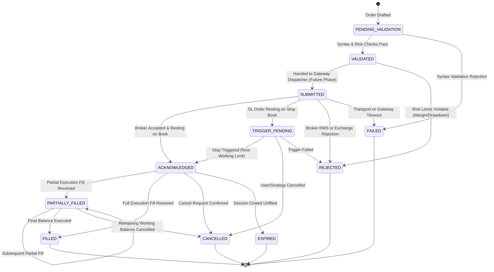

# Phase 7 Architectural Design Specification
## Order Domain Foundation

**Document Version:** 1.0.0  
**Phase:** Phase 7 — Order Domain Foundation  
**Target Milestone:** Milestone M3 (Pre-Execution Baseline)  
**Baseline Dependencies:** 
- Milestone M1 Baseline Locked & Tagged (`M1_BASELINE`, commit `4d9341a`)
- Milestone M2 Baseline Locked & Tagged (`M2_BASELINE`, commit `c4d30e6`)
  - Phase 4: WebSocket Supervisor & Streaming Infrastructure
  - Phase 5: Market Watch Foundation & Real-Time Price Engine
  - Phase 6: Portfolio Foundation, Margins & MTM Engine
**Status:** Architectural Design (Pre-Implementation)  
**Implementation Constraint:** **Design specification only — Zero production implementation code generated in this phase**.  

---

## Scope Exclusions (Strict Project Governance)

In compliance with the **PROJECT_CONSTITUTION** and explicit user directives, the following execution features are **strictly prohibited** from Phase 7:

- ❌ **No Place Order Execution**: Zero live order submission, routing, or placement to the broker gateway or exchange.
- ❌ **No Modify Order Execution**: Zero order modification, quantity revisions, or price amendments.
- ❌ **No Cancel Order Execution**: Zero order cancellation, mass cancellation, or emergency kill-switch routing.
- ❌ **No Basket Orders**: Zero multi-leg spread builders, margin-benefit sequencers, or batch execution routines.
- ❌ **No Option Chain Orders**: Zero automated options execution from option chain matrices or Greek scrapers.

> [!IMPORTANT]
> **Core Architectural Objective of Phase 7:**  
> The system must **understand, validate, track, state-model, persist, and audit orders**, but **under no circumstances execute them**. Execution pipelines are deferred exclusively to subsequent milestones.

---

## 1. Executive Summary & Architectural Objectives

Phases 1 through 6 established terminal security, broker connectivity, streaming tick supervisor, multi-watchlist touchlines, Demat holdings custody, open position tracking, cash/collateral limits, and real-time MTM calculations.

Phase 7 introduces the terminal's **Order Domain Foundation**. In algorithmic trading, the order entity is the most critical lifecycle object. Attempting to place orders without a formal, validated, auditable order state machine is the leading cause of trading catastrophes (e.g. duplicate fills, runaway infinite execution loops, and orphaned positions).

The primary architectural objectives of Phase 7 are:

1. **Ubiquitous Order Domain Model**: Define a rich, standardized `Order` entity capturing all order specifications across Indian cash and derivative markets (`NSE`, `BSE`, `NFO`, `BFO`, `CDS`).
2. **Deterministic Order Finite State Machine (FSM)**: Formalize all lifecycle states (`PENDING_VALIDATION`, `VALIDATED`, `SUBMITTED`, `ACKNOWLEDGED`, `TRIGGER_PENDING`, `PARTIALLY_FILLED`, `FILLED`, `REJECTED`, `CANCELLED`, `EXPIRED`, `FAILED`) with strict legal transition guards.
3. **Relational Order Persistence**: Design database schema (`orders`, `order_events`, `trade_executions`) with idempotency keys (`client_order_id`) to prevent duplicate records and enable complete post-trade analytics.
4. **Order Validation Framework (Pre-Flight Checks)**: Implement comprehensive structural validations (NSE 0.05 paise tick rule, contract lot sizes, exchange freeze limits, and aggressive Limit/Market Protection buffers).
5. **Passive Pre-Trade Risk Framework**: Evaluate account margin sufficiency against Phase 6 `MarginService`, account drawdown limits against `PortfolioSummary`, and order exposure limits without triggering live broker actions.
6. **Order Event & Audit Models**: Dispatch granular notifications across Phase 1's `EventBus` and write immutable records to the `audit_logs` table.
7. **Read-Only & Validation Order APIs**: Provide operator interfaces to view order books, trade books, and dry-run validation endpoints (`POST /api/orders/validate`).
8. **Broker Model Inversion**: Map Kotak Neo's specific API order attributes (`nOrdNo`, `trdSym`, `exSeg`, `prctyp`, `prc`, `trgPrc`, `qty`, `prod`, `validity`, `ordSt`) into standardized internal domain abstractions.

---

## 2. High-Level System Architecture

```
+---------------------------------------------------------------------------------------------------+
|                                      PRESENTATION & REST API                                      |
|    GET /api/orders (Filterable Order Book)            GET /api/orders/<order_id> (Detail & Events) |
|    GET /api/orders/trades (Executed Trade Book)       GET /api/orders/stats (Daily Metrics)       |
|    POST /api/orders/validate (Dry-Run Structural & Risk Check ONLY - ZERO EXECUTION)             |
+-------------------------------------------------+-------------------------------------------------+
                                                  |
                                                  v
+---------------------------------------------------------------------------------------------------+
|                                      ORDER FOUNDATION LAYER                                       |
|                                                                                                   |
|   +------------------------------------+             +----------------------------------------+   |
|   |       OrderValidationService       |             |           OrderRiskService             |   |
|   | - NSE 0.05 tick size rule          |             | - Pre-trade margin requirement check   |   |
|   | - Lot size & freeze limit bounds   |             | - Max order value & account drawdown   |   |
|   | - Market Protection (MP) buffering |             | - Short sell delivery validation       |   |
|   | - Order attribute completeness     |             | - Open order count quota guard         |   |
|   +-----------------+------------------+             +-------------------+--------------------+   |
|                     |                                                    |                        |
|                     +-----------------------+----------------------------+                        |
|                                             |                                                     |
|                                             v                                                     |
|   +-------------------------------------------------------------------------------------------+   |
|   |                                   OrderStateMachine & Engine                              |   |
|   | - Legal transition guards (e.g. FILLED is terminal, cannot transition to CANCELLED)       |   |
|   | - Rejection reason normalization & execution tracking                                      |   |
|   | - Idempotency key verification (client_order_id)                                          |   |
|   +-----------------------------------------+-------------------------------------------------+   |
|                                             |                                                     |
|                                             v                                                     |
|   +-------------------------------------------------------------------------------------------+   |
|   |                                     OrderRepository                                       |   |
|   | - Relational persistence: orders, order_events, trade_executions                          |   |
|   | - Fast filtering by client_order_id, broker_order_id, status, date range, and symbol      |   |
|   +-------------------------------------------------------------------------------------------+   |
+---------------------------------------------+-----------------------------------------------------+
                                              |
                                              v
+---------------------------------------------------------------------------------------------------+
|                                      DEPENDENCY BRIDGES                                           |
|   Phase 5: InstrumentService (Token & Lot check)   Phase 6: MarginService (Available limits)      |
|   Phase 5: PriceEngine (LTP for buffer check)      Phase 6: PositionsService (Position limits)    |
|   BrokerCache: Partitioned TTL (orders:active, 3s) EventBus: ORDER_* Event Dispatch               |
|   AuditLogger: ORDER_VALIDATE, RISK_CHECK          SQLite Database: orders, order_events, trades  |
+---------------------------------------------------------------------------------------------------+
```

---

## 3. Order Domain Model

### 3.1. Enums and Constants

```python
from enum import Enum

class OrderSide(str, Enum):
    """Transaction direction."""
    BUY = "BUY"
    SELL = "SELL"


class OrderType(str, Enum):
    """Execution price condition."""
    MARKET = "MARKET"   # Immediate execution at prevailing touchline (subject to MP buffer)
    LIMIT = "LIMIT"     # Execution at specified price or better
    SL = "SL"           # Stop Loss Limit (rests until trigger_price, executes as limit)
    SL_M = "SL_M"       # Stop Loss Market (rests until trigger_price, executes as market)


class ProductType(str, Enum):
    """Settlement and margin product code."""
    CNC = "CNC"         # Cash and Carry (Equity delivery)
    MIS = "MIS"         # Margin Intraday Square-off
    NRML = "NRML"       # Normal overnight derivatives (Futures & Options)


class Validity(str, Enum):
    """Time-in-force instruction."""
    DAY = "DAY"         # Order valid until end of regular trading session
    IOC = "IOC"         # Immediate or Cancel (fill immediately or cancel unfilled balance)
    EOS = "EOS"         # End of Session (standard session validity)


class OrderStatus(str, Enum):
    """Formal lifecycle state."""
    PENDING_VALIDATION = "PENDING_VALIDATION"  # Created, awaiting pre-flight checks
    VALIDATED = "VALIDATED"                    # Passed syntax & risk checks
    SUBMITTED = "SUBMITTED"                    # Dispatched towards broker gateway
    ACKNOWLEDGED = "ACKNOWLEDGED"              # Broker received order, resting on exchange book
    TRIGGER_PENDING = "TRIGGER_PENDING"        # SL order resting until trigger condition met
    PARTIALLY_FILLED = "PARTIALLY_FILLED"      # Partial execution recorded
    FILLED = "FILLED"                          # Entire quantity executed (Terminal)
    REJECTED = "REJECTED"                      # Rejected by broker RMS or exchange (Terminal)
    CANCELLED = "CANCELLED"                    # Operator or system cancelled (Terminal)
    EXPIRED = "EXPIRED"                        # Unfilled at session close (Terminal)
    FAILED = "FAILED"                          # Technical gateway or validation failure (Terminal)
```

### 3.2. Order Domain Dataclass

```python
@dataclass
class Order:
    """
    Standardized internal Order representation.
    Tracks technical parameters, state lifecycle, exchange execution identifiers,
    and regulatory audit timestamps.
    """
    # Identifiers
    client_order_id: str                      # UUID v4 idempotency token generated by terminal
    user_id: int                              # Terminal operator identifier
    broker_order_id: Optional[str] = None     # Kotak Neo assigned identifier (nOrdNo)
    exchange_order_id: Optional[str] = None   # Exchange sequence identifier (exOrdId)

    # Instrument Details
    instrument_token: str = ""                # Unique broker scrip token
    exchange_segment: str = "nse_cm"          # nse_cm, bse_cm, nse_fo, bse_fo, cde_fo
    trading_symbol: str = ""                  # Official exchange trading symbol
    
    # Order Parameters
    side: OrderSide = OrderSide.BUY
    order_type: OrderType = OrderType.LIMIT
    product_type: ProductType = ProductType.MIS
    validity: Validity = Validity.DAY
    
    # Quantities & Prices
    quantity: int = 0                         # Total requested order quantity
    filled_quantity: int = 0                  # Cumulative traded quantity
    pending_quantity: int = 0                 # Unfilled working quantity (quantity - filled_quantity)
    disclosed_quantity: int = 0               # Disclosed quantity to exchange book (optional)
    price: float = 0.0                        # Limit price (must be rounded to 0.05 tick)
    trigger_price: float = 0.0                # Stop Loss activation price
    average_price: float = 0.0                # Volume-weighted average traded price

    # Lifecycle & Status
    status: OrderStatus = OrderStatus.PENDING_VALIDATION
    rejection_reason: Optional[str] = None    # Error message from RMS or exchange
    exchange_timestamp: Optional[str] = None  # Upstream exchange fill/acknowledgment timestamp

    # Audit & Freshness Timestamps
    source_timestamp: Optional[str] = None    # Broker gateway reported timestamp
    retrieved_timestamp: str = field(
        default_factory=lambda: datetime.now(timezone.utc).isoformat()
    )
    created_at: float = field(default_factory=time.time)
    updated_at: float = field(default_factory=time.time)

    def is_terminal(self) -> bool:
        """Return True if order has reached an irreversible end state."""
        return self.status in (
            OrderStatus.FILLED,
            OrderStatus.REJECTED,
            OrderStatus.CANCELLED,
            OrderStatus.EXPIRED,
            OrderStatus.FAILED,
        )

    def is_open(self) -> bool:
        """Return True if order is active or resting on exchange book."""
        return self.status in (
            OrderStatus.ACKNOWLEDGED,
            OrderStatus.TRIGGER_PENDING,
            OrderStatus.PARTIALLY_FILLED,
        )
```

### 3.3. Execution Fill Dataclass (`TradeExecution`)

```python
@dataclass
class TradeExecution:
    """
    Represents an atomic partial or full trade execution fill reported by exchange.
    """
    trade_id: str                             # Exchange trade sequence identifier
    client_order_id: str                      # Terminal order identifier
    broker_order_id: str                      # Broker order identifier
    fill_quantity: int                        # Quantity executed in this fill
    fill_price: float                         # Price executed in this fill
    exchange_segment: str
    trading_symbol: str
    exchange_timestamp: str
    retrieved_timestamp: str = field(
        default_factory=lambda: datetime.now(timezone.utc).isoformat()
    )
```

---

## 4. Order State Machine (FSM)

The Order State Machine is the foundational defense against invalid state corruption. All state transitions must be explicitly validated against a transition matrix.

### 4.1. State Transition Matrix



### 4.2. Legal Transition Rules Table

| Current State | Permitted Next States | Guard Condition / Rationale |
|---|---|---|
| `PENDING_VALIDATION` | `VALIDATED`, `FAILED` | Validates tick size, lot size, price bounds, required fields. |
| `VALIDATED` | `SUBMITTED`, `REJECTED` | Validates pre-trade margins, account drawdown, open order quotas. |
| `SUBMITTED` | `ACKNOWLEDGED`, `TRIGGER_PENDING`, `REJECTED`, `FAILED` | Receives broker `200 OK` + `nOrdNo` or RMS rejection payload. |
| `TRIGGER_PENDING` | `ACKNOWLEDGED`, `CANCELLED`, `REJECTED` | Transitions to `ACKNOWLEDGED` when LTP breaches trigger price. |
| `ACKNOWLEDGED` | `PARTIALLY_FILLED`, `FILLED`, `CANCELLED`, `EXPIRED`, `REJECTED` | Working limit order resting on exchange book. |
| `PARTIALLY_FILLED` | `PARTIALLY_FILLED`, `FILLED`, `CANCELLED` | Remaining quantity is working; cannot reject once fills occur. |
| `FILLED` | *None (Terminal)* | Irreversible; no further transitions allowed. |
| `REJECTED` | *None (Terminal)* | Irreversible; dead on arrival. |
| `CANCELLED` | *None (Terminal)* | Irreversible; working balance withdrawn. |
| `EXPIRED` | *None (Terminal)* | Irreversible; closed at end of trading day. |
| `FAILED` | *None (Terminal)* | Irreversible; technical validation or system failure. |

> [!CAUTION]
> **Illegal Transition Trap:**  
> Once an order enters `FILLED`, it is mathematically and legally impossible for it to transition to `CANCELLED` or `REJECTED`. If a late out-of-order cancellation payload arrives from a delayed socket frame after execution fills, the FSM must discard it and log an audit discrepancy.

---

## 5. Order Repository & Database Schema

Phase 7 defines relational persistence in SQLite via SQLAlchemy and Alembic migration `004_create_order_tables.py`.

### 5.1. Relational Database Tables

```sql
-- 1. Main Orders Table
CREATE TABLE orders (
    id INTEGER PRIMARY KEY AUTOINCREMENT,
    client_order_id VARCHAR(64) NOT NULL UNIQUE,      -- UUID v4 Idempotency Key
    user_id INTEGER NOT NULL REFERENCES users(id),
    broker_order_id VARCHAR(64) NULL,                 -- Kotak Neo nOrdNo
    exchange_order_id VARCHAR(64) NULL,               -- Exchange exOrdId
    
    -- Scrip Parameters
    instrument_token VARCHAR(32) NOT NULL,
    exchange_segment VARCHAR(16) NOT NULL,
    trading_symbol VARCHAR(64) NOT NULL,
    
    -- Order Specifications
    side VARCHAR(8) NOT NULL,                         -- BUY, SELL
    order_type VARCHAR(16) NOT NULL,                  -- MARKET, LIMIT, SL, SL_M
    product_type VARCHAR(16) NOT NULL,                -- CNC, MIS, NRML
    validity VARCHAR(8) NOT NULL DEFAULT 'DAY',       -- DAY, IOC
    
    -- Financial Values
    quantity INTEGER NOT NULL,
    filled_quantity INTEGER NOT NULL DEFAULT 0,
    pending_quantity INTEGER NOT NULL,
    disclosed_quantity INTEGER NOT NULL DEFAULT 0,
    price NUMERIC(12, 4) NOT NULL DEFAULT 0.0000,
    trigger_price NUMERIC(12, 4) NOT NULL DEFAULT 0.0000,
    average_price NUMERIC(12, 4) NOT NULL DEFAULT 0.0000,
    
    -- Lifecycle
    status VARCHAR(32) NOT NULL,
    rejection_reason TEXT NULL,
    
    -- Timestamps
    exchange_timestamp VARCHAR(64) NULL,
    source_timestamp VARCHAR(64) NULL,
    retrieved_timestamp VARCHAR(64) NOT NULL,
    created_at TIMESTAMP NOT NULL DEFAULT CURRENT_TIMESTAMP,
    updated_at TIMESTAMP NOT NULL DEFAULT CURRENT_TIMESTAMP
);

CREATE INDEX idx_orders_user_status ON orders(user_id, status);
CREATE INDEX idx_orders_broker_id ON orders(broker_order_id);
CREATE INDEX idx_orders_symbol ON orders(trading_symbol);
CREATE INDEX idx_orders_created_at ON orders(created_at);

-- 2. Order Events Trail Table (Audit History of State Transitions)
CREATE TABLE order_events (
    id INTEGER PRIMARY KEY AUTOINCREMENT,
    order_id INTEGER NOT NULL REFERENCES orders(id) ON DELETE CASCADE,
    client_order_id VARCHAR(64) NOT NULL,
    from_status VARCHAR(32) NOT NULL,
    to_status VARCHAR(32) NOT NULL,
    reason TEXT NULL,
    payload_snapshot JSON NULL,
    created_at TIMESTAMP NOT NULL DEFAULT CURRENT_TIMESTAMP
);

CREATE INDEX idx_order_events_order_id ON order_events(order_id);

-- 3. Trade Executions Table (Fill Records)
CREATE TABLE trade_executions (
    id INTEGER PRIMARY KEY AUTOINCREMENT,
    trade_id VARCHAR(64) NOT NULL UNIQUE,             -- Exchange trade identifier
    order_id INTEGER NOT NULL REFERENCES orders(id) ON DELETE CASCADE,
    client_order_id VARCHAR(64) NOT NULL,
    broker_order_id VARCHAR(64) NOT NULL,
    fill_quantity INTEGER NOT NULL,
    fill_price NUMERIC(12, 4) NOT NULL,
    exchange_segment VARCHAR(16) NOT NULL,
    trading_symbol VARCHAR(64) NOT NULL,
    exchange_timestamp VARCHAR(64) NOT NULL,
    retrieved_timestamp VARCHAR(64) NOT NULL,
    created_at TIMESTAMP NOT NULL DEFAULT CURRENT_TIMESTAMP
);

CREATE INDEX idx_trade_executions_order ON trade_executions(order_id);
```

### 5.2. Repository Interface Contract

```python
class OrderRepositoryInterface(ABC):
    """Data access contract for Order domain entities."""

    @abstractmethod
    def save(self, order: Order) -> Order:
        """Persist or update an order entity."""
        pass

    @abstractmethod
    def find_by_client_order_id(self, client_order_id: str) -> Optional[Order]:
        """Lookup order by idempotency token."""
        pass

    @abstractmethod
    def find_by_broker_order_id(self, broker_order_id: str) -> Optional[Order]:
        """Lookup order by broker nOrdNo."""
        pass

    @abstractmethod
    def find_orders(
        self,
        user_id: int,
        status: Optional[OrderStatus] = None,
        symbol: Optional[str] = None,
        segment: Optional[str] = None,
        limit: int = 100,
        offset: int = 0,
    ) -> List[Order]:
        """Query orders with comprehensive filter parameters."""
        pass

    @abstractmethod
    def record_transition(
        self,
        order_id: int,
        client_order_id: str,
        from_status: OrderStatus,
        to_status: OrderStatus,
        reason: Optional[str] = None,
        snapshot: Optional[Dict[str, Any]] = None,
    ) -> None:
        """Append an immutable state transition event."""
        pass

    @abstractmethod
    def record_trade_execution(self, trade: TradeExecution) -> None:
        """Persist an atomic trade execution fill."""
        pass
```

---

## 6. Order Validation Framework (Pre-Flight Checks)

Before an order can be considered syntactically valid (`OrderStatus.VALIDATED`), it must pass all deterministic rules implemented in `OrderValidationService`.

```
                        ORDER VALIDATION PIPELINE
                                
  Order Draft  ---> [ Rule 1: Attribute Completeness ]
                            | Pass
                            v
                    [ Rule 2: Segment & Scrip Master Existence ]
                            | Pass
                            v
                    [ Rule 3: NSE 0.05 Tick Size Multiplier ]
                            | Pass
                            v
                    [ Rule 4: Lot Size & Freeze Limit Bounds ]
                            | Pass
                            v
                    [ Rule 5: SL Price & Trigger Logic ]
                            | Pass
                            v
                    [ Rule 6: Market Protection (MP) Buffering ]
                            | Pass
                            v
                      RESULT: VALIDATED
```

### 6.1. Validation Rules

1. **Attribute Completeness Rule**:
   - `quantity` must be integer $> 0$.
   - `trading_symbol` and `instrument_token` must not be empty or whitespace.
   - `exchange_segment` must be a supported segment (`nse_cm`, `bse_cm`, `nse_fo`, `bse_fo`, `cde_fo`).
   - `side` must be `BUY` or `SELL`.
   - `order_type` must be one of `MARKET`, `LIMIT`, `SL`, `SL_M`.
   - `product_type` must be one of `CNC`, `MIS`, `NRML`.
2. **Scrip Master Verification**:
   - The `instrument_token` must exist in Phase 5's `InstrumentService` cache.
   - Segment specified in request must match the token's registered segment.
3. **NSE 0.05 Paise Tick Rule**:
   - In Indian equity and equity derivative markets, order prices must be strictly divisible by ₹0.05 (`price % 0.05 == 0.0`).
   - Any price submitted with fractional ticks (e.g. ₹245.03) will be rejected by the exchange RMS.
   - For currency derivatives (`cde_fo`), the tick size is ₹0.0025.
   - Validator enforces:
     $$\text{Tick Remainder} = \left(\text{Price} \times 1000\right) \pmod{\text{Tick Size} \times 1000} == 0$$
4. **Lot Size & Freeze Limit Validation**:
   - **Lot Multiples**: For derivative segments (`nse_fo`, `bse_fo`, `cde_fo`), `quantity % lot_size == 0`. (e.g. NIFTY quantities must be multiples of 25; BANKNIFTY multiples of 15).
   - **Exchange Freeze Limits**: The maximum single-order quantity must not exceed the exchange-mandated freeze limit (e.g. NIFTY freeze = 1,800 quantity; BANKNIFTY freeze = 900 quantity).
5. **Stop Loss (SL) Trigger Logic**:
   - For `SL` or `SL_M` orders, `trigger_price` must be $> 0.0$.
   - **Buy Stop Loss**: To protect a short position, buying requires the trigger to be placed **above** the current market price, and `price >= trigger_price`.
   - **Sell Stop Loss**: To protect a long position, selling requires the trigger to be placed **below** the current market price, and `price <= trigger_price`.
6. **Market Protection (MP) Buffering for Limit Orders**:
   - To avoid naked market order RMS rejections in illiquid contracts, market orders are automatically buffered into aggressive Limit orders:
     $$\text{Buffered Buy Price} = \text{LTP} \times (1.0 + \text{Buffer \%})$$
     $$\text{Buffered Sell Price} = \text{LTP} \times (1.0 - \text{Buffer \%})$$
   - Formatted price must be snapped to nearest 0.05 tick size.

---

## 7. Passive Pre-Trade Risk Framework

The `OrderRiskService` runs passive risk checks without placing orders or touching live capital.

```
                           RISK VALIDATION PIPELINE
                                
  Validated Order  ---> [ Check 1: Margin Requirement vs Available Cash ]
                                   | Pass
                                   v
                        [ Check 2: Max Single Order Value Bound ]
                                   | Pass
                                   v
                        [ Check 3: Daily Drawdown Guard ]
                                   | Pass
                                   v
                        [ Check 4: Short Delivery Block for CNC ]
                                   | Pass
                                   v
                        [ Check 5: Open Orders Limit Quota ]
                                   | Pass
                                   v
                              RISK APPROVED
```

### 7.1. Risk Validation Rules

1. **Pre-Trade Margin Requirement Verification**:
   - Queries Phase 6 [`MarginService`](file:///c:/Users/User/Documents/02.NMD%20Docs/Trading/Learn%20To%20Code%20-%20Nitin%20Joshi/ND%20Projects/ND_Kotak_Neo_Personal_Trading_Terminal/app/portfolio/services/margin_service.py).
   - Computes estimated margin commitment:
     - Cash Buy (`CNC`): $\text{Required} = \text{Quantity} \times \text{Price}$
     - Intraday Cash (`MIS`): $\text{Required} = \text{Quantity} \times \text{Price} \times 0.20$ (5x Leverage)
     - Option Buy (`NRML`/`MIS`): $\text{Required} = \text{Quantity} \times \text{Premium Price}$
     - Option Sell / Futures: Queries SPAN + Exposure estimate.
   - Enforces:
     $$\text{Available Cash} \ge \text{Estimated Margin} \times 1.05 \quad (\text{5\% Safety Buffer})$$
2. **Max Single Order Value Bound**:
   - Enforces a configurable ceiling (e.g. ₹5,00,000 per order) to prevent catastrophic fat-finger errors:
     $$\text{Order Value} = \text{Quantity} \times \text{Price} \le \text{MAX\_ORDER\_VALUE}$$
3. **Daily Account Drawdown Guard**:
   - Queries Phase 6 [`PortfolioSummary`](file:///c:/Users/User/Documents/02.NMD%20Docs/Trading/Learn%20To%20Code%20-%20Nitin%20Joshi/ND%20Projects/ND_Kotak_Neo_Personal_Trading_Terminal/app/portfolio/models/portfolio_summary.py).
   - If today's realized loss + unrealized MTM breaches the operator's configured daily loss limit (e.g. ₹20,000 max loss), all new position-opening orders are rejected.
4. **Short Sell Delivery Block (CNC Sales)**:
   - Selling equity under `CNC` product requires verified physical custody in the user's Demat account.
   - Queries Phase 6 [`HoldingsService`](file:///c:/Users/User/Documents/02.NMD%20Docs/Trading/Learn%20To%20Code%20-%20Nitin%20Joshi/ND%20Projects/ND_Kotak_Neo_Personal_Trading_Terminal/app/portfolio/services/holdings_service.py).
   - If $\text{Available Demat Quantity} < \text{Sell Quantity}$, rejects order with `CNC_SHORT_SELLING_PROHIBITED`.
5. **Open Orders Quota Guard**:
   - Limits concurrent resting orders to a maximum of 50 open orders to protect against socket starvation and API rate-limiting.

---

## 8. Order Event Model

All order lifecycle activities dispatch structured events across Phase 1's `EventBus`.

### 8.1. Registered Event Types

| Event Name | Constant | Payload Structure |
|---|---|---|
| `order.created` | `ORDER_CREATED` | `{client_order_id, user_id, symbol, side, qty, order_type, timestamp}` |
| `order.validated` | `ORDER_VALIDATED` | `{client_order_id, status, margin_required, tick_size, timestamp}` |
| `order.validation_failed` | `ORDER_VALIDATION_FAILED` | `{client_order_id, reason, error_code, timestamp}` |
| `order.risk_passed` | `ORDER_RISK_PASSED` | `{client_order_id, available_cash, required_margin, timestamp}` |
| `order.risk_rejected` | `ORDER_RISK_REJECTED` | `{client_order_id, violation_type, limit_value, actual_value, timestamp}` |
| `order.state_changed` | `ORDER_STATE_CHANGED` | `{client_order_id, from_status, to_status, reason, timestamp}` |
| `order.partially_filled` | `ORDER_PARTIALLY_FILLED` | `{client_order_id, trade_id, fill_qty, fill_price, pending_qty, timestamp}` |
| `order.filled` | `ORDER_FILLED` | `{client_order_id, trade_id, filled_qty, avg_price, timestamp}` |
| `order.rejected` | `ORDER_REJECTED` | `{client_order_id, rejection_reason, timestamp}` |
| `order.cancelled` | `ORDER_CANCELLED` | `{client_order_id, cancelled_qty, reason, timestamp}` |
| `order.reconciled` | `ORDER_RECONCILED` | `{client_order_id, broker_order_id, reconciled_status, timestamp}` |

---

## 9. Order Audit Trail

Every order operation generates an immutable audit record in the `audit_logs` table via `audit_logger.record(...)`.

### 9.1. Audit Actions

```python
AUDIT_ORDER_VALIDATION = "ORDER_VALIDATION"
AUDIT_ORDER_RISK_CHECK = "ORDER_RISK_CHECK"
AUDIT_ORDER_STATE_TRANSITION = "ORDER_STATE_TRANSITION"
AUDIT_ORDER_RECONCILIATION = "ORDER_RECONCILIATION"
AUDIT_ORDER_DISCREPANCY = "ORDER_DISCREPANCY"
```

### 9.2. Audit Structure & Regulatory Traceability
Each audit entry captures:
- `category`: `AuditCategory.ORDER`
- `action`: Specific audit action name
- `actor`: User ID or automated system process name
- `correlation_id`: Correlation ID passed across HTTP / background threads
- `request_id`: Individual request identifier
- `details`: JSON payload containing order parameters, previous state, new state, evaluated risk numbers, and client IP.

---

## 10. Order Cache Strategy

Order querying must support low-latency UI responsiveness while maintaining absolute consistency with the SQLite database.

```
+---------------------------------------------------------------------------------------------------+
|                                       ORDER CACHE TOPOLOGY                                        |
|                                                                                                   |
|   +------------------------------------+             +----------------------------------------+   |
|   |          In-Memory L1 Cache        |             |           BrokerCache (L2)             |   |
|   | - Dict[client_order_id, Order]     |             | - Key: 'orders:active'                 |   |
|   | - Thread-safe via threading.RLock  |             | - Partition TTL = 3.0s                 |   |
|   | - Holds ONLY active/open orders    |             | - Invalidated on execution fills       |   |
|   +-----------------+------------------+             +-------------------+--------------------+   |
|                     |                                                    |                        |
|                     +-----------------------+----------------------------+                        |
|                                             |                                                     |
|                                             v                                                     |
|                               +---------------------------+                                       |
|                               |  SQLite Database Orders   |                                       |
|                               |  (Authoritative Storage)  |                                       |
|                               +---------------------------+                                       |
+---------------------------------------------------------------------------------------------------+
```

### Cache Invalidation Policies
1. **Event-Driven Write-Through**: When state changes occur (`VALIDATED`, `FILLED`, `CANCELLED`), the L1 cache and database are updated synchronously.
2. **TTL for Bulk Queries**: Active order lists (`orders:active`) are cached with a short `TTL = 3.0s` to collapse rapid poll bursts from frontend tabs.
3. **Instant Eviction on Fill**: Arrival of a trade fill instantly evicts cached queries and forces an in-memory recalculation.

---

## 11. Read-Only & Validation Order APIs (Design Only)

Phase 7 provides strictly read-only and pre-flight validation REST endpoints.

### 11.1. API Endpoints

#### 1. `GET /api/orders/status`
- **Access**: Public
- **Description**: Returns order domain operational status.
- **Response**:
  ```json
  {
    "status": "success",
    "data": {
      "module": "order_domain_foundation",
      "version": "phase_7",
      "execution_enabled": false
    }
  }
  ```

#### 2. `POST /api/orders/validate` (Pre-Flight Dry Run)
- **Access**: Authenticated (`@login_required`)
- **Description**: Validates order parameters and evaluates pre-trade margin/drawdown risk without placing or submitting the order.
- **Request Body**:
  ```json
  {
    "instrument_token": "26000",
    "exchange_segment": "nse_cm",
    "trading_symbol": "RELIANCE",
    "side": "BUY",
    "order_type": "LIMIT",
    "product_type": "MIS",
    "quantity": 100,
    "price": 2450.00
  }
  ```
- **Response**:
  ```json
  {
    "status": "success",
    "data": {
      "valid": true,
      "tick_size": 0.05,
      "lot_size": 1,
      "freeze_limit": 10000,
      "estimated_margin_required": 49000.00,
      "available_cash": 150000.00,
      "margin_status": "SUFFICIENT",
      "risk_status": "APPROVED",
      "buffered_limit_price": 2450.00,
      "validation_messages": []
    }
  }
  ```

#### 3. `GET /api/orders`
- **Access**: Authenticated (`@login_required`)
- **Query Parameters**:
  - `status`: Optional filter (`open`, `completed`, `rejected`, `all`)
  - `symbol`: Filter by trading symbol
  - `limit`: Pagination limit (default: 50)
  - `offset`: Pagination offset (default: 0)
- **Response**:
  ```json
  {
    "status": "success",
    "data": {
      "total_count": 1,
      "orders": [
        {
          "client_order_id": "9b1deb4d-3b7d-4bad-9bdd-2b0d7b3dcb6d",
          "broker_order_id": "24110600012345",
          "trading_symbol": "RELIANCE",
          "side": "BUY",
          "order_type": "LIMIT",
          "product_type": "MIS",
          "quantity": 100,
          "filled_quantity": 100,
          "price": 2450.00,
          "average_price": 2449.85,
          "status": "FILLED",
          "source_timestamp": "2026-11-06T09:15:22+05:30",
          "retrieved_timestamp": "2026-11-06T03:45:23.123456Z"
        }
      ]
    }
  }
  ```

#### 4. `GET /api/orders/<client_order_id>`
- **Access**: Authenticated (`@login_required`)
- **Description**: Fetches order detail, state transition timeline, and execution fill history.

#### 5. `GET /api/orders/trades`
- **Access**: Authenticated (`@login_required`)
- **Description**: Returns executed trade fills (trade book).

---

## 12. Broker Integration Boundaries

Phase 7 defines the translation layer between Kotak Neo SDK response models and internal domain abstractions.

### 12.1. Kotak Neo Field Mapping Matrix

| Internal Domain Attribute | Kotak Neo API Field Name | Transformation & Sanitization Rule |
|---|---|---|
| `broker_order_id` | `nOrdNo` / `orderNo` | String conversion, stripped |
| `exchange_order_id` | `exOrdId` / `exchangeOrderNo` | String conversion, stripped |
| `instrument_token` | `tok` / `token` / `pSymbol` | String conversion |
| `trading_symbol` | `trdSym` / `symbol` / `dispSym` | Whitespace-normalized uppercase |
| `exchange_segment` | `exSeg` / `segment` | Lowercase (`nse_cm`, `nse_fo`, etc.) |
| `side` | `trnsTp` / `transactionType` | `"B"` $\to$ `BUY`, `"S"` $\to$ `SELL` |
| `order_type` | `prctyp` / `priceType` | `"L"` $\to$ `LIMIT`, `"MKT"` $\to$ `MARKET`, `"SL"` $\to$ `SL`, `"SL-M"` $\to$ `SL_M` |
| `product_type` | `prod` / `product` | `"CNC"`, `"MIS"`, `"NRML"` uppercase |
| `quantity` | `qty` / `orderQuantity` | Integer conversion |
| `filled_quantity` | `fldQty` / `filledQuantity` | Integer conversion |
| `price` | `prc` / `price` | Float conversion, 2 decimal places |
| `trigger_price` | `trgPrc` / `triggerPrice` | Float conversion, 2 decimal places |
| `average_price` | `avgPrc` / `averagePrice` | Float conversion, 2 decimal places |
| `status` | `ordSt` / `status` | Normalizer mapping Kotak text status to `OrderStatus` enum |
| `rejection_reason` | `rejRsn` / `cancelRejectReason` | Text string extracted from payload |

### 12.2. BrokerInterface Segregation
In Phase 7, the `BrokerInterface` contract strictly includes read-only order methods:
```python
# Permitted in Phase 7:
def get_order_book(self) -> List[Dict[str, Any]]: ...
def get_trade_book(self) -> List[Dict[str, Any]]: ...
def get_order_history(self, order_id: str) -> List[Dict[str, Any]]: ...

# STRICTLY PROHIBITED in Phase 7 (Deferred to Future Execution Phase):
# def place_order(...)
# def modify_order(...)
# def cancel_order(...)
```

---

## 13. Recovery & Reconciliation Strategy

### 13.1. The Golden Rule Applied to Orders
Just as established in Phase 6 for positions:
> **An unconfirmed order is an UNKNOWN order, NEVER an assumed CANCELLED or REJECTED order.**

If an order status query to Kotak Neo returns a network timeout or empty payload, the order status **must remain in its current state or transition to an internal recovery state (`RECONCILING`)**, strictly prohibiting the system from assuming the order was cancelled and placing a duplicate order!

### 13.2. Order Book State Reconciliation Algorithm
1. Query `client.order_report()` from Kotak Neo.
2. Unpack polymorphic response structures safely.
3. For each order returned by broker:
   - Match by `broker_order_id` (`nOrdNo`) or `client_order_id`.
   - If internal state is open (`ACKNOWLEDGED`, `TRIGGER_PENDING`, `PARTIALLY_FILLED`) and broker reports `complete`, update internal status to `FILLED` and record executions.
   - If broker reports `rejected` or `cancelled`, transition internal status accordingly and capture `rejection_reason`.
4. If an order in broker report does not exist in local database (e.g. placed out-of-band via Kotak mobile app), ingest it as an `EXTERNAL` order with full audit logging (`ORDER_DISCREPANCY`).

---

## 14. Test Strategy

Phase 7 requires a comprehensive unit and integration test suite verifying that the system understands and governs orders with 100% precision without executing them.

### 14.1. Unit Test Coverage
- **Order Model & Dataclass**:
  - Test serialization to dict and JSON roundtrip.
  - Test `is_terminal()` and `is_open()` helper predicates.
- **Order State Machine**:
  - Test every valid state transition (e.g. `PENDING` $\to$ `VALIDATED`).
  - Test rejection of illegal transitions (e.g. `FILLED` $\to$ `CANCELLED` raises `IllegalOrderStateTransitionException`).
- **Order Validation Service**:
  - Test NSE 0.05 paise tick enforcement (valid: 100.05, invalid: 100.03).
  - Test currency 0.0025 tick enforcement for `cde_fo`.
  - Test lot size multiple validation for NFO contracts.
  - Test freeze limit boundary rejections.
  - Test SL trigger logic: Buy SL trigger vs price; Sell SL trigger vs price.
- **Order Risk Service**:
  - Test margin sufficiency check against mocked `MarginService`.
  - Test order value ceiling violation.
  - Test daily drawdown guard against mocked `PortfolioSummary`.
  - Test short delivery block for CNC selling against mocked `HoldingsService`.

### 14.2. Integration Test Coverage
- **Order Repository**:
  - Test SQLite persistence of `Order`, `OrderEvent`, and `TradeExecution`.
  - Test lookup by `client_order_id` and `broker_order_id`.
  - Test filter queries with status, symbol, and pagination.
- **REST API Routes**:
  - Test `GET /api/orders/status` returns `execution_enabled: false`.
  - Test `POST /api/orders/validate` returns complete validation & margin metadata without executing.
  - Test verification that `POST /api/orders/place`, `PUT /api/orders/<id>`, `DELETE /api/orders/<id>` return `404 Not Found` or `405 Method Not Allowed`.
- **Event Bus & Audit Trail**:
  - Test event publishing for `ORDER_VALIDATED`, `ORDER_STATE_CHANGED`.
  - Test audit log record generation in `audit_logs` table.

---

## 15. Compliance Checklist & Constitutional Verification

| Requirement | Status | Architectural Mechanism |
|---|---|---|
| **No Place Order** | STRICT COMPLIANCE | Zero execution code; only validation and state models exist. |
| **No Modify Order** | STRICT COMPLIANCE | Zero modification routes or adapter execution methods. |
| **No Cancel Order** | STRICT COMPLIANCE | Zero cancellation routes or adapter execution methods. |
| **No Basket Orders** | STRICT COMPLIANCE | Basket module remains unmapped stub. |
| **No Option Chain Orders** | STRICT COMPLIANCE | Option chain matrices excluded from Phase 7. |
| **FSM Transition Safety** | STRICT COMPLIANCE | Strict state transition table enforced with custom exceptions. |
| **Tick Size Compliance** | STRICT COMPLIANCE | Mathematical modulo tick verification (0.05 / 0.0025). |
| **The Golden Rule** | STRICT COMPLIANCE | Missing order records treated as `UNKNOWN`, never assumed dead. |
| **Dual-Timestamp Protocol** | STRICT COMPLIANCE | `source_timestamp` and `retrieved_timestamp` on all entities. |

---

*This specification establishes the authoritative blueprint for Phase 7 implementation upon operator approval.*
