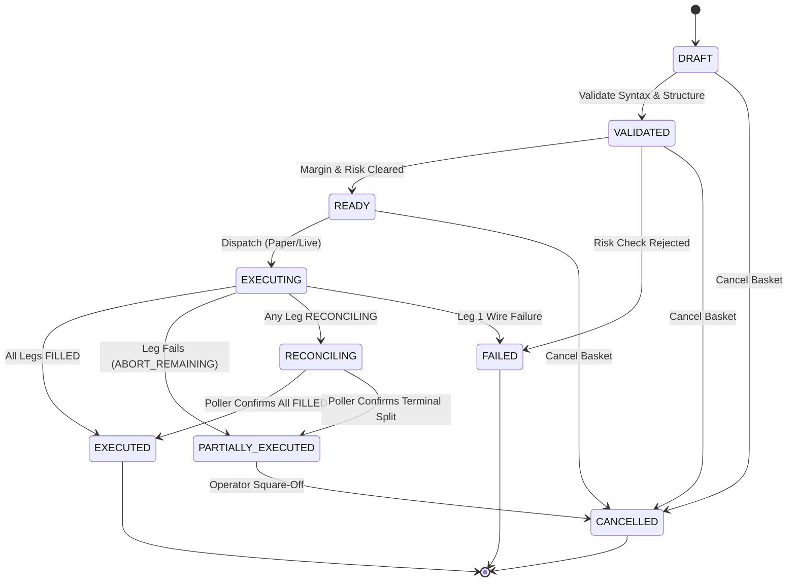
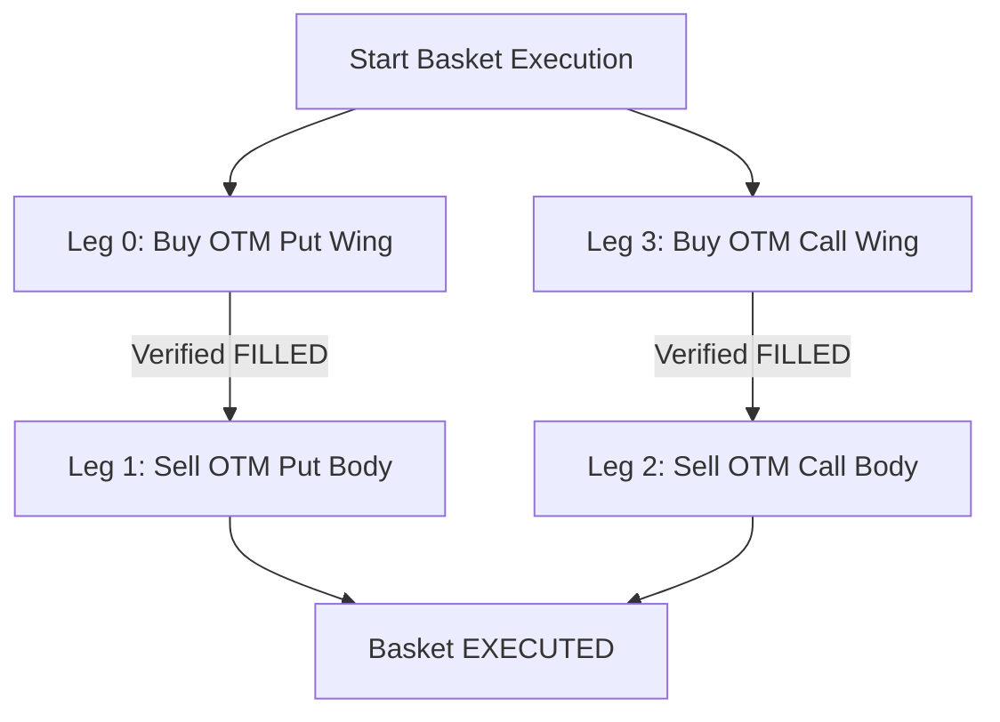
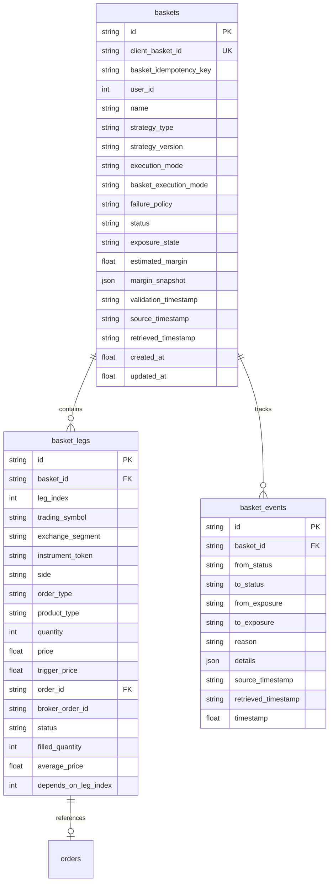

# Phase 9 Architectural Design Specification
## Advanced Orders & Option Strategy Foundation

**Document Version:** 1.0.0  
**Phase:** Phase 9 — Advanced Orders & Option Strategy Foundation  
**Target Milestone:** Milestone M5 (Advanced Orders Baseline)  
**Baseline Dependencies:** 
- Milestone M1 Baseline Locked (`M1_BASELINE`, commit `4d9341a`)
- Milestone M2 Baseline Locked (`M2_BASELINE`, commit `c4d30e6`)
  - Phase 4: WebSocket Supervisor & Streaming Infrastructure
  - Phase 5: Market Watch Foundation & Real-Time Price Engine
  - Phase 6: Portfolio Foundation, Margins & MTM Engine
- Milestone M3 Baseline Locked (`M3_BASELINE`, commit `22dd3c8`)
  - Phase 7: Order Domain Foundation, FSM, Pre-Flight Validation & Risk Framework
- Milestone M4 Baseline Locked (`M4_BASELINE`, commit `2362ba8`)
  - Phase 8: Order Execution Foundation, ExecutionMode Governance, Idempotency & Poller
  - Audited Paper Execution Simulator (`PAPER_EXECUTION_AUDIT.md`)
**Status:** Architectural Design (Pre-Implementation)  
**Implementation Constraint:** **Design specification only — Zero production implementation code generated in this phase**.  

---

## Scope Exclusions (Strict Project Governance)

In strict compliance with the **PROJECT_CONSTITUTION** and core architectural mandates, the following features are **explicitly prohibited** from Phase 9:

- ❌ **No Autonomous Trading Bots**: Zero autonomous signal dispatchers, automated scanners, or headless auto-trading daemons. All basket and multi-leg order submissions remain strictly human-initiated.
- ❌ **No Signal Generation**: Zero automated technical analysis entry/exit triggers (e.g. Supertrend, RSI, EMA, Bollinger bands).
- ❌ **No Auto Entry / Auto Exit**: Zero unattended trade triggers or unprompted square-offs.
- ❌ **No Strategy Automation**: The system understands multi-leg structures; it never decides when to deploy them.
- ❌ **No Auto Hedging**: No automated delta-neutral balancing or autonomous hedging actions.
- ❌ **No Greeks Engine**: Black-Scholes formulas, Delta, Gamma, Theta, Vega, and Rho are deferred to future milestones.
- ❌ **No Option Chain Analytics**: Real-time option chain matrices, strike ladders, and Open Interest scrapers remain outside Phase 9 scope.
- ❌ **No Delta Hedging or Volatility Arbitrage**: Zero algorithmic statistical arbitrage engines.
- ❌ **No Strategy Backtesting**: Zero backtesting simulations or historical strategy replay harnesses.
- ❌ **No Auto Repair of Failed Legs**: If a leg is rejected or fails on the wire, the system **never** attempts automated compensating market orders or synthetic fixes. It aborts remaining legs and prompts the human operator.
- ❌ **No Auto Rollover**: Expiry rollovers must be designed and executed by the operator.
- ❌ **No AI/ML Trading Decisions**: Zero predictive models or generative execution agents.
- ❌ **No Copy Trading**: Zero multi-account replication or social trading features.

> [!IMPORTANT]
> **Core Architectural Objective of Phase 9:**  
> Phase 9 extends the terminal's execution capabilities from atomic, single-leg orders to multi-leg structures and option strategy baskets (e.g., Bull Call Spreads, Straddles, Strangles, Iron Condors). It establishes basket validation, strategy structure verification, dependency execution sequencing, basket-level idempotency, and multi-leg reconciliation while strictly preserving Phase 8 `ExecutionMode` gating, the single-leg Order FSM, and **The Golden Rule of Reconciliation**.

---

## 1. Executive Summary & Architectural Invariants

Milestone M4 established a rock-solid, audited foundation for single-order execution: the terminal validates single-order syntax, evaluates margin adequacy, protects against market slippage, dispatches wire requests to Kotak Neo, and asynchronously reconciles order states.

However, institutional-grade derivatives trading requires coordinating **multiple atomic orders simultaneously** to construct predefined risk-defined option strategies (e.g., buying wings before selling body strikes in an Iron Condor to secure upfront exchange margin relief). 

Phase 9 introduces the **Basket Order and Option Strategy Foundation**. To ensure stability and safety, Phase 9 is governed by four non-negotiable architectural mandates:

```
========================================================================================================
                                     PHASE 9 GOVERNING ARCHITECTURE
========================================================================================================

    [ HUMAN OPERATOR / REST CLIENT ]
                   |
                   | POST /api/baskets/execute
                   v
+------------------------------------------------------------------------------------------------------+
| 1. BASKET IDEMPOTENCY LAYER                                                                          |
|    - Dual-Key Deduplication: client_basket_id (UUIDv4) + basket_idempotency_key                      |
|    - Memory TTL Cache + Database Unique Constraint (baskets.client_basket_id)                        |
+------------------------------------------------------------------------------------------------------+
                   |
                   v
+------------------------------------------------------------------------------------------------------+
| 2. OPTION STRATEGY VALIDATION & RISK ENGINE                                                          |
|    - Structural Validation: Strike Spacing, Expiry Symmetry, Lot Multiples, Underlying Parity         |
|    - Capital Risk Clearance: Margin Sufficiency Check, Max Drawdown Floor, Demat Custody Check       |
|    - Strategy Versioning: e.g. IRON_CONDOR_V1, BULL_CALL_SPREAD_V1                                   |
+------------------------------------------------------------------------------------------------------+
                   |
                   v
+------------------------------------------------------------------------------------------------------+
| 3. BASKET EXECUTION ORCHESTRATOR (`BasketExecutionService`)                                          |
|    - ExecutionMode Inheritance: DISABLED (Refuse) -> PAPER (Simulated) -> LIVE (Wire)                |
|    - Execution Sequencing: SEQUENTIAL (Default), PARALLEL, or DEPENDENCY (Buy Hedge -> Sell Short)    |
|    - Failure Policy: ABORT_REMAINING (Default) — Stop execution, never auto-repair                   |
|    - Dispatches to: Phase 8 OrderExecutionService -> KotakOrderAdapter                               |
+------------------------------------------------------------------------------------------------------+
                   |
                   v
+------------------------------------------------------------------------------------------------------+
| 4. BASKET FSM & EXPOSURE RECONCILER                                                                  |
|    - Basket FSM: DRAFT -> VALIDATED -> READY -> EXECUTING -> PARTIALLY_EXECUTED -> EXECUTED          |
|    - Exposure State Model: NEUTRAL, PARTIALLY_EXPOSED, FULLY_HEDGED, UNKNOWN                         |
|    - The Golden Rule Alignment: If any leg enters RECONCILING, Basket enters RECONCILING            |
+------------------------------------------------------------------------------------------------------+
                   |                                                                 |
                   v                                                                 v
+--------------------------------+                             +--------------------------------+
|       SYSTEM EVENT BUS         |                             |     APPEND-ONLY AUDIT LOG      |
|  - BASKET_CREATED / VALIDATED  |                             |  - AUDIT_BASKET_CREATED        |
|  - BASKET_EXECUTION_STARTED    |                             |  - AUDIT_BASKET_VALIDATED      |
|  - BASKET_LEG_FILLED           |                             |  - AUDIT_BASKET_EXEC_STARTED   |
|  - BASKET_RECONCILING          |                             |  - AUDIT_BASKET_LEG_FILLED     |
|  - BASKET_COMPLETED / FAILED   |                             |  - AUDIT_BASKET_RECONCILIATION |
+--------------------------------+                             +--------------------------------+
========================================================================================================
```

---

## 2. Core Domain Models

Phase 9 defines standardized, immutable domain models in `app/baskets/models/basket.py` and `app/baskets/models/strategy.py`.

### 2.1. Enumerations

#### `StrategyType`
Enumerates standardized multi-leg option and stock structures understood by the validation engine:
- `CUSTOM`: Free-form user basket without structural parity rules.
- `BULL_CALL_SPREAD`: Debit spread: Buy lower strike Call + Sell higher strike Call (same expiry).
- `BEAR_PUT_SPREAD`: Debit spread: Buy higher strike Put + Sell lower strike Put (same expiry).
- `LONG_STRADDLE`: Volatility buyer: Buy ATM Call + Buy ATM Put (same strike, same expiry).
- `SHORT_STRADDLE`: Volatility seller: Sell ATM Call + Sell ATM Put (same strike, same expiry).
- `LONG_STRANGLE`: Volatility buyer: Buy OTM Call + Buy OTM Put (Call strike > Put strike, same expiry).
- `SHORT_STRANGLE`: Volatility seller: Sell OTM Call + Sell OTM Put (Call strike > Put strike, same expiry).
- `IRON_CONDOR`: Defined-risk credit spread: Buy OTM Put + Sell higher OTM Put + Sell lower OTM Call + Buy higher OTM Call.
- `IRON_BUTTERFLY`: Defined-risk credit spread: Buy OTM Put + Sell ATM Put + Sell ATM Call + Buy OTM Call.
- `COVERED_CALL`: Income strategy: Long Underlying Equity (CNC) + Sell OTM Call.
- `PROTECTIVE_PUT`: Hedged portfolio: Long Underlying Equity (CNC) + Buy OTM Put.

#### `BasketFailurePolicy`
Governs automated execution behavior if an individual leg is rejected or fails:
- `ABORT_REMAINING` (**Phase 9 Default**): Cease dispatching any remaining legs immediately. Do not submit subsequent legs. Retain filled legs as-is. Set Basket state to `PARTIALLY_EXECUTED` or `FAILED`. Require human operator intervention.
- `CONTINUE`: Continue dispatching subsequent independent legs despite earlier leg failures (only permitted on `CUSTOM` baskets with no inter-leg dependencies).
- `COMPENSATING_ACTION`: Reserved for future phases. **Prohibited in Phase 9**.

#### `BasketExecutionMode`
Governs the dispatch sequence of legs across the wire:
- `SEQUENTIAL` (**Phase 9 Default**): Dispatch legs strictly one after another ($Leg_{i+1}$ dispatches only after $Leg_i$ is confirmed `FILLED`).
- `PARALLEL`: Dispatch all validated legs concurrently in parallel worker threads (suited for liquid, non-dependent equity baskets).
- `DEPENDENCY`: Explicit Directed Acyclic Graph (DAG) sequencing (e.g. Buy Wing Hedges $\to$ Verify Filled $\to$ Sell Short Body Legs).

#### `BasketExposureState`
Authoritative multi-leg financial exposure descriptor (detailed in Section 6):
- `NEUTRAL`: Zero directional or execution exposure (all legs unfilled or completely closed).
- `PARTIALLY_EXPOSED`: Asymmetric, broken, or unhedged exposure (e.g. short leg filled without protective long wing hedge).
- `FULLY_HEDGED`: All legs executed according to defined strategy proportions, establishing structural risk boundaries.
- `UNKNOWN`: One or more legs are in `RECONCILING` or unconfirmed broker status; exposure cannot be proven until broker wire status resolves.

---

### 2.2. Domain Entities

#### 1. `BasketLeg` Dataclass
Represents an individual leg within a multi-leg basket:
```python
@dataclass
class BasketLeg:
    leg_id: str                               # Unique UUID v4 for the leg
    leg_index: int                            # 0-indexed execution order position
    trading_symbol: str                       # Official NSE/BSE contract symbol
    exchange_segment: str                     # nse_cm, nse_fo, bse_cm, bse_fo
    instrument_token: str                     # Broker scrip master token
    side: OrderSide                           # BUY or SELL
    order_type: OrderType                     # MARKET, LIMIT, SL, SL_M
    product_type: ProductType                 # MIS, NRML, CNC
    validity: Validity                        # DAY, IOC
    quantity: int                             # Requested contract quantity
    price: float                              # Limit price (must respect tick size)
    trigger_price: float                      # Trigger price (for SL orders)
    
    # Execution & Association Linkage
    order_id: Optional[str] = None            # Local client_order_id linked upon dispatch
    broker_order_id: Optional[str] = None     # Kotak Neo assigned broker order ID
    status: OrderStatus = OrderStatus.PENDING_VALIDATION
    filled_quantity: int = 0
    average_price: float = 0.0
    
    # Inter-Leg Dependency
    depends_on_leg_index: Optional[int] = None # Must wait for Leg[index] == FILLED before dispatch
```

#### 2. `Basket` Dataclass
Represents the parent multi-leg container:
```python
@dataclass
class Basket:
    basket_id: str                            # System primary key (UUID v4)
    client_basket_id: str                     # Client idempotency token (UUID v4)
    basket_idempotency_key: str               # Cryptographic hash of (user_id + legs payload)
    user_id: int                              # Authenticated operator ID
    name: str                                 # Human-readable label (e.g. "NIFTY Weekly Iron Condor")
    strategy_type: StrategyType               # Strategy classification enum
    strategy_version: str                     # Schema version (e.g. "IRON_CONDOR_V1")
    execution_mode: ExecutionMode             # Inherited: DISABLED, PAPER, LIVE
    basket_execution_mode: BasketExecutionMode# SEQUENTIAL, PARALLEL, DEPENDENCY
    failure_policy: BasketFailurePolicy       # ABORT_REMAINING (Default)
    
    # Lifecycle & Exposure States
    status: BasketState = BasketState.DRAFT
    exposure_state: BasketExposureState = BasketExposureState.NEUTRAL
    
    # Legs Collection
    legs: List[BasketLeg] = field(default_factory=list)
    
    # Risk & Capital Snapshots
    estimated_margin: float = 0.0             # Upfront exchange margin required
    margin_snapshot: Dict[str, Any] = field(default_factory=dict)
    validation_timestamp: Optional[str] = None# ISO 8601 UTC timestamp of risk clearance
    rejection_reason: Optional[str] = None
    
    # Regulatory Dual Timestamps
    source_timestamp: Optional[str] = None    # Upstream broker acknowledgment time
    retrieved_timestamp: str = field(
        default_factory=lambda: datetime.now(timezone.utc).isoformat()
    )
    created_at: float = field(default_factory=time.time)
    updated_at: float = field(default_factory=time.time)
```

---

## 3. Mandatory Addition #1: Basket Idempotency Architecture

In live options trading, rapid multi-leg submission is highly vulnerable to network jitter and user double-clicking. Placing a duplicate single order causes unintended exposure; placing a duplicate **4-leg Iron Condor** causes **quadruple unintended exposure** and can instantly wipe out margin or breach exchange position limits.

### 3.1. Basket Idempotency vs. Order Idempotency
Phase 9 enforces strict two-level layered idempotency:

| Level | Identifier | Scope & Responsibility | Protection Boundary |
|---|---|---|---|
| **Level 1: Basket Idempotency** | `client_basket_id`<br>`basket_idempotency_key` | Evaluated at `BasketExecutionService`. Prevents duplicate creation or submission of the entire multi-leg container. | Intercepts UI double-clicks, browser retry storms, and duplicate API calls before a single leg is formed. |
| **Level 2: Order Idempotency** | `client_order_id` (Per Leg) | Evaluated at Phase 8 `OrderExecutionService` and `IdempotencyManager`. Governs single-leg wire submissions. | Guarantees single-execution semantics on the broker wire for each individual order payload. |

```
[ POST /api/baskets/execute ]
             |
             +---> [ Level 1: Basket Idempotency Check ]
             |     - Is client_basket_id already active in BasketIdempotencyManager?
             |     - Does baskets table contain UNIQUE(client_basket_id)?
             |     - If Duplicate: RETURN 409 Conflict (DUPLICATE_BASKET_REQUEST)
             |
             +---> [ For Each Leg in Basket ]
                   - Generate unique leg.client_order_id (UUID v4)
                   - Dispatch to Level 2: OrderExecutionService(client_order_id)
                   - Inherit single-order DB constraint & in-memory TTL lock
```

### 3.2. Idempotency Key Generation Algorithm
To guarantee uniqueness across network reconnects:
1. `client_basket_id`: Operator-supplied or UI-generated UUID v4 string.
2. `basket_idempotency_key`: SHA-256 hash computed deterministically from:
   $$\text{Hash} = \text{SHA256}(\text{user\_id} + \text{strategy\_type} + \sum_{i=1}^{n} (\text{symbol}_i + \text{side}_i + \text{qty}_i + \text{price}_i))$$
3. Both keys are cached in `BasketIdempotencyManager` with a 120-second sliding TTL lock and enforced via database unique constraints on `baskets.client_basket_id`.

---

## 4. Mandatory Addition #2: Basket Failure Policy (`BasketFailurePolicy`)

When executing multi-leg strategies, partial fills and rejections introduce asymmetric directional risk.

### 4.1. Supported Policies
```
enum BasketFailurePolicy:
    ABORT_REMAINING       = "ABORT_REMAINING"       # Phase 9 Standard (Fail-Safe)
    CONTINUE              = "CONTINUE"              # Permitted only for unhedged CUSTOM baskets
    COMPENSATING_ACTION   = "COMPENSATING_ACTION"   # Strictly Prohibited in Phase 9
```

### 4.2. Phase 9 Standard: `ABORT_REMAINING`
In Phase 9, `ABORT_REMAINING` is the hardcoded default policy for all structured option strategies.

#### Concrete Failure Scenario:
Consider a 4-leg **Iron Condor** on NIFTY:
* **Leg 1 (Buy OTM Put Hedge):** Dispatched $\to$ `FILLED` (Quantity: 50, Price: ₹15.00).
* **Leg 2 (Sell Short Put Body):** Dispatched $\to$ `REJECTED` by Broker RMS (Reason: Margin Ceiling Breached).
* **Leg 3 (Sell Short Call Body):** `NOT_SUBMITTED`.
* **Leg 4 (Buy OTM Call Hedge):** `NOT_SUBMITTED`.

#### Execution Rules Under `ABORT_REMAINING`:
1. **Immediate Execution Freeze**: The `BasketExecutionService` cancels the dispatch queue for Leg 3 and Leg 4.
2. **Zero Compensating Orders**: The terminal **must never** attempt an automated market sell to exit Leg 1 or attempt to modify Leg 2. Automated recovery algorithms introduce dangerous secondary execution risk.
3. **State Mutation**:
   - Basket state transitions immediately from `EXECUTING` to `PARTIALLY_EXECUTED` (or `FAILED` if Leg 1 failed).
   - Basket exposure state transitions to `PARTIALLY_EXPOSED`.
4. **Operator Alerting**: Emits `BASKET_FAILED` event and logs structured `AUDIT_BASKET_FAILED` record detailing the failed leg index and RMS reason. Control is yielded completely to the human operator.

---

## 5. Mandatory Addition #3: ExecutionMode Inheritance Pipeline

Phase 8 established the non-negotiable `ExecutionMode` gate (`DISABLED`, `PAPER`, `LIVE`). Multi-leg basket execution **must strictly inherit and comply with this architecture**.

### 5.1. Strict Inversion of Control
A basket **never** communicates with the broker wire directly. Every basket leg must be routed through the Phase 8 `OrderExecutionService`:

$$\text{Basket} \longrightarrow \text{BasketExecutionService} \longrightarrow \text{OrderExecutionService} \longrightarrow \text{KotakOrderAdapter} \longrightarrow \text{Broker Wire}$$

```
                                  EXECUTION MODE INHERITANCE
                                  
      [ ExecutionModeManager (Phase 8) ]
                     |
        +------------+------------+
        |                         |
    Mode: DISABLED            Mode: PAPER / LIVE
        |                         |
        v                         v
  Reject Basket           Dispatch Basket Leg
  HTTP 403 Forbidden      to OrderExecutionService
  (Zero Wire / Paper)     (Inherits Mode Constraints)
```

### 5.2. Governance Rules
1. **Global Mode Primacy**: If `ExecutionModeManager.get_mode() == ExecutionMode.DISABLED`, calling `POST /api/baskets/{id}/execute` returns `HTTP 403 Forbidden` (`ExecutionModeException: Order execution is strictly DISABLED`).
2. **Inheritance at Dispatch**: When a basket is authorized for execution, each `BasketLeg` is transformed into an authoritative `Order` entity inheriting the parent basket's `ExecutionMode`.
3. **Paper Isolation**: When `ExecutionMode == PAPER`, all basket legs execute against Phase 8's audited paper simulator (`PAPER_EXECUTION_AUDIT.md`), guaranteeing that simulated fills strictly match requested quantities without transmitting packets to Kotak Neo servers.

---

## 6. Mandatory Addition #4: Reconciling Exposure Model (`BasketExposureState`)

In single-order systems, `OrderStatus` provides sufficient clarity (e.g., `FILLED` vs. `RECONCILING`). In multi-leg strategies, **basket status alone is mathematically insufficient to determine portfolio risk**.

### 6.1. Why Basket Status Alone is Insufficient
Consider an operator executing an **Iron Butterfly**:
- If the basket status is `EXECUTING`, does the account have open naked risk?
- If the basket status is `RECONCILING`, what is the directional delta?
- If Leg 1 (Long Put) and Leg 2 (Long Call) are `FILLED`, but Leg 3 (Short Straddle) is `RECONCILING` due to a gateway socket drop:
  - The Basket Status is `RECONCILING`.
  - But financially, the account is **Long Volatility (Holding Long Options)**.
- Conversely, if Leg 3 (Short Straddle) is `FILLED` and Leg 1/Leg 2 (Long Hedges) are `RECONCILING`:
  - The Basket Status is still `RECONCILING`.
  - But financially, the account has **Catastrophic Unhedged Short Gamma (Naked Short Straddle)**!

To prevent blindness during network drops, Phase 9 decouples **Lifecycle State (`BasketState`)** from **Risk Exposure State (`BasketExposureState`)**.

### 6.2. Exposure State Transition Matrix
| Strategy Type | Leg Execution Profile | Basket Status | Exposure State | Financial Risk Context |
|---|---|---|---|---|
| **Iron Condor** | Leg 1: Unfilled<br>Leg 2: Unfilled<br>Leg 3: Unfilled<br>Leg 4: Unfilled | `READY` | `NEUTRAL` | Zero capital or directional risk. |
| **Iron Condor** | Leg 1 (Long Put): `FILLED`<br>Leg 2 (Short Put): `FILLED`<br>Leg 3 (Short Call): `RECONCILING`<br>Leg 4 (Long Call): `NOT_SUBMITTED` | `RECONCILING` | `PARTIALLY_EXPOSED` | **High Risk**: Bull Put spread active, but Short Call body is in unconfirmed state without Call wing protection. |
| **Bull Call Spread**| Leg 1 (Long Call): `FILLED`<br>Leg 2 (Short Call): `FILLED` | `EXECUTED` | `FULLY_HEDGED` | Risk is defined; maximum loss is capped at net debit paid. |
| **Bull Call Spread**| Leg 1 (Long Call): `REJECTED`<br>Leg 2 (Short Call): `NOT_SUBMITTED` | `FAILED` | `NEUTRAL` | Zero legs filled; zero market exposure. |
| **Short Straddle** | Leg 1 (Short Call): `FILLED`<br>Leg 2 (Short Put): `RECONCILING` | `RECONCILING` | `UNKNOWN` | Naked short Call active; matching engine confirmation pending on Put leg. Operator must monitor wire. |

> [!IMPORTANT]
> **The Golden Rule Alignment**: Under Phase 6 and Phase 7 governance, **unconfirmed != dead**. If any leg enters `OrderStatus.RECONCILING`, the parent Basket **must** enter `BasketState.RECONCILING` and `BasketExposureState.PARTIALLY_EXPOSED` (or `UNKNOWN`). The reconciler continuously polls the broker until true exchange state is proven.

---

## 7. Basket Finite State Machine (FSM)

The lifecycle of a basket is governed by a thread-safe, forward-only deterministic finite state machine implemented in `app/baskets/services/basket_state_machine.py`.

### 7.1. State Catalog (`BasketState`)
```
enum BasketState:
    DRAFT               # Initial creation; legs can be added, edited, or removed
    VALIDATED           # Syntax, strike parity, and lot size validation passed
    READY               # Pre-trade capital risk and margin checks cleared
    EXECUTING           # Dispatched across the wire; legs actively routing
    PARTIALLY_EXECUTED  # Execution halted with some legs filled (e.g. failure policy abort)
    EXECUTED            # All legs filled to 100% requested quantity (Terminal)
    FAILED              # Pre-flight check rejected or Leg 1 failed (Terminal)
    CANCELLED           # Operator cancelled before completion (Terminal)
    RECONCILING         # One or more legs are in unconfirmed broker status
```

### 7.2. FSM State Diagram


### 7.3. Legal Transition Matrix
```python
LEGAL_BASKET_TRANSITIONS: Dict[BasketState, Set[BasketState]] = {
    BasketState.DRAFT: {
        BasketState.VALIDATED,
        BasketState.CANCELLED,
    },
    BasketState.VALIDATED: {
        BasketState.READY,
        BasketState.FAILED,
        BasketState.CANCELLED,
    },
    BasketState.READY: {
        BasketState.EXECUTING,
        BasketState.CANCELLED,
    },
    BasketState.EXECUTING: {
        BasketState.EXECUTED,
        BasketState.PARTIALLY_EXECUTED,
        BasketState.FAILED,
        BasketState.RECONCILING,
    },
    BasketState.PARTIALLY_EXECUTED: {
        BasketState.CANCELLED,
        BasketState.RECONCILING,
    },
    BasketState.RECONCILING: {
        BasketState.EXECUTED,
        BasketState.PARTIALLY_EXECUTED,
        BasketState.FAILED,
    },
    BasketState.EXECUTED: set(),    # Terminal
    BasketState.FAILED: set(),      # Terminal
    BasketState.CANCELLED: set(),   # Terminal
}
```

---

## 8. Basket Execution Modes & Dependency Sequencing

### 8.1. Comparison of Execution Modes
```
enum BasketExecutionMode:
    SEQUENTIAL    # Phase 9 Default
    PARALLEL      # Optional for non-dependent equity baskets
    DEPENDENCY    # Optional DAG model for options hedge priority
```

| Mode | Sequencing Mechanism | Advantages | Operational Risks | Recommended Use Case |
|---|---|---|---|---|
| **`SEQUENTIAL`** | $Leg_i \to \text{Wait for Fill} \to Leg_{i+1}$ | Guaranteed order of arrival; lowest risk of execution inversion. | Higher total basket fill latency ($\approx 200\text{ms} - 500\text{ms}$). | Standard multi-leg options trading (Default). |
| **`PARALLEL`** | Threads dispatch all legs simultaneously. | Lowest latency ($\approx 50\text{ms} - 80\text{ms}$). | High risk: Short leg might fill while Long hedge is rejected. | Equity baskets (e.g. buying 5 stocks simultaneously). |
| **`DEPENDENCY`** | Legs declare `depends_on_leg_index`. | Ensures Long hedge wings fill *before* short body legs are routed. | Slower if dependency chain is deep. | Credit spreads & Iron Condors requiring upfront margin relief. |

### 8.2. Dependency Execution Graph (DAG) Model
In options trading, executing a short leg before a long leg requires naked margin (₹1.5 Lakh per lot). Executing the long leg first establishes a spread, reducing margin to ₹35,000.

#### Execution Sequence for Iron Condor Under `DEPENDENCY` Mode:

If Leg 0 or Leg 3 fails, Leg 1 and Leg 2 are **never dispatched**, protecting the account from unhedged naked margin spikes.

---

## 9. Option Strategy Validation Engine

Located in `app/baskets/services/strategy_validator.py`, this engine validates semantic and mathematical consistency before any basket can transition to `BasketState.VALIDATED`.

### 9.1. Universal Strategy Invariants
Every structured option basket must satisfy:
1. **Underlying Consistency**: All legs must reference the same underlying index or equity (e.g. all legs must be `NIFTY` or all `BANKNIFTY`).
2. **Expiry Consistency**: All legs must share the identical expiry date (except for Calendar Spreads, which are deferred to future phases).
3. **Lot Multiples**: Every leg's quantity must be an exact multiple of the exchange contract lot size (e.g. multiple of 25 for NIFTY, 15 for BANKNIFTY).
4. **Product Type Parity**: All legs must share the identical product code (`MIS` or `NRML`). Inter-product spreading (e.g. `MIS` with `CNC`) is prohibited.

### 9.2. Strategy-Specific Validation Rules

#### 1. `LONG_STRADDLE` / `SHORT_STRADDLE`
* **Leg Count**: Exactly 2 legs.
* **Composition**: Exactly 1 Call (`CE`) and 1 Put (`PE`).
* **Sides**: Both `BUY` (Long Straddle) or both `SELL` (Short Straddle).
* **Strike Rule**: $\text{Strike}(\text{Call}) == \text{Strike}(\text{Put})$.
* **Quantity Rule**: $\text{Quantity}(\text{Call}) == \text{Quantity}(\text{Put})$.

#### 2. `LONG_STRANGLE` / `SHORT_STRANGLE`
* **Leg Count**: Exactly 2 legs.
* **Composition**: Exactly 1 Call (`CE`) and 1 Put (`PE`).
* **Sides**: Both `BUY` (Long Strangle) or both `SELL` (Short Strangle).
* **Strike Rule**: $\text{Strike}(\text{Call}) > \text{Strike}(\text{Put})$.
* **Quantity Rule**: $\text{Quantity}(\text{Call}) == \text{Quantity}(\text{Put})$.

#### 3. `BULL_CALL_SPREAD`
* **Leg Count**: Exactly 2 legs.
* **Composition**: Both legs must be Calls (`CE`).
* **Sides**: Exactly 1 `BUY` and 1 `SELL`.
* **Strike Rule**: $\text{Strike}(\text{Buy Call}) < \text{Strike}(\text{Sell Call})$.
* **Quantity Rule**: $\text{Quantity}(\text{Buy}) == \text{Quantity}(\text{Sell})$.

#### 4. `BEAR_PUT_SPREAD`
* **Leg Count**: Exactly 2 legs.
* **Composition**: Both legs must be Puts (`PE`).
* **Sides**: Exactly 1 `BUY` and 1 `SELL`.
* **Strike Rule**: $\text{Strike}(\text{Buy Put}) > \text{Strike}(\text{Sell Put})$.
* **Quantity Rule**: $\text{Quantity}(\text{Buy}) == \text{Quantity}(\text{Sell})$.

#### 5. `IRON_CONDOR`
* **Leg Count**: Exactly 4 legs (2 Puts, 2 Calls).
* **Composition**:
  - Put Wing: Buy Put at $K_1$
  - Put Body: Sell Put at $K_2$
  - Call Body: Sell Call at $K_3$
  - Call Wing: Buy Call at $K_4$
* **Strike Ladder Invariant**:
  $$K_1 < K_2 < K_3 < K_4$$
* **Symmetry Rule**: Wing spreads must be equal:
  $$(K_2 - K_1) == (K_4 - K_3)$$
* **Quantity Parity**: $\text{Quantity}(L_1) == \text{Quantity}(L_2) == \text{Quantity}(L_3) == \text{Quantity}(L_4)$.

#### 6. `COVERED_CALL`
* **Leg Count**: Exactly 2 legs.
* **Composition**:
  - Leg 1: Equity Cash Delivery (`CNC`) Buy (or pre-existing custody).
  - Leg 2: Derivative Index/Stock Call (`CE`) Sell (`NRML`/`MIS`).
* **Underlying Parity**: Equity symbol must match derivative underlying scrip.
* **Quantity Rule**: Equity quantity must equal derivative contract lot size.

---

## 10. Pre-Trade Risk Framework for Baskets

The `BasketRiskService` integrates with Phase 6 (`MarginService`, `PortfolioSummary`) and Phase 7 (`OrderRiskService`) to assess portfolio safety before any basket transitions to `BasketState.READY`.

### 10.1. Multi-Leg Risk Verifications
1. **Aggregate Margin Availability**:
   - Calculates the net upfront margin requirement across all legs using Phase 6 `MarginService`.
   - Incorporates a **+10% safety buffer** over exchange minimum margin to absorb intra-trade spread execution latency.
   $$\text{Required Margin} \le \text{Available Margin} \times 0.90$$
2. **Gross Basket Notional Value Ceiling**:
   - The cumulative gross value of all legs in a single basket must not exceed ₹20,00,000 (₹20 Lakh).
3. **Daily Account Drawdown Breach**:
   - Re-evaluates Phase 6 `PortfolioSummary.unrealized_pnl + realized_pnl`.
   - If cumulative daily loss breaches -₹20,000, all basket executions are immediately blocked.
4. **Open Basket Concurrent Quota**:
   - Active baskets in `EXECUTING` or `RECONCILING` status are capped at a maximum of **5 concurrent baskets**.
5. **Demat Custody Verification for Covered Legs**:
   - For `COVERED_CALL` strategies, verifies physical settlement custody via Phase 6 `HoldingsService` before permitting short call authorization.

### 10.2. Auditability Attributes
To guarantee post-trade regulatory compliance:
- `margin_snapshot`: Full JSON snapshot of margins at validation time (`available_cash`, `collateral`, `required_margin`).
- `validation_timestamp`: Precise ISO 8601 UTC timestamp when the risk engine authorized the basket.

---

## 11. Relational Database Schema & Migrations

Database persistence is managed via SQLAlchemy ORM entities in `app/baskets/models/basket_entity.py` and Alembic Migration `005_create_basket_tables.py` (Revision ID: `a1b2c3d4e5f6`, revising `004_create_order_tables.py`).

### 11.1. Entity Relationship Diagram


### 11.2. Table Specifications & Indexes
1. **`baskets` Table**:
   - Primary Key: `id` (VARCHAR(36)).
   - Unique Constraint: `client_basket_id` (VARCHAR(36)).
   - Indexes: `ix_baskets_user_id`, `ix_baskets_status`, `ix_baskets_strategy_type`, `ix_baskets_created_at`.
2. **`basket_legs` Table**:
   - Foreign Key: `basket_id` referencing `baskets.id` (`ON DELETE CASCADE`).
   - Indexes: `ix_basket_legs_basket_id`, `ix_basket_legs_order_id`, `ix_basket_legs_broker_order_id`.
3. **`basket_events` Table**:
   - Immutable audit trail recording lifecycle and exposure state transitions.
   - Foreign Key: `basket_id` referencing `baskets.id` (`ON DELETE CASCADE`).
   - Index: `ix_basket_events_basket_id`.

---

## 12. System Event Bus & Audit Logging Integration

### 12.1. Event Bus Catalog (`app/events/event_types.py`)
Phase 9 registers new system events:
* `BASKET_CREATED`: New basket drafted locally.
* `BASKET_VALIDATED`: Strategy syntax and strike ladder verified.
* `BASKET_EXECUTION_STARTED`: Wire routing initiated.
* `BASKET_LEG_FILLED`: Individual leg fill recorded.
* `BASKET_RECONCILING`: Golden Rule invoked; basket exposure marked unconfirmed.
* `BASKET_COMPLETED`: All legs filled successfully.
* `BASKET_FAILED`: Failure policy aborted remaining legs.
* `BASKET_CANCELLED`: Operator cancelled basket.

#### Payload Specification Example (`BASKET_LEG_FILLED`):
```json
{
  "event": "basket.leg_filled",
  "timestamp": "2026-11-06T11:20:05.123456Z",
  "data": {
    "basket_id": "bkt-9876-uuid4",
    "client_basket_id": "cbkt-1122-uuid4",
    "leg_index": 0,
    "trading_symbol": "NIFTY26NOV24500PE",
    "fill_quantity": 50,
    "fill_price": 18.50,
    "basket_status": "EXECUTING",
    "basket_exposure_state": "PARTIALLY_EXPOSED"
  }
}
```

### 12.2. Audit Framework Catalog (`app/core/audit.py`)
Registered audit actions:
* `AUDIT_BASKET_CREATED`
* `AUDIT_BASKET_VALIDATED`
* `AUDIT_BASKET_EXECUTION_STARTED`
* `AUDIT_BASKET_LEG_FILLED`
* `AUDIT_BASKET_RECONCILIATION`
* `AUDIT_BASKET_FAILED`
* `AUDIT_BASKET_CANCELLED`

---

## 13. REST API Design

Basket operations are exposed via authenticated REST endpoints under the `/api/baskets` namespace in `app/baskets/routes.py`.

### 13.1. Route Summary
| HTTP Verb | Path | Auth Required | Description |
|---|---|---|---|
| `GET` | `/api/baskets/status` | Public | Operational status and execution gating info. |
| `POST` | `/api/baskets` | Yes | Create a new multi-leg basket draft. |
| `POST` | `/api/baskets/validate` | Yes | Dry-run validation of strategy structure and risk. |
| `POST` | `/api/baskets/{id}/execute` | Yes | Trigger basket execution (gated by `ExecutionMode`). |
| `POST` | `/api/baskets/{id}/cancel` | Yes | Cancel unfilled legs in a resting or draft basket. |
| `GET` | `/api/baskets` | Yes | List operator baskets (with status & strategy filters). |
| `GET` | `/api/baskets/{id}` | Yes | Retrieve full basket details, legs, and event timeline. |

### 13.2. Detailed Endpoint Contracts

#### 1. `POST /api/baskets` — Create Basket
* **Request Payload**:
```json
{
  "client_basket_id": "bkt-req-20261106-01",
  "name": "NIFTY Weekly Bull Call Spread",
  "strategy_type": "BULL_CALL_SPREAD",
  "strategy_version": "BULL_CALL_SPREAD_V1",
  "basket_execution_mode": "SEQUENTIAL",
  "failure_policy": "ABORT_REMAINING",
  "legs": [
    {
      "leg_index": 0,
      "trading_symbol": "NIFTY26NOV24500CE",
      "exchange_segment": "nse_fo",
      "side": "BUY",
      "order_type": "LIMIT",
      "product_type": "MIS",
      "quantity": 50,
      "price": 145.20
    },
    {
      "leg_index": 1,
      "trading_symbol": "NIFTY26NOV24700CE",
      "exchange_segment": "nse_fo",
      "side": "SELL",
      "order_type": "LIMIT",
      "product_type": "MIS",
      "quantity": 50,
      "price": 62.50
    }
  ]
}
```
* **Success Response (`201 Created`)**:
```json
{
  "success": true,
  "data": {
    "basket_id": "bkt-9876-uuid4",
    "client_basket_id": "bkt-req-20261106-01",
    "status": "DRAFT",
    "exposure_state": "NEUTRAL",
    "strategy_type": "BULL_CALL_SPREAD",
    "total_legs": 2,
    "created_at": 1794050400.123
  }
}
```

#### 2. `POST /api/baskets/validate` — Dry-Run Validation
* **Success Response (`200 OK`)**:
```json
{
  "success": true,
  "data": {
    "valid": true,
    "strategy_syntax_passed": true,
    "risk_checks_passed": true,
    "estimated_margin": 42500.00,
    "available_margin": 150000.00,
    "margin_headroom": 107500.00,
    "errors": []
  }
}
```

#### 3. `POST /api/baskets/{id}/execute` — Execute Basket
* **Execution Gating**: Refused with `403 Forbidden` if `ExecutionMode == DISABLED`.
* **Success Response (`200 OK`)**:
```json
{
  "success": true,
  "message": "Basket execution dispatched",
  "data": {
    "basket_id": "bkt-9876-uuid4",
    "execution_mode": "LIVE",
    "basket_execution_mode": "SEQUENTIAL",
    "status": "EXECUTING",
    "exposure_state": "PARTIALLY_EXPOSED"
  }
}
```

---

## 14. Comprehensive Test Strategy

Phase 9 implementation must achieve 100% automated test coverage across unit and integration tiers.

### 14.1. Unit Testing Matrix
1. **Basket Idempotency Tests (`tests/unit/test_basket_idempotency.py`)**:
   - Verify `check_and_acquire()` succeeds on initial token.
   - Verify duplicate `client_basket_id` is immediately rejected without evaluating legs.
   - Verify database unique constraint prevents race conditions across concurrent workers.
2. **Strategy Validation Tests (`tests/unit/test_strategy_validator.py`)**:
   - `test_iron_condor_strike_ladder`: Validates $K_1 < K_2 < K_3 < K_4$ and equal wing spacing.
   - `test_straddle_strike_equality`: Validates Call strike equals Put strike.
   - `test_expiry_mismatch_rejection`: Validates rejection if Leg 1 and Leg 2 have different expiries.
   - `test_lot_size_multiples`: Validates quantity modulo check against contract lot size.
3. **Basket Failure Policy Tests (`tests/unit/test_basket_failure_policy.py`)**:
   - `test_abort_remaining_policy`: If Leg 0 fills and Leg 1 is rejected, verify Leg 2 is never dispatched.
   - Verify zero automated compensating orders are submitted.
4. **Exposure State Tests (`tests/unit/test_basket_exposure_state.py`)**:
   - Verify transitions between `NEUTRAL`, `PARTIALLY_EXPOSED`, and `FULLY_HEDGED`.
   - Verify that an unconfirmed leg immediately forces `BasketExposureState.UNKNOWN` or `PARTIALLY_EXPOSED`.
5. **ExecutionMode Inheritance Tests (`tests/unit/test_basket_execution_mode.py`)**:
   - Verify basket execution is refused when `ExecutionMode.DISABLED`.
   - Verify legs route to paper simulator when `ExecutionMode.PAPER`.
   - Verify legs route to wire adapter when `ExecutionMode.LIVE`.
6. **Basket FSM Legality Tests (`tests/unit/test_basket_fsm.py`)**:
   - Verify legal lifecycle progression: `DRAFT` $\to$ `VALIDATED` $\to$ `READY` $\to$ `EXECUTING` $\to$ `EXECUTED`.
   - Verify illegal transition rejection (e.g. `EXECUTED` $\to$ `CANCELLED`).
   - Verify recovery from `RECONCILING` to `EXECUTED` upon poller confirmation.

### 14.2. Integration Testing Matrix (`tests/integration/test_basket_routes.py`)
1. `test_basket_rest_lifecycle`: Full create, validate, execute, and detail retrieval via REST.
2. `test_basket_cancel_open_legs`: Cancels resting limit legs in an executing basket.
3. `test_emergency_kill_switch_integration`: Verifies that `POST /api/orders/cancel-all` halts all executing baskets and cancels individual resting legs.

---

## 15. Implementation Deliverables & Sign-Off Checklist

When approved by the user, Phase 9 implementation will deliver:

- [ ] `app/baskets/models/basket.py` — Dataclasses & enums (`Basket`, `BasketLeg`, `StrategyType`, `BasketExposureState`).
- [ ] `app/baskets/models/basket_entity.py` — SQLAlchemy ORM models.
- [ ] `migrations/versions/005_create_basket_tables.py` — Alembic schema migration.
- [ ] `app/baskets/services/basket_idempotency_manager.py` — In-memory TTL & unique key validator.
- [ ] `app/baskets/services/strategy_validator.py` — Multi-leg option parity validation engine.
- [ ] `app/baskets/services/basket_risk_service.py` — Aggregate margin & drawdown gatekeeper.
- [ ] `app/baskets/services/basket_state_machine.py` — Deterministic 9-state Basket FSM.
- [ ] `app/baskets/services/basket_execution_service.py` — Orchestrator with `ExecutionMode` inheritance & sequencing.
- [ ] `app/baskets/routes.py` — Complete REST API suite (`/api/baskets`).
- [ ] Unit & Integration test suites achieving 100% automated pass rate.
- [ ] `docs/adr/ADR-013-Advanced-Orders-and-Option-Strategies.md`.
- [ ] `PHASE9_ARCHITECTURE_REVIEW.md`.

---

**`PHASE9_DESIGN_SPEC.md` is complete, verified, and ready for architectural review.**
