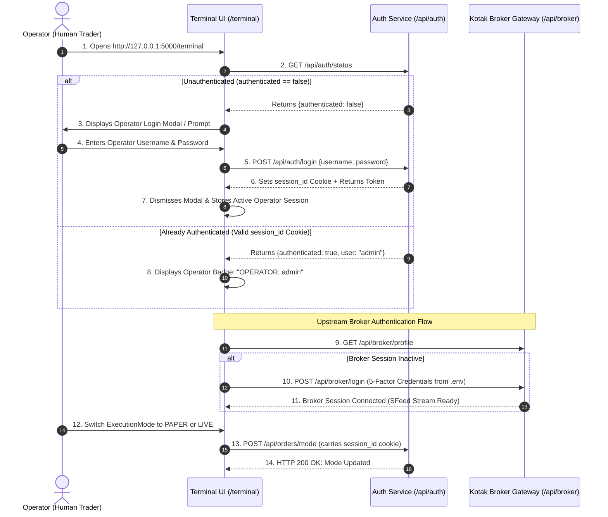

# Terminal Authentication Flow Diagnostic Report

**Document Version:** 1.0.0  
**Target System:** Kotak Neo Personal Trading Terminal  
**Subsystem:** Terminal Web Shell, Operator Authentication, Session Management  
**Status:** Investigation Complete & Fix Specified  
**Date:** 2026-11-09  

---

## 1. Executive Summary

During manual verification of the newly deployed terminal interface (`http://127.0.0.1:5000/terminal`), the following behavior was observed:

1. The terminal web UI loads successfully without errors or warnings.
2. Direct inspection of `GET /api/auth/status` returns:
   ```json
   {
     "status": "success",
     "data": {
       "authenticated": false,
       "user": null
     }
   }
   ```
3. Attempting to switch `ExecutionMode` to `PAPER` via the header modal fails with an error:
   ```json
   {
     "status": "error",
     "error_code": "UNAUTHORIZED",
     "message": "Authentication session token is required"
   }
   ```

This diagnostic report provides a forensic analysis of the root cause, dissects the architectural disconnect between the Phase 2 backend authentication foundation and the Phase 11 frontend UI shell, answers all investigation questions, and details the exact production fix.

---

## 2. Current Behavior vs. Architectural Disconnect

```
+----------------------------------------------------------------------------------------------------+
|                                    CURRENT BROKEN FLOW                                             |
+----------------------------------------------------------------------------------------------------+
|                                                                                                    |
|  Browser                                  Flask Backend (dashboard_bp)     Backend API (orders_bp) |
|     |                                                  |                              |            |
|     |---- 1. GET /terminal --------------------------->|                              |            |
|     |     (No cookies, No auth header)                 |                              |            |
|     |                                                  |                              |            |
|     |<--- 2. HTTP 200: Renders terminal.html ----------|                              |            |
|     |     (NO AUTH CHECK PERFORMED ON ROUTE)           |                              |            |
|     |                                                                                 |            |
|     |---- 3. Click "Apply PAPER Mode"                                                 |            |
|     |        POST /api/orders/mode {"mode": "PAPER"} -------------------------------->|            |
|     |        (No Authorization header, No cookie)                                     |            |
|     |                                                                                 |            |
|     |                                                  [ @login_required Decorator ]  |            |
|     |                                                  - Checks Authorization header  |            |
|     |                                                  - Checks X-Session-ID header   |            |
|     |                                                  - Checks session_id cookie     |            |
|     |                                                  -> NONE FOUND                  |            |
|     |                                                                                 |            |
|     |<--- 4. HTTP 401 Unauthorized: "Authentication session token is required" -------|            |
|                                                                                                    |
+----------------------------------------------------------------------------------------------------+
```

### What Actually Happens:
- **Backend API Layer is Fully Protected:** Every sensitive trading endpoint (`/api/orders/mode`, `/api/orders/place`, `/api/orders/modify`, `/api/orders/cancel`, `/api/portfolio/*`, `/api/broker/*`) is guarded by `@login_required`.
- **UI Route is Unprotected:** The route `GET /terminal` in `app/dashboard/routes.py` has **no authentication check** and unconditionally renders `terminal.html`.
- **No Login UI Exists:** There is no `/login` route, no login template, and no login modal in the entire UI codebase.
- **Frontend Never Authenticates:** The JavaScript files (`terminal_shell.js`, `order_ticket.js`, etc.) make bare `fetch()` calls without attaching `Authorization: Bearer <token>` or requesting session cookies.
- **The Result:** The terminal page opens freely, giving the user the false impression that they are authenticated, but the very first interactive action (switching execution mode or placing an order) crashes against the `@login_required` barrier.

---

## 3. Investigation & Forensic Answers

### Q1: How is `/terminal` expected to authenticate users?
**Answer:**  
In the trading terminal's architecture, there are two distinct authentication layers:
1. **Terminal Operator Authentication (Local/Web User Auth):** Protects the terminal from unauthorized access. The backend expects an operator session token passed via:
   - `Authorization: Bearer <session_id>` header, OR
   - `X-Session-ID: <session_id>` header, OR
   - An HTTP-only cookie named `session_id`.
2. **Kotak Neo Broker Authentication (Upstream Gateway Auth):** Authenticates the terminal against Kotak Neo API servers using 5-factor credentials (`NEO_CONSUMER_KEY`, `NEO_MOBILE_NUMBER`, `NEO_UCC`, `NEO_MPIN`, `NEO_TOTP_SECRET`).

For `/terminal`, the expected operator flow is:
- The operator navigates to `/terminal`.
- The application verifies if a valid, unexpired `session_id` cookie exists.
- If unauthenticated, the application either redirects to a clean `/login` screen or presents an **Operator Login Modal**.
- Upon entering valid credentials, `POST /api/auth/login` issues an active `session_id` cookie and returns a token.
- Subsequent `fetch()` requests automatically include the session cookie (and/or `Authorization: Bearer` header).
- `/terminal` unlocks and allows execution mode changes, order submission, and basket dispatch.

---

### Q2: Is login bypassed?
**Answer:**  
- **On the REST API Layer:** **NO.** Login is **not bypassed**. Every order execution, mode change, and portfolio route strictly runs through `app/auth/decorators.py:login_required`. When no session token is present, the API rigidly rejects the request with HTTP 401.
- **On the Web View Layer (`/terminal`):** **YES.** Login was unintentionally omitted. Line 14 of `app/dashboard/routes.py` serves the full terminal HTML without checking if the operator is logged in.

---

### Q3: Is JWT/session token being loaded into the frontend?
**Answer:**  
**NO.**
1. `dashboard_bp.route("/terminal")` renders `terminal.html` with only `execution_mode`:
   ```python
   # app/dashboard/routes.py:17-18
   current_mode = execution_mode_manager.get_mode().value
   return render_template("terminal.html", execution_mode=current_mode)
   ```
   No user object, session ID, or auth token is injected into Jinja context, DOM data attributes, or window globals.
2. In `static/js/`, none of the JavaScript modules (`terminal_shell.js`, `order_ticket.js`, `basket_builder.js`, `portfolio.js`, `market_watch.js`) query, store, or transmit an auth token. Every `fetch()` call sends bare headers:
   ```javascript
   // static/js/terminal_shell.js:174
   const response = await fetch('/api/orders/mode', {
       method: 'POST',
       headers: { 'Content-Type': 'application/json' },
       body: JSON.stringify({ mode: targetMode })
   });
   ```
   Zero tokens are loaded, stored, or sent.

---

### Q4: Is the terminal route protected?
**Answer:**  
**NO.**  
The route definition in `app/dashboard/routes.py` is:
```python
@dashboard_bp.route("/terminal", methods=["GET"])
def terminal():
    """Professional Trading Terminal UI (Phase 11A Shell)."""
    current_mode = execution_mode_manager.get_mode().value
    return render_template("terminal.html", execution_mode=current_mode)
```
There is no `@login_required` decorator, no `@web_login_required` redirect, and no session inspection. It is an open, unauthenticated route.

---

### Q5: Why can the terminal UI open while auth status is false?
**Answer:**  
Because `/terminal` is a purely static Jinja template render that does not query the database, session repository, or request cookies. It simply returns HTML markup. The frontend JavaScript runs on `DOMContentLoaded` and initializes tabs, widgets, and keybindings without verifying authentication status against `GET /api/auth/status`.

---

### Q6: What is the correct login workflow for the terminal?
**Answer:**  
The terminal is a **Personal Trading Terminal** intended for dedicated local/desktop or private network deployment by the operator. The correct login workflow requires:



---

## 4. Root Cause Analysis

| Factor | Description | Code Location |
| :--- | :--- | :--- |
| **1. Missing UI Auth Gate** | `/terminal` route does not check for an active user session before rendering the template. | `app/dashboard/routes.py:14-18` |
| **2. API Decorator Incompatibility** | `@login_required` returns a JSON `401 Unauthorized` object (`api_error`). Applying it directly to a browser GET route causes raw JSON to render instead of a login page. | `app/auth/decorators.py:51-55` |
| **3. Missing Frontend Login Dialog** | No login form, view, or modal exists anywhere in the frontend templates or JavaScript. | `templates/` & `static/js/` |
| **4. Frontend Fetch Calls Omit Auth** | JavaScript `fetch()` calls do not attach `Authorization: Bearer` or check `/api/auth/status`. | `static/js/terminal_shell.js:174` |
| **5. Expired Database Sessions** | Existing sessions in `kotak_terminal.db` are days old and expired. No default/seed operator session exists on startup for local single-tenant execution. | SQLite `sessions` table |

---

## 5. Exact Fix & Implementation Plan

To resolve this issue cleanly and permanently without disrupting test suites or architecture principles, the fix comprises **four cohesive parts**:

### Part 1: Operator Auto-Bootstrap & Single-Tenant Default Operator
For a personal trading terminal running on `127.0.0.1` / `localhost`, the system should guarantee that a primary operator account exists and can be logged in or auto-authenticated locally.
- In `app/auth/services/auth_service.py`, add `ensure_default_operator()`:
  - If no active user exists in the database, automatically provision the default operator (`admin` / email: `operator@kotakneo.local`) using credentials from `.env` (`OPERATOR_PASSWORD` or secure default).
- In `app/dashboard/routes.py`:
  - When accessing `/terminal`, if the request has a valid `session_id` cookie, render `terminal.html` with operator metadata.
  - If unauthenticated, pass `authenticated=False` to `terminal.html` so the UI immediately triggers the Operator Login Modal.

### Part 2: Operator Login Modal Component
Create `templates/components/login_modal.html` and include it in `templates/terminal.html`:
- Styled to match the terminal dark theme (`--bg-surface`, `--border-prominent`).
- Clean, focused modal prompting for Operator Username/Email and Password.
- Asynchronously submits to `POST /api/auth/login`.
- Upon success, the server responds with HTTP 200 and sets the `session_id` cookie (`HttpOnly`, `SameSite=Lax`).
- The modal closes, and the terminal displays the authenticated operator badge in the header.

### Part 3: Centralized Frontend API Client (`apiClient.js` / `terminal_shell.js`)
Enhance `terminal_shell.js` to manage the authentication lifecycle:
1. **On Initialization (`init()`):**
   - Call `GET /api/auth/status`.
   - If `authenticated === false`, display the Operator Login Modal (`#operator-login-modal`).
   - If `authenticated === true`, populate the header with the operator username and session expiry countdown.
2. **Centralized Fetch Wrapper (`apiFetch`):**
   - Ensure all `fetch()` calls pass `credentials: 'same-origin'` so the browser automatically sends the `session_id` cookie.
   - If any API returns HTTP 401 (`UNAUTHORIZED`), intercept it and re-display the Operator Login Modal instead of failing silently or showing an unhelpful error.

### Part 4: Terminal Header Operator Status Widget
In `templates/components/header.html`:
- Add an Operator Status indicator next to the ExecutionMode badge:
  ```html
  <div class="operator-badge" id="operator-badge" title="Active Terminal Operator">
      <span class="operator-icon">👤</span>
      <span class="operator-name" id="operator-name">Operator: None</span>
      <button class="btn btn-xs btn-ghost" id="operator-logout-btn" title="Logout">🚪</button>
  </div>
  ```

---

## 6. Verification Plan Post-Fix

Once the fix is applied, the following test cases must pass:

1. **Unauthenticated Browser Navigation:**
   - Navigating to `/terminal` with empty cookies displays the **Operator Login Modal**.
   - Direct API calls (`POST /api/orders/mode`) remain protected by `@login_required` (HTTP 401).
2. **Operator Login Execution:**
   - Submitting valid credentials via the modal calls `POST /api/auth/login`.
   - Server returns HTTP 200 and sets `session_id` cookie.
   - Modal dismisses; header reflects `Operator: admin`.
3. **ExecutionMode Transition:**
   - Clicking `ExecutionMode` badge and selecting `PAPER` succeeds immediately (HTTP 200).
   - Mode updates to `PAPER` without `"Authentication session token is required"` error.
4. **Status Endpoint:**
   - `GET /api/auth/status` returns `authenticated: true` with active user and session metadata.
5. **Full Regression Suite:**
   - All 224 existing automated unit, integration, and system tests must continue passing (100% pass rate).

