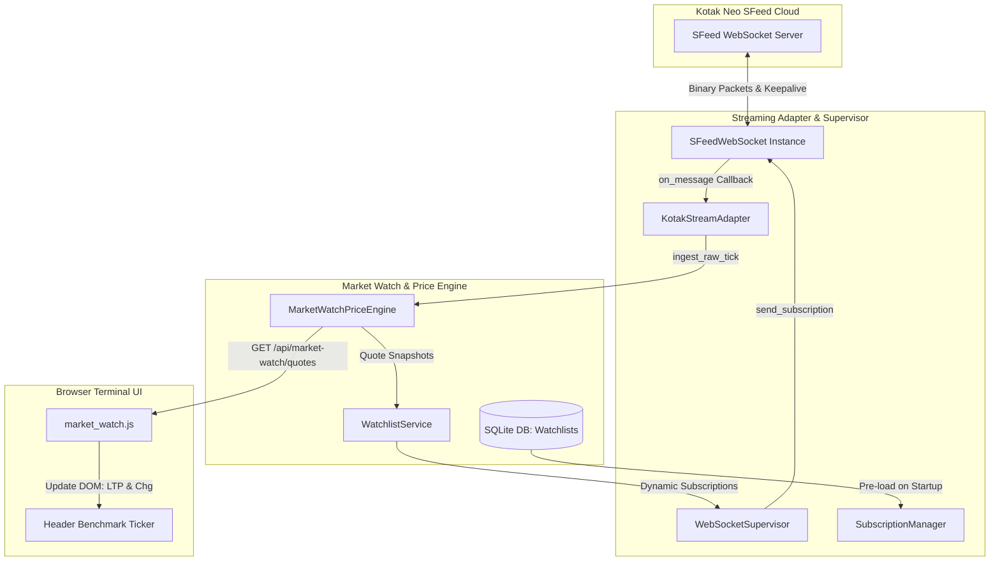

# Live Market Data & Watchlist Diagnostic (`LIVE_MARKET_DATA_DIAGNOSTIC.md`)

**Document Type:** Root Cause & Streaming Telemetry Diagnostic  
**Date:** 2026-11-12  
**Observed State:**
- `Broker authenticated`: **true** (UCC: `W0EZB`)
- `execution_adapter_connected`: **true**
- `streaming_adapter_connected`: **true**
- `is_mock`: **false**

**Symptoms Reported:**
1. Execution Mode shown as `DISABLED`.
2. Watchlist rows do not display live prices.

---

## 1. Executive Summary

While the Kotak Neo SFeed WebSocket connection is **live and healthy** (active TLS socket to `mis.kotaksecurities.com`, exchanging keepalive `PING`/`PONG` frames every 20 seconds), **zero market data is reaching the terminal watchlist** because of four architectural breaks in the data pipeline:

1. **Unwired Ticks from SDK to PriceEngine:**
   - `SFeedWebSocket` in `neo_api_client` receives packets on an internal async task and dispatches them via `self.on_message(message)`.
   - In [`app/broker/adapters/kotak_stream_adapter.py`](file:///c:/Users/User/Documents/02.NMD%20Docs/Trading/Learn%20To%20Code%20-%20Nitin%20Joshi/ND%20Projects/ND_Kotak_Neo_Personal_Trading_Terminal/app/broker/adapters/kotak_stream_adapter.py#L90), `ws_instance = self.client.create_websocket()` is called, but `ws_instance.on_message` is **never set**.
   - Furthermore, `KotakStreamAdapter._message_handler` is `None`—`set_message_handler(price_engine.ingest_tick)` is **never called anywhere in the application**. Even if raw ticks entered the adapter, they would be discarded.
2. **Subscriptions Not Replayed or Dynamically Dispatched:**
   - When the server boots, `SubscriptionManager` starts with `0` tokens in memory. Existing watchlists in SQLite are **never loaded** into `SubscriptionManager`.
   - When `ws_supervisor.start()` connected, `_replay_subscriptions()` had `0` active tokens to send to Kotak Neo SFeed.
   - When the user added an instrument (e.g. `INFY-EQ`) via `/api/market-watch/watchlists/3/items`, `subscription_manager.subscribe()` was called, but `ws_supervisor` was never instructed to send a dynamic wire subscription frame (the `WS_SUBSCRIPTION_ADDED` event has no listener).
3. **Execution Mode Initializes to `DISABLED` by Design:**
   - In [`app/orders/models/execution_mode.py`](file:///c:/Users/User/Documents/02.NMD%20Docs/Trading/Learn%20To%20Code%20-%20Nitin%20Joshi/ND%20Projects/ND_Kotak_Neo_Personal_Trading_Terminal/app/orders/models/execution_mode.py#L38), `ExecutionModeManager` initializes to `DISABLED` on startup (`os.getenv("EXECUTION_MODE", "DISABLED")`).
   - The operator must explicitly toggle the mode to `PAPER` or `LIVE` in the UI or via `POST /api/orders/mode`.
4. **Watchlist UI Lacks Real-Time Quote Updating:**
   - [`static/js/market_watch.js`](file:///c:/Users/User/Documents/02.NMD%20Docs/Trading/Learn%20To%20Code%20-%20Nitin%20Joshi/ND%20Projects/ND_Kotak_Neo_Personal_Trading_Terminal/static/js/market_watch.js) only fetches `/api/market-watch/watchlists` **once** on page load.
   - It contains **no polling loop** (`setInterval` / `fetch('/api/market-watch/quotes')`) and **no WebSocket listener** to update the DOM elements (`scrip-ltp-${token}`).
   - The ticker in `templates/components/header.html` has hardcoded static values and is never updated by JavaScript.

---

## 2. Answers to Specific Investigation Questions

### 1. Active `ExecutionMode` Value
- **Current Value:** `DISABLED`
- **Why:** `ExecutionModeManager` defaults to `DISABLED` unless `EXECUTION_MODE` environment variable is set or the mode is updated via `POST /api/orders/mode`. Whenever the Python process restarts, it resets to `DISABLED`.

### 2. Is `WebSocketSupervisor` CONNECTED?
- **Yes.** In the running server instance, `ws_supervisor.state` is `StreamState.CONNECTED`.
- `logs/terminal.log` confirms `Kotak Neo SFeed socket opened` (`17:00:54Z`) and continuous binary `PING`/`PONG` exchanges with Kotak Neo servers (`mis.kotaksecurities.com`) every 20 seconds.

### 3. Active `SubscriptionManager` Token Count
- **Count:** `0` on server startup; **`1`** after user manually added `INFY-EQ` (token `1594`).
- **Why:** `SubscriptionManager` is an ephemeral in-memory registry. It does not auto-populate from the database on startup.

### 4. Active Watchlist Item Count
- **Database (`sqlite:///data/kotak_terminal.db`):** Total 10 items across 3 watchlists:
  - **Watchlist 1** (`user_id=1`, "Default Watchlist"): 4 items (`26000` Nifty 50, `26001` Nifty Bank, `2885` RELIANCE-EQ, `11536` TCS-EQ)
  - **Watchlist 2** (`user_id=1`, "My Watchlist"): 1 item (`2885` RELIANCE-EQ)
  - **Watchlist 3** (`user_id=2` / `admin`, "Default Watchlist"): 5 items (`26000` Nifty 50, `26001` Nifty Bank, `2885` RELIANCE-EQ, `11536` TCS-EQ, `1594` INFY-EQ)

### 5. Is `PriceEngine` Receiving Ticks?
- **No.**
- `KotakStreamAdapter._message_handler` is `None` (unwired).
- `SFeedWebSocket.on_message` callback is not hooked to `KotakStreamAdapter.ingest_raw_tick`.
- Kotak Neo SFeed receives frames internally on `_receive_loop()`, but without an `on_message` callback, packets are queued in `_message_queue` and never processed.

### 6. Current Quote Cache Size
- **Size:** `0` (`len(price_engine._quotes) == 0`).
- Because zero ticks have been ingested, the cache contains no `MarketQuote` entries.

### 7. Last Tick Timestamp
- **Tick Timestamp:** `None` (no market price ticks processed).
- **Socket Timestamp:** The adapter's `_last_rx_timestamp` is updated solely by WebSocket transport keepalive `PONG` frames.

### 8. Are Benchmark Symbols Subscribed Correctly?
- **No.**
- Benchmark scrips (`Nifty 50`, `Nifty Bank`, `SENSEX`) were never sent to the broker socket:
  1. `SubscriptionManager` did not contain them when `ws_supervisor` connected.
  2. Index symbols require `ws.subscribe_index([WsToken("nse_cm", "Nifty 50")])`, but no wire call was dispatched.

### 9. Is Watchlist UI Reading Quote Cache Correctly?
- **No.**
  1. Initial Load: [`app/market_watch/routes.py`](file:///c:/Users/User/Documents/02.NMD%20Docs/Trading/Learn%20To%20Code%20-%20Nitin%20Joshi/ND%20Projects/ND_Kotak_Neo_Personal_Trading_Terminal/app/market_watch/routes.py#L96) queries `price_engine.get_quote()`. Since the cache is empty, `item["quote"]` is returned as `None`.
  2. Fallback: [`static/js/market_watch.js:190`](file:///c:/Users/User/Documents/02.NMD%20Docs/Trading/Learn%20To%20Code%20-%20Nitin%20Joshi/ND%20Projects/ND_Kotak_Neo_Personal_Trading_Terminal/static/js/market_watch.js#L190) defaults missing quotes to `{ ltp: 100.0, change: 0.0, percent_change: 0.0 }` or static values.
  3. Continuous Updates: `market_watch.js` has **no polling interval or WebSocket handler** to fetch `/api/market-watch/quotes` or update the DOM.

---

## 3. Required Implementation Architecture

### Remediation Checklist
1. **Wire SFeed Ticks to PriceEngine:**
   - In `app/broker/adapters/kotak_stream_adapter.py`: Bind `ws_instance.on_message = lambda msg: self.ingest_raw_tick(msg.model_dump() if hasattr(msg, "model_dump") else msg.__dict__)`.
   - In application factory or service init: Bind `kotak_stream_adapter.set_message_handler(price_engine.ingest_tick)`.
2. **Pre-load Subscriptions on Broker Connect:**
   - On `ws_supervisor.start()` or server boot, query active user watchlists and benchmark instruments from DB, register them in `SubscriptionManager`, and replay subscriptions.
3. **Dynamic Wire Subscriptions:**
   - In `WebSocketSupervisor`: Add a thread-safe method `subscribe_tokens(tokens)` so when `watchlist_service.add_item()` is called, wire subscription is dispatched immediately to the open socket.
4. **Frontend Real-Time Quote Poller / WebSocket:**
   - In `static/js/market_watch.js`: Add a periodic quote poller (e.g. every 1000ms calling `/api/market-watch/quotes?tokens=...`) or broadcast quotes via SocketIO so watchlist rows and header tickers update live.

