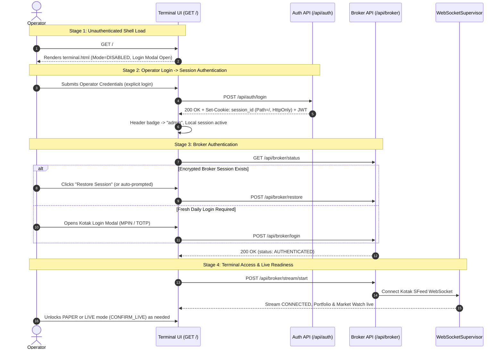

# Terminal Entrypoint & Production Login Sequence Remediation Plan

**Document Status:** Design & Remediation Specification (Phase 12B UAT Paused Pending Implementation)  
**Date:** 2026-11-12  
**Scope:** Root Entrypoint Unification (`/`), Phase 1 Dashboard Deprecation, Operator $\to$ Broker Auth Sequence, and Live UAT Prerequisites  

---

## 1. Problem Statement & Architectural Gap

During Phase 12B UAT preparation, an entry-point and authentication-flow split was identified:

| Route | Current Handler ([`app/dashboard/routes.py`](file:///c:/Users/User/Documents/02.NMD%20Docs/Trading/Learn%20To%20Code%20-%20Nitin%20Joshi/ND%20Projects/ND_Kotak_Neo_Personal_Trading_Terminal/app/dashboard/routes.py#L10-L46)) | Current Behavior | Issue |
| :--- | :--- | :--- | :--- |
| **`GET /`** | `index()` | Renders [`templates/index.html`](file:///c:/Users/User/Documents/02.NMD%20Docs/Trading/Learn%20To Code%20-%20Nitin%20Joshi/ND%20Projects/ND_Kotak_Neo_Personal_Trading_Terminal/templates/index.html) ("Phase 1 - Project Skeleton Ready") | Operators visiting the root URL land on an obsolete Phase 1 status page instead of the trading terminal. |
| **`GET /terminal`** | `terminal()` | Renders [`templates/terminal.html`](file:///c:/Users/User/Documents/02.NMD%20Docs/Trading/Learn%20To%20Code%20-%20Nitin%20Joshi/ND%20Projects/ND_Kotak_Neo_Personal_Trading_Terminal/templates/terminal.html) with auth context | The real application lives on a secondary subpath. |
| **Header Broker Pill** | [`templates/components/header.html`](file:///c:/Users/User/Documents/02.NMD%20Docs/Trading/Learn%20To%20Code%20-%20Nitin%20Joshi/ND%20Projects/ND_Kotak_Neo_Personal_Trading_Terminal/templates/components/header.html#L63-L67) | Hardcoded `LIVE STREAM` badge with static `connected` dot | Backend `/api/broker/login`, `/api/broker/restore`, and `/api/broker/stream/start` exist, but **no UI exists** to trigger Real Kotak Login or view real broker/SFeed state. |

**Phase 12B Live UAT is paused** until `/` is established as the canonical terminal entry point and the full **Operator Login $\to$ Session Auth $\to$ Broker Auth $\to$ Terminal Access** pipeline is wired end-to-end in the UI.

---

## 2. Entrypoint Decision: Render `terminal.html` Directly at `/`

### Options Evaluated
- **Option A — HTTP 302 Redirect (`/` $\to$ `/terminal`):** Adds an unnecessary network roundtrip on every initial load, exposes `/terminal` as the permanent URL bar path, and breaks clean root-domain semantics.
- **Option B — Render `terminal.html` Directly from `/` (Recommended):** Serves the Trading Terminal directly at `http://<host>:<port>/` with zero redirect latency, clean URL semantics, and unified cookie/session scope (`Path=/`).

### Selected Architecture (Option B + Backward-Compatible Alias)
1. **`GET /`** becomes the primary application entrypoint and executes the authenticated session check + renders `templates/terminal.html`.
2. **`GET /terminal`** is retained as a backward-compatible alias (either `redirect(url_for("dashboard.index"), code=302)` or bound to the same view function `_render_terminal()`) so existing integration tests (`test_terminal_routes.py`, `test_terminal_auth.py`, `test_market_watch_ui_routes.py`, `test_portfolio_order_book_ui_routes.py`, `test_basket_option_chain_ui_routes.py`) and bookmarks continue to pass without breakage.
   - *Note:* Binding both `@dashboard_bp.route("/")` and `@dashboard_bp.route("/terminal")` to the shared `_render_terminal()` helper preserves 100% compatibility with existing `client.get("/terminal")` tests that expect HTTP `200` directly without `follow_redirects=True`.

---

## 3. Deprecation of the Old Phase 1 Dashboard

1. **Remove `/` Binding from `index.html`:** `dashboard_bp.route("/")` will no longer render `templates/index.html`.
2. **Archive/Remove `templates/index.html`:** Delete `templates/index.html` (or move to `templates/deprecated/phase1_skeleton.html` if historical reference is desired; clean deletion is preferred since Git retains history).
3. **Update Health Metadata:** Update `GET /api/system/health` in [`app/dashboard/routes.py`](file:///c:/Users/User/Documents/02.NMD%20Docs/Trading/Learn%20To%20Code%20-%20Nitin%20Joshi/ND%20Projects/ND_Kotak_Neo_Personal_Trading_Terminal/app/dashboard/routes.py#L49-L52) to report the current production phase rather than `"phase_1_skeleton"`.

---

## 4. Review of Terminal & Operator Authentication Flow

### Current State (Implemented in Commit `9e8e245`)
- **Default Operator Provisioning:** [`AuthService.ensure_default_operator()`](file:///c:/Users/User/Documents/02.NMD%20Docs/Trading/Learn%20To%20Code%20-%20Nitin%20Joshi/ND%20Projects/ND_Kotak_Neo_Personal_Trading_Terminal/app/auth/services/auth_service.py) provisions `admin` on startup if no user exists, **without** auto-logging in.
- **Explicit Operator Login:** [`templates/components/login_modal.html`](file:///c:/Users/User/Documents/02.NMD%20Docs/Trading/Learn%20To%20Code%20-%20Nitin%20Joshi/ND%20Projects/ND_Kotak_Neo_Personal_Trading_Terminal/templates/components/login_modal.html) collects username/password and calls `POST /api/auth/login`.
- **Session Cookie & `apiFetch`:** `login()` sets `session_id` (`HttpOnly`, `SameSite=Lax`, `Path=/`). [`terminal_shell.js`](file:///c:/Users/User/Documents/02.NMD%20Docs/Trading/Learn%20To%20Code%20-%20Nitin%20Joshi/ND%20Projects/ND_Kotak_Neo_Personal_Trading_Terminal/static/js/terminal_shell.js) wraps `window.fetch` so all `/api/*` requests send cookies/Bearer tokens and re-open the login modal on `401`.

### Remaining Gaps Identified
1. **Entrypoint Split:** Visiting `/` bypasses the terminal and its login modal entirely.
2. **Missing Post-Login Broker Gate:** Once the operator logs into the local terminal (`admin`), there is **no UI step** to authenticate with Kotak Neo (`/api/broker/login` or `/api/broker/restore`) or start SFeed (`/api/broker/stream/start`).
3. **False Connection Indicator:** [`header.html`](file:///c:/Users/User/Documents/02.NMD%20Docs/Trading/Learn%20To%20Code%20-%20Nitin%20Joshi/ND%20Projects/ND_Kotak_Neo_Personal_Trading_Terminal/templates/components/header.html#L64-L67) hardcodes `LIVE STREAM` with a green dot even when `kotak_adapter.is_authenticated` is `False` and `ws_supervisor` is `DISCONNECTED`.
4. **LIVE Mode Missing Broker Pre-Check:** Switching ExecutionMode to `LIVE` only checks `this.isAuthenticated` (operator session) and the `CONFIRM_LIVE` typing challenge — it does not warn or block in UI if the Kotak Neo broker session is disconnected.

---

## 5. Production Login Sequence

### Stage Definitions
1. **Operator Login:** Human explicitly enters local terminal credentials in `#operator-login-modal`.
2. **Session Authentication:** Backend issues `session_id` cookie (`Path=/`, `HttpOnly`, `SameSite=Lax`) and session token; `GET /api/auth/status` returns `authenticated: true`. All protected `/api/*` endpoints are unlocked for this operator.
3. **Broker Authentication:** Operator authenticates against Kotak Neo via `POST /api/broker/restore` (using encrypted DB session) or `POST /api/broker/login` (Consumer Key/Secret, Mobile, UCC, MPIN, TOTP). ExecutionMode remains `DISABLED` by default.
4. **Terminal Access:** Broker status badge turns green, SFeed WebSocket stream starts (`POST /api/broker/stream/start`), initial portfolio/holdings/positions/funds sync, and the operator can safely transition ExecutionMode to `PAPER` or `LIVE`.

---

## 6. Exposing Real Kotak Login in the UI

### 6.1 Dynamic Header Broker & Stream Pill
Replace the static `#header-connection-pill` in [`templates/components/header.html`](file:///c:/Users/User/Documents/02.NMD%20Docs/Trading/Learn%20To%20Code - Nitin%20Joshi/ND%20Projects/ND_Kotak_Neo_Personal_Trading_Terminal/templates/components/header.html#L63-L67) with an interactive status button synced to `GET /api/broker/status` and `GET /api/broker/stream/metrics`:
- **Red (`BROKER: DISCONNECTED`):** No active Kotak session. Clicking opens the **Kotak Broker Login Modal**.
- **Amber (`BROKER: AUTH | STREAM: OFF`):** Broker authenticated, SFeed not yet started. Clicking opens Broker Controls (Start Stream / Logout).
- **Green (`BROKER: AUTH | SFEED: LIVE`):** Broker authenticated and WebSocket streaming active.

### 6.2 Kotak Broker Authentication Modal (`templates/components/broker_login_modal.html`)
Expose a dedicated modal accessible from the header Broker Pill (and optionally offered via toast/prompt immediately after Operator Login when broker status is `DISCONNECTED`):
- **Tab / Action 1 — Restore Saved Session:** Button calling `POST /api/broker/restore` (for mid-day browser reloads without re-entering TOTP/MPIN).
- **Tab / Action 2 — Fresh Kotak Neo Login (`POST /api/broker/login`):**
  - Inputs for `UCC`, `Mobile Number`, `MPIN` (masked), and `TOTP` / `TOTP Secret` (masked).
  - Checkbox/toggle: *"Use server `.env` credentials (`NEO_*`)"* — allows triggering `POST /api/broker/login` with `{}` when `.env` is configured on the trusted personal machine, without exposing `NEO_CONSUMER_KEY` / `NEO_CONSUMER_SECRET` in browser DOM.
- **Stream & Session Controls (when connected):**
  - **Start / Stop SFeed Stream** (`POST /api/broker/stream/start` / `stop`).
  - **Broker Logout** (`POST /api/broker/logout`).
- **Paper-Only Bypass:** Operator can dismiss the modal and remain in `PAPER` mode without connecting a live broker session.

### 6.3 ExecutionMode `LIVE` Guardrail
In [`terminal_shell.js`](file:///c:/Users/User/Documents/02.NMD%20Docs/Trading/Learn%20To%20Code%20-%20Nitin%20Joshi/ND%20Projects/ND_Kotak_Neo_Personal_Trading_Terminal/static/js/terminal_shell.js), prevent switching ExecutionMode to `LIVE` in the UI if `brokerAuthenticated !== true`; instead, display an inline error in the mode modal with a direct button to open the Kotak Broker Login Modal.

---

## 7. UAT Prerequisites Before First Live Order

Phase 12B Live UAT **must not resume** until all prerequisites below are verified in order:

| # | Prerequisite | Verification Criterion |
| :--- | :--- | :--- |
| **1** | **Root Entrypoint `/` Active** | `GET /` serves `terminal.html` (HTTP 200); `templates/index.html` deprecated; `GET /terminal` remains functional. |
| **2** | **Operator Auth Verified** | Opening `/` starts unauthenticated (`MODE: DISABLED`); explicit login with `admin` unlocks `/api/*` via `Path=/` cookie. |
| **3** | **Environment & Encryption Ready** | `.env` contains valid `FERNET_KEY` / `SECRET_KEY` and Kotak Neo API credentials (`NEO_CONSUMER_KEY`, `NEO_CONSUMER_SECRET`, `NEO_UCC`, `NEO_MOBILE_NUMBER`, `NEO_MPIN`, `NEO_TOTP_SECRET`). |
| **4** | **Real Kotak Login via UI** | Clicking the Header Broker Pill opens the Broker Login Modal; `POST /api/broker/login` succeeds and header transitions to `BROKER: AUTH`. |
| **5** | **Broker Session Restore** | Refreshing `/` and clicking **Restore Session** (`POST /api/broker/restore`) re-establishes the broker session without re-entering credentials. |
| **6** | **Real SFeed Stream Connected** | `POST /api/broker/stream/start` transitions SFeed pill to `CONNECTED`; live NIFTY/BANKNIFTY/watchlist ticks update in the UI. |
| **7** | **DISABLED & PAPER Mode Sanity** | `DISABLED` blocks all orders (`403`); `PAPER` mode order fills and updates Order Book / Trade Book (noting auto-fill behavior per [`PAPER_MODE_KILL_SWITCH_GUIDANCE.md`](file:///c:/Users/User/Documents/02.NMD%20Docs/Trading/Learn%20To%20Code%20-%20Nitin%20Joshi/ND%20Projects/ND_Kotak_Neo_Personal_Trading_Terminal/PAPER_MODE_KILL_SWITCH_GUIDANCE.md)). |
| **8** | **LIVE Mode & Kill-Switch Prep** | `CONFIRM_LIVE` challenge works; Kotak Neo mobile/web app is open side-by-side as manual safety net before executing Section 4 & Section 5A (1-share roundtrip). |

